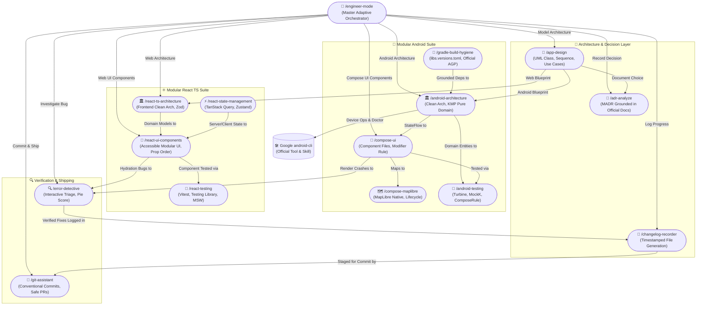

# 🚀 AI-Engineer-Skills

A curated, enterprise-grade suite of **interconnected, modular AI coding agent skills** designed to turn your AI coding assistant (Gemini, Claude Code, Cursor, Codex, Copilot, Windsurf) into an autonomous, rigorous senior software engineering team.

Inspired by the precision, multi-agent parallelism, and anti-slop principles of [pstack](https://github.com/cursor/plugins/tree/main/pstack), **AI-Engineer-Skills** connects all specialized skills into an intelligent mesh with **`/engineer-mode`** as the universal adaptive entry point.

---

## 🧭 Navigation & Module Hub

Every skill module has its own comprehensive documentation, workflow diagrams, and prompt lists. Use the links below to navigate across the suite:

| Hub Directory | Core Domain | Skills Included | Direct Documentation Link |
|---|---|---|---|
| 🚀 **`engineer-mode/`** | Master Entry Point & Playbooks | `/engineer-mode` | [Engineer Mode Guide](engineer-mode/README.md) |
| 📱 **`android-skills/`** | Modular Android Suite & Google CLI | `/android-architecture`, `/compose-ui`, `/compose-maplibre`, `/android-testing`, `/gradle-build-hygiene` | [Android Skills Guide](android-skills/README.md) |
| ⚛️ **`react-ts-skills/`** | Modular React TS Suite | `/react-ts-architecture`, `/react-ui-components`, `/react-state-management`, `/react-testing` | [React TS Skills Guide](react-ts-skills/README.md) |
| 🔍 **`diagnostic-skills/`** | Diagnostics, ADR, Design & Logs | `/error-detective`, `/adr-analyze`, `/app-design`, `/changelog-recorder` | [Diagnostic Skills Guide](diagnostic-skills/README.md) |
| 🌿 **`git-skills/`** | Version Control & PR Shipping | `/git-assistant` | [Git Skills Guide](git-skills/README.md) |

---

## 🕸️ The Connected Skills Mesh

In traditional setups, AI skills run as disconnected silos. In **AI-Engineer-Skills**, all 15 skills know about and collaborate with the entire team:



---

## 🎯 Universal Entry Point: `/engineer-mode`

When you begin any non-trivial task, invoke `/engineer-mode`. It functions like an experienced engineering lead:

1. **Assesses Intent**: Analyzes your initial prompt for domain, scope, and technical constraints.
2. **Interactive Triage**: If your goal is broad or ambiguous, it presents an interactive questionnaire with curated playbooks:
   - `[1]` **Error Investigation** (`/error-detective`)
   - `[2]` **App System Design & UML** (`/app-design`)
   - `[3]` **Architecture Decision Record** (`/adr-analyze`)
   - `[4]` **Android Engineering Suite** (`/android-architecture`, `/compose-ui`, `/compose-maplibre`, `/android-testing`, `/gradle-build-hygiene`)
   - `[5]` **React + TypeScript Modern Web Suite** (`/react-ts-architecture`, `/react-ui-components`, `/react-state-management`, `/react-testing`)
   - `[6]` **Changelog Documentation** (`/changelog-recorder`)
   - `[7]` **Git Shipping & PR Creation** (`/git-assistant`)
   - `[8]` **End-to-End Autonomous Delivery** (Design ➔ ADR ➔ Modular Code ➔ Testing ➔ Changelog ➔ Ship)
3. **Coordinates Routing**: Hands off work to specialized domain experts and preserves all context across turns.

---

## 📦 What's Included

### 📱 1. Modular Android Engineering
- **`/android-architecture`**: Strict Clean Architecture. Domain layer contains **zero `android.*` framework code** and is shared/ready for Kotlin Multiplatform (`commonMain`). Room for caching, Retrofit for network, Dagger Hilt DI, single-expression extension mappers, and mandatory KDocs.
- **`/compose-ui`**: Modern Jetpack Compose UI. Enforces **modular component file separation** (never 1 giant file; separate screen, content, cards, state, and preview). Enforces the **Modifier Rule**: in declaration, `modifier: Modifier = Modifier` is the top optional parameter; at call site consumption, it is passed at the very bottom. State stability (`@Immutable`/`@Stable`, immutable collections), edge-to-edge system insets, and purposeful tactile haptics.
- **`/compose-maplibre`**: MapLibre Native in Compose. Lifecycle-safe MapView handling, vector tile rendering, GeoJSON caching, Material 3 floating control overlays, and camera animations.
- **`/android-testing`**: Automated test engineering. Turbine for Coroutines Flow testing, MockK and clean offline fakes for UseCase/ViewModel isolation, ComposeTestRule semantic UI tests, and zero flaky sleeps.
- **`/gradle-build-hygiene`**: Centralized Version Catalog (`gradle/libs.versions.toml`). R8/ProGuard keep rules, compileSdk/targetSdk best practices, and **strict grounding in official Google AGP documentation without guesswork**.
- **Google `android-cli` Routing**: Custom commands seamlessly route to the official Google `android-cli` package (`android doctor`, `android init`, `android run`, `android doc`).

### ⚛️ 2. Modular React + TypeScript Web Engineering
- **`/react-ts-architecture`**: Frontend Clean Architecture. Pure TypeScript domain models and business validators (zero DOM or UI dependencies), schema validation with Zod, DTO-to-Domain mappers, and strict type discipline (zero `any`, discriminated unions, `satisfies`).
- **`/react-ui-components`**: Accessible modern UI components. Enforces **modular component file decomposition** (never 1 monolithic file). Prop ordering rule (mandatory data/callbacks top, optional styling/className bottom), Tailwind CSS design tokens, and WCAG 2.2 AA accessibility.
- **`/react-state-management`**: TanStack Query (React Query) for server state caching, background sync, and optimistic mutations with rollback. Zustand for atomic, lightweight client UI state.
- **`/react-testing`**: User-centric automated testing using Vitest, React Testing Library, and Mock Service Worker (MSW) network interception.

### 🔍 3. Diagnostics, ADR, App Design & Living Docs
- **`/error-detective`**: Interactive bug triage. Asks error type and affected module (or autonomously scans logs/codebase if unsure). Pinpoints root cause, implements verified fix, and produces post-mortem reports in `/docs/error-fix/` with a **Mermaid Pie Chart Score**.
- **`/adr-analyze`**: Architecture Decision Records. Evaluates technical trade-offs grounded in official vendor documentation (Google Android Architecture Guide, React Docs, W3C/MDN). Generates MADR records in `/docs/adr/ADR-XXXX-<title>.md`.
- **`/app-design`**: Enterprise visual modeling. Generates UML class diagrams, sequence flows, state machines, and use case specifications in `/docs/architecture/` in English.
- **`/changelog-recorder`**: Permanent chronological changelogs in `/docs/changelogs/` with strict timestamp naming conventions: `YYYY-MM-DD_HH-mm-ss_<main-change-title>.md`, detailing modified files, KMP/architecture impact, and test verification proof.

### 🌿 4. Git Assistant & Version Control
- **`/git-assistant`**: Safety-first Git operations. Atomic staging, conventional commits (`feat`, `fix`, `refactor`, `perf`, `docs`, `test`, `chore`), safe pulls with rebase, 3-way conflict resolution without data loss, pre-rebase safety tags, and briefing-style PR descriptions.

---

## ⚡ Installation & Synchronization (Windows, macOS & Linux)

We provide an interactive **cross-platform Python installation script** along with native double-clickable launchers:

```
AI-Engineer-Skills/
├── install.py          # Universal Python installer (Windows, macOS, Linux)
├── install.bat         # Windows Command Prompt / File Explorer Launcher
├── install.ps1         # Windows PowerShell Launcher
├── install.command     # macOS Finder Double-Clickable Launcher
└── install.sh          # Linux / macOS / WSL Terminal Launcher
```

### Option A: Windows (Double-Click or Command Prompt)
1. Double-click **`install.bat`** in Windows File Explorer (or run `install.bat` in CMD / `.\install.ps1` in PowerShell).
2. The script checks for Python 3 (installs it automatically via `winget` if missing) and launches the installer.
3. Checks for Google's official `android-cli` and prompts for target AI agents!

### Option B: macOS (Double-Click in Finder)
1. Double-click **`install.command`** in macOS Finder.
2. The script checks for Python 3 (installs it via Homebrew if missing) and launches the installer.

### Option C: Linux / macOS Terminal
```bash
cd AI-Engineer-Skills
./install.sh
```
*Or execute directly with Python:*
```bash
python3 install.py
```

### Option D: Non-Interactive / Scripted Install
```bash
# Install to all agents and auto-setup tools
python3 install.py --all --auto-install-android-cli

# Install only to Gemini and Claude
python3 install.py --agents 1,2 --skip-android-cli
```

---

## 🤖 Supported AI Agents

| Number | AI Coding Agent | Global Skills Directory |
|---|---|---|
| **1** | **Google Gemini / Antigravity** | `~/.agents/skills` & `~/.gemini/config/skills` |
| **2** | **Claude Code (Anthropic)** | `~/.claude/skills` |
| **3** | **Cursor** | `~/.cursor/skills` |
| **4** | **OpenAI Codex CLI** | `~/.codex/skills` |
| **5** | **GitHub Copilot (CLI / Agent)** | `~/.copilot/skills` |
| **6** | **Windsurf (Codeium)** | `~/.codeium/windsurf/skills` |
| **7** | **Roo Code / Cline** | `~/.roo/skills` & `~/.cline/skills` |

---

## 🧹 Intelligent Lifecycle & Cleanup Management

The installer handles configuration hygiene automatically:
- **Legacy Cleanup**: Automatically detects and removes outdated standalone or monolithic skills (e.g. `android-expert`, `react-ts-expert`, `android-clean-architecture`, custom `android-cli`, `android-data-layer`, `compose-ui-preview-design`) to avoid polluting your global skills folder.
- **Unselected Agent Pruning**: If you previously installed skills to an agent and later unselect that agent, the installer safely purges our managed skills from that agent's global folder.
- **Manifest Tracking**: Writes state to `~/.ai-engineer-skills-manifest.json` for reproducible synchronization.

---

## 📄 License & Community

Open-source and designed to elevate AI coding assistants into genuine senior engineering partners. Fork it, customize your playbooks, and submit Pull Requests!
