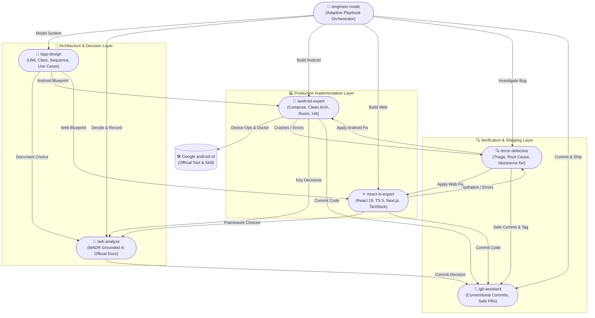

# 🚀 AI-Engineer-Skills

A curated, enterprise-grade suite of **interconnected AI coding agent skills** designed to turn your AI coding assistant (Gemini, Claude Code, Cursor, Codex, Copilot, Windsurf) into an autonomous, rigorous senior software engineering team.

Inspired by the precision, multi-agent parallelism, and anti-slop principles of [pstack](https://github.com/cursor/plugins/tree/main/pstack), **AI-Engineer-Skills** connects all specialized skills into an intelligent mesh with **`/engineer-mode`** as the universal adaptive entry point.

---

## 🧭 Navigation & Module Hub

Every skill module has its own comprehensive documentation, workflow diagrams, and prompt lists. Use the links below to navigate across the suite:

| Hub Directory | Core Domain | Slash Commands | Direct Documentation Link |
|---|---|---|---|
| 🚀 **`engineer-mode/`** | Master Entry Point & Playbooks | `/engineer-mode` | [Engineer Mode Guide](engineer-mode/README.md) |
| 📱 **`android-skills/`** | In-Depth Android, Compose & Google CLI | `/android-expert` | [Android Skills Guide](android-skills/README.md) |
| ⚛️ **`react-ts-skills/`** | React 19, TypeScript 5, Next.js, Vite | `/react-ts-expert` | [React TS Skills Guide](react-ts-skills/README.md) |
| 🔍 **`diagnostic-skills/`** | Error Triage, ADR Decisions, UML Modeling | `/error-detective`, `/adr-analyze`, `/app-design` | [Diagnostic Skills Guide](diagnostic-skills/README.md) |
| 🌿 **`git-skills/`** | Version Control, Safe Rebase, PR Briefs | `/git-assistant` | [Git Skills Guide](git-skills/README.md) |

---

## 🕸️ The Connected Skills Mesh

In traditional setups, AI skills run as disconnected silos. In **AI-Engineer-Skills**, every skill knows about and collaborates with the entire team:



---

## 🎯 Universal Entry Point: `/engineer-mode`

When you begin any non-trivial task, invoke `/engineer-mode`. It functions like an experienced engineering lead:

1. **Assesses Intent**: Analyzes your initial prompt for domain, scope, and technical constraints.
2. **Interactive Triage**: If your goal is broad or ambiguous, it presents an interactive questionnaire with curated playbooks:
   - `[1]` **Error Investigation** (`/error-detective`)
   - `[2]` **App System Design & UML** (`/app-design`)
   - `[3]` **Architecture Decision Record** (`/adr-analyze`)
   - `[4]` **In-Depth Android Engineering** (`/android-expert`)
   - `[5]` **React + TypeScript Modern Web** (`/react-ts-expert`)
   - `[6]` **Git Shipping & PR Creation** (`/git-assistant`)
   - `[7]` **End-to-End Autonomous Delivery** (Design ➔ ADR ➔ Code ➔ Triage ➔ Ship)
3. **Coordinates Routing**: Hands off work to specialized domain experts and preserves all context across turns.

---

## 📦 What's Included

### 1. In-Depth Android Engineering (`/android-expert`)
- **Single Consolidated Master Skill**: Replaces fragmented sub-skills with one comprehensive, production-tested Android knowledge base.
- **Clean Architecture**: Strict separation of Domain (pure Kotlin), Data (Room/Retrofit/DataStore), and Presentation (Compose).
- **Jetpack Compose UI**: Edge-to-edge system insets, state stability (`@Immutable`/`@Stable`), purposeful `LocalHapticFeedback`, and predictive back navigation.
- **Zero Hardcoded Strings**: Multi-language localization with mandatory semantic prefixes (`label_`, `msg_`, `title_`, `action_`, `error_`, `hint_`, `desc_`).
- **Idiomatic Kotlin**: Strong preference for concise single-expression one-liners (`fun ... = ...`), expression getters, and mandatory `kotlin.time.Duration` (`5.seconds`).
- **Official Google `android-cli` Routing**: Custom commands seamlessly route to the official Google `android-cli` package (`android doctor`, `android init`, `android run`, `android doc`).

### 2. React + TypeScript Web Engineering (`/react-ts-expert`)
- **Modern Standards**: React 19, TypeScript 5+, Next.js App Router (RSC + Actions) and Vite SPA architectures.
- **Strict Type Discipline**: Zero `any` policy, discriminated unions for state modeling, `satisfies` operator, and exhaustive pattern checks.
- **State Management**: TanStack Query for server synchronization and caching; lightweight Zustand stores for client state.
- **Design & A11y**: Mobile-first Tailwind CSS, WCAG 2.2 AA accessibility, keyboard navigation, and visible focus indicators.
- **Core Web Vitals**: High LCP prioritization, zero Cumulative Layout Shift (CLS), and minimized Interaction to Next Paint (INP).

### 3. Error Detective & Incident Reporting (`/error-detective`)
- **Interactive Triage**: Systematically asks for error category and affected module (or autonomously inspects logs, test failures, and diffs if unsure).
- **Root Cause Isolation**: Maps stack traces to exact line numbers and architectural invariants.
- **Incident Post-Mortems**: Generates structured reports in `/docs/error-fix/YYYY-MM-DD-<slug>.md` with Mermaid sequence diagrams and a **Mermaid Pie Chart Score**:
  ```mermaid
  pie title Incident Severity & Resolution Score
      "Resolution Confidence" : 85
      "Root Cause Severity" : 10
      "Regression Risk" : 5
  ```

### 4. Architecture Decision Records (`/adr-analyze`)
- **Official Documentation Grounding**: Evaluates trade-offs against official vendor standards (Google Android Architecture Guidelines, React Docs, W3C/MDN).
- **MADR Format**: Generates standardized records in `/docs/adr/ADR-XXXX-<title>.md` with context, decision drivers, considered options, pros/cons, and citations.
- **Registry Index**: Maintains `<project-root>/docs/adr/README.md` automatically.

### 5. App Design & UML Modeling (`/app-design`)
- **Visual System Specifications**: Generates UML class diagrams, sequence flows, UI state machines, and use case specifications in `/docs/architecture/`.
- **Clean Separation**: Visually isolates Presentation, Domain, and Data layer boundaries.
- **100% English**: All documentation, diagrams, and use case tables are written in clear, professional English.

### 6. Git Assistant & Safe Shipping (`/git-assistant`)
- **Safety First**: Prohibits destructive force-pushes and blind `git add .` operations; creates automatic pre-rebase safety tags.
- **Conventional Commits**: Enforces standardized commit messages (`feat`, `fix`, `refactor`, `perf`, `docs`, `test`, `chore`).
- **3-Way Conflict Resolution**: Explains divergence and resolves merge conflicts cleanly without dropping code.
- **PR Briefings**: Formats executive Pull Request descriptions complete with motivation, testing evidence, and links to `/docs/`.

---

## ⚡ Installation & Synchronization

We provide an interactive **Python installation script** along with double-clickable launchers:

```
AI-Engineer-Skills/
├── install.py          # Universal Python installer
├── install.command     # macOS Finder double-clickable launcher
└── install.sh          # Linux / macOS / WSL terminal launcher
```

### Option A: Double-Click Launcher (macOS)
1. Double-click **`install.command`** in macOS Finder.
2. The script checks for Python 3 (installs it via Homebrew if missing), launches the installer, and checks for Google's official `android-cli`.
3. Select your AI coding agents, and the script installs the skills automatically!

### Option B: Terminal Command (macOS / Linux / Windows WSL)
```bash
cd AI-Engineer-Skills
./install.sh
```
*Or execute directly with Python:*
```bash
python3 install.py
```

### Option C: Non-Interactive / Scripted Install
```bash
# Install to all agents and auto-setup tools
python3 install.py --all --auto-install-android-cli

# Install only to Gemini and Claude
python3 install.py --agents 1,2 --skip-android-cli
```

---

## 🤖 Supported AI Agents

| Number | AI Coding Agent | Global Skills Directory |
|---|---|---|
| **1** | **Google Gemini / Antigravity** | `~/.agents/skills` & `~/.gemini/config/skills` |
| **2** | **Claude Code (Anthropic)** | `~/.claude/skills` |
| **3** | **Cursor** | `~/.cursor/skills` |
| **4** | **OpenAI Codex CLI** | `~/.codex/skills` |
| **5** | **GitHub Copilot (CLI / Agent)** | `~/.copilot/skills` |
| **6** | **Windsurf (Codeium)** | `~/.codeium/windsurf/skills` |
| **7** | **Roo Code / Cline** | `~/.roo/skills` & `~/.cline/skills` |

---

## 🧹 Intelligent Lifecycle & Cleanup Management

The installer handles configuration hygiene automatically:
- **Legacy Cleanup**: Automatically detects and removes outdated standalone skills (e.g. `android-clean-architecture`, custom `android-cli`, `android-data-layer`, `compose-ui-preview-design`) to avoid polluting your global skills folder.
- **Unselected Agent Pruning**: If you previously installed skills to an agent and later unselect that agent, the installer safely purges our managed skills from that agent's global folder.
- **Manifest Tracking**: Writes state to `~/.ai-engineer-skills-manifest.json` for reproducible synchronization.

---

## 📄 License & Community

Open-source and designed to elevate AI coding assistants into genuine senior engineering partners. Fork it, customize your playbooks, and submit Pull Requests!
