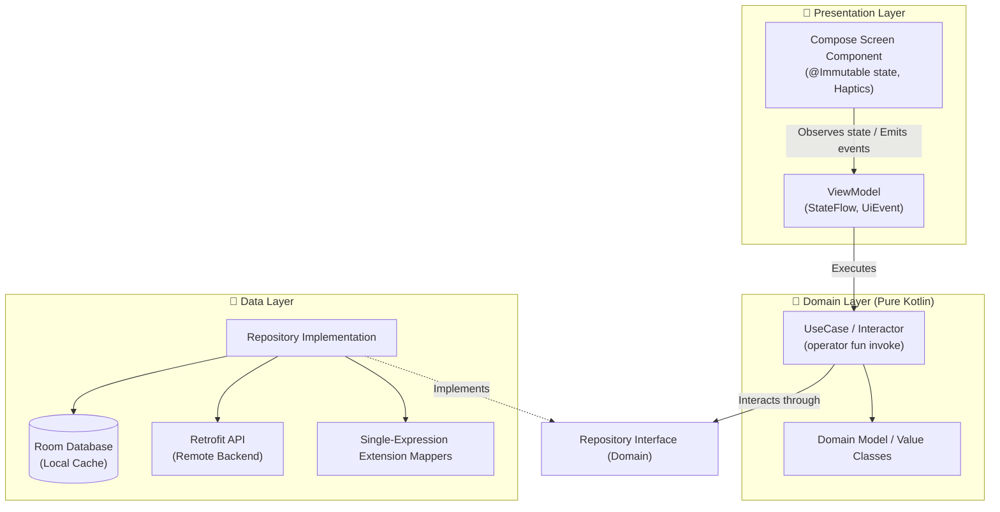
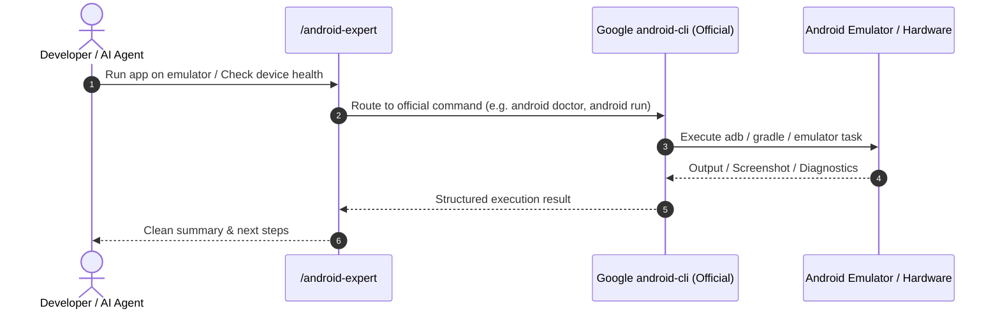

# 📱 Android Engineering Skills

Welcome to the **Android Engineering Skills** documentation. This module contains the master, consolidated **Android In-Depth Expert** (`/android-expert`) skill, incorporating enterprise Clean Architecture, modern Jetpack Compose UI, Coroutines & Flow, reactive data persistence, Gradle hygiene, and seamless routing to Google's official `android-cli`.

---

## 🧭 Navigation & Connected Skills Hub

| Hub Directory | Domain | Direct Link |
|---|---|---|
| 🏠 **Root Hub** | Full Suite Overview & Installer | [Root README](../README.md) |
| 🚀 **Engineer Mode** | Master Entry Point & Playbook Router | [Engineer Mode README](../engineer-mode/README.md) |
| ⚛️ **React TS Skills** | Next.js, Vite, TypeScript, Tailwind, Web Vitals | [React TS README](../react-ts-skills/README.md) |
| 🔍 **Diagnostic Skills** | Error Detective, ADR Detection, App Design | [Diagnostic README](../diagnostic-skills/README.md) |
| 🌿 **Git Skills** | Branching, Safe Rebase, Conflict Resolution, PRs | [Git README](../git-skills/README.md) |

---

## 🏗️ Architecture Blueprint

The skill enforces strict **Clean Architecture (MVVM/MVI)** separation across all Android applications:



---

## 🛠️ Google Android CLI Integration

Rather than duplicating custom CLI helper scripts, this skill routes directly to Google's official `android-cli`:



---

## 📋 Capabilities & Rule Matrix

| Area | Rule / Standard | Enforcement Detail |
|---|---|---|
| **Domain Layer** | Pure Kotlin Isolation | Zero dependencies on `android.*`, no `@Serializable`, no database annotations. |
| **Data Layer** | Clean Repositories & Mappers | Hide Retrofit & Room behind domain interfaces. Use one-liner extension mappers. |
| **Presentation** | Compose UI State Stability | Single ViewModel per screen, `@Immutable` state classes, immutable collections. |
| **Haptic Feedback** | Purposeful Tactile Response | Use `LocalHapticFeedback.current` with strictly mapped `HapticFeedbackType`. |
| **Strings & i18n** | Zero Hardcoded Strings | Extract to `strings.xml` with semantic prefixes (`label_`, `msg_`, `title_`, etc.). |
| **Kotlin Idioms** | One-Liner Expressions | Prefer `fun ... = ...`, expression getters, and `kotlin.time.Duration` extensions. |
| **Platform Compliance** | Android 14+ Guardrails | Foreground service types, predictive back gestures, photo picker. |

---

## ⚡ How to Trigger

You can trigger the Android Expert directly or via `/engineer-mode`:

```text
/android-expert create a clean architecture shopping cart screen with Jetpack Compose
```
```text
/android-expert implement an offline-first Room repository with single-expression mappers
```
```text
/android-expert audit this ViewModel for recomposition stability and coroutine safety
```

### Connected Skill Hand-offs:
- Encountering a crash or ANR? ➔ Routes to [Error Detective](../diagnostic-skills/README.md)
- Making a major architecture decision? ➔ Routes to [ADR Analyze](../diagnostic-skills/README.md)
- Modeling module relationships? ➔ Routes to [App Design](../diagnostic-skills/README.md)
- Ready to commit clean code? ➔ Routes to [Git Assistant](../git-skills/README.md)
