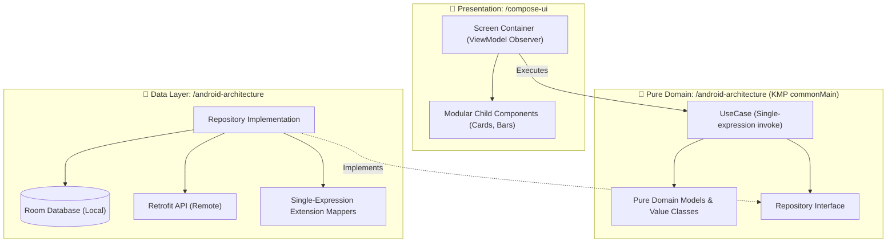

# 📱 Android Engineering Skills Suite

Welcome to the **Android Engineering Skills Suite**. Rather than bundling all capabilities into a single monolithic skill, this module provides **5 specialized, modular skills** that collaborate seamlessly to enforce enterprise Clean Architecture, pure KMP-ready business logic, modular Jetpack Compose UI decomposition, geospatial mapping, automated testing, and official-docs-grounded Gradle hygiene.

---

## 🧭 Navigation & Connected Skills Hub

| Hub Directory | Domain | Direct Link |
|---|---|---|
| 🏠 **Root Hub** | Full Suite Overview & Universal Installer | [Root README](../README.md) |
| 🚀 **Engineer Mode** | Master Entry Point & Adaptive Playbook Router | [Engineer Mode README](../engineer-mode/README.md) |
| ⚛️ **React TS Skills** | Next.js, Vite, TypeScript, Tailwind, Web Vitals | [React TS README](../react-ts-skills/README.md) |
| 🔍 **Diagnostic Skills** | Error Detective, ADR Detection, App Design, Changelogs | [Diagnostic README](../diagnostic-skills/README.md) |
| 🌿 **Git Skills** | Branching, Safe Rebase, Conflict Resolution, PRs | [Git README](../git-skills/README.md) |

---

## 📦 Modular Android Skills Matrix

| Skill Directory | Slash Command | Primary Purpose | Deliverables |
|---|---|---|---|
| [**`android-architecture/`**](./android-architecture/README.md) | `/android-architecture` | Enforce Clean Architecture with pure Kotlin domain (zero `android.*` framework code, KMP-ready), Room/Retrofit data layer, Hilt DI, and KDocs. | Domain UseCases, Repository contracts, Room DAOs |
| [**`compose-ui/`**](./compose-ui/README.md) | `/compose-ui` | Modern Jetpack Compose UI. Enforces multi-file decomposition (never 1 giant file), strict modifier parameter rules, state stability, and haptics. | Screen, Content, Component, and Preview files |
| [**`compose-maplibre/`**](./compose-maplibre/README.md) | `/compose-maplibre` | MapLibre Native in Compose with lifecycle safety, GeoJSON caching, Material 3 overlays, and camera animations. | MapView composable wrappers and overlays |
| [**`android-testing/`**](./android-testing/README.md) | `/android-testing` | Automated test engineering: Turbine for Coroutines Flow, MockK/Fakes for UseCases, ComposeTestRule semantic UI tests. | Unit and UI test suites |
| [**`gradle-build-hygiene/`**](./gradle-build-hygiene/README.md) | `/gradle-build-hygiene` | Version Catalog (`libs.versions.toml`) management, R8/ProGuard rules, official Google AGP documentation grounding without guesswork. | `libs.versions.toml`, `build.gradle.kts` |

---

## 🏗️ Architecture Blueprint: Pure Domain & KMP Readiness



---

## 🎨 Compose UI: File Separation & Modifier Ordering

### 1. Multi-File Decomposition (Never 1 Giant File)
Each Compose screen must be decomposed into dedicated, testable files:
- `CartScreen.kt`: Stateful container handling ViewModel observation.
- `CartContent.kt`: Stateless layout organizing child components.
- `CartItemCard.kt`: Isolated item card component in `components/`.
- `CartUiState.kt`: Immutable state class with immutable collections.
- `CartPreview.kt`: Light and dark mode previews.

### 2. The Modifier Rule
- **In Composable Declaration**: The `modifier: Modifier = Modifier` must be the **top parameter among optional arguments** (right after mandatory data and callbacks).
- **At the Call Site (Consumption)**: Pass the `modifier` chain at the **very bottom of the call arguments** so data arguments stay visible:

```kotlin
// Declaration: modifier is TOP of optional parameters
@Composable
fun CartItemCard(
    item: CartItemUiModel,
    onDeleteClick: (String) -> Unit,
    modifier: Modifier = Modifier,      // TOP of optional params
    isHighlighted: Boolean = false,
) { ... }

// Call site: modifier is passed at the VERY BOTTOM
CartItemCard(
    item = currentItem,
    onDeleteClick = { viewModel.onEvent(CartEvent.Delete(it)) },
    isHighlighted = true,
    modifier = Modifier
        .fillMaxWidth()
        .padding(horizontal = 16.dp, vertical = 8.dp) // BOTTOM of arguments
)
```

---

## 🛠️ Google Android CLI Routing

When you need device automation, emulator execution, or SDK inspection, the Android skills route directly to Google's official `android-cli`:
- Run APK on device: `android run`
- Health check: `android doctor`
- Layout & visual inspection: `android layout`, `android screen`
- Official docs search: `android doc`

---

## ⚡ How to Trigger

```text
/android-architecture design an offline-first repository with pure KMP domain models
```
```text
/compose-ui decompose a checkout screen into modular component files with strict modifier ordering
```
```text
/compose-maplibre render GeoJSON polygon layers with lifecycle-safe MapView in Compose
```
```text
/android-testing generate Turbine unit tests for CartViewModel and a ComposeTestRule UI test
```
```text
/gradle-build-hygiene update libs.versions.toml to Kotlin 2.0.21 referencing official docs
```
