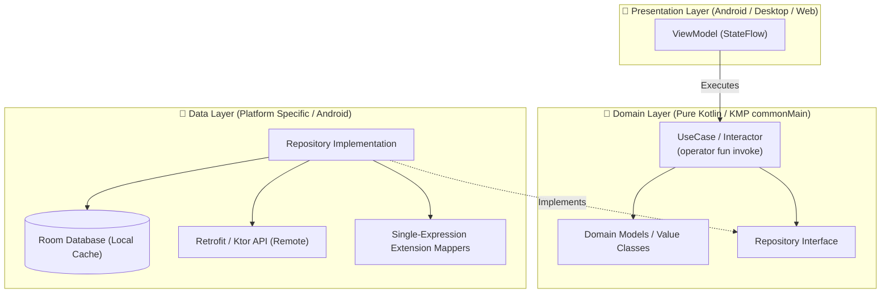

# 🏛️ Android & KMP Clean Architecture (/android-architecture)

The **Android Clean Architecture Skill** enforces strict separation of concerns across mobile and multiplatform codebases. It guarantees that business logic remains completely decoupled from platform frameworks, ensuring effortless testing, maintainability, and instant readiness for Kotlin Multiplatform (KMP).

---

## 🧭 Connected Skills & Routing


---

## 🏗️ 1. Layer Boundary Rules (KMP-Ready)



### A. Domain Layer (Pure Kotlin — Zero Framework Leakage)
- **Zero Android Imports**: The domain layer MUST NEVER import `android.*` packages (e.g. no `android.os.Bundle`, no `android.content.Context`, no `android.util.Log`).
- **KMP Ready (`commonMain`)**: All entities, UseCases, and repository interfaces must reside in pure Kotlin source sets capable of compilation to iOS, Desktop, and Web.
- **Single-Expression UseCases**: UseCases must have a single public responsibility exposed via `operator fun invoke`:
  ```kotlin
  /**
   * Retrieves active user subscriptions with offline fallback.
   *
   * @property repository Domain contract for user subscription persistence.
   */
  class GetUserSubscriptionsUseCase @Inject constructor(
      private val repository: SubscriptionRepository,
  ) {
      /**
       * Emits subscription updates reactively.
       *
       * @param userId The unique identifier of the target user.
       * @return A cold [Flow] emitting the current [UserSubscription].
       */
      operator fun invoke(userId: UserId): Flow<UserSubscription> = repository.observeSubscriptions(userId)
  }
  ```
- **Type-Safe Value Classes**: Wrap domain identifiers in `@JvmInline value class` for zero runtime memory overhead:
  ```kotlin
  /** Unique domain identifier for a user entity. */
  @JvmInline
  value class UserId(val value: String)
  ```

### B. Data Layer (Encapsulation & Extension Mappers)
- Implement repository interfaces defined in Domain.
- Keep Room entities, Retrofit DTOs, and serialization annotations (`@Serializable`, `@Entity`) strictly inside the Data layer.
- Transform data to domain using concise, single-expression extension mappers:
  ```kotlin
  /** Maps database entity to pure domain model. */
  fun UserEntity.toDomain(): User = User(id = UserId(id), name = name, email = email)

  /** Maps network DTO to database entity for local caching. */
  fun UserDto.toEntity(): UserEntity = UserEntity(id = id, name = name, email = email)
  ```

### C. Dependency Injection (Dagger Hilt)
- Bind repository implementations to domain interfaces via `@Binds` in dedicated Hilt modules (`@InstallIn(SingletonComponent::class)`).
- Scope expensive resources (`@Singleton`) and ViewModel dependencies (`@ViewModelScoped`).

---

## ✍️ 2. Clean Code, KDocs & Anti-Slop Discipline

1. **Mandatory KDocs**: All public classes, interfaces, and functions must feature clear KDocs documenting their intention, parameters, and return types.
2. **No Robotic Comments**: Remove filler comments like `// Assigning variable`, `// Return result`, or `// Constructor`. Code must be self-documenting.
3. **No Dead Code**: Remove commented-out code blocks, obsolete test helpers, and unused imports.
4. **Time Safety with `kotlin.time.Duration`**: Never pass raw Long milliseconds to delays or timeouts. Use `5.seconds`, `300.milliseconds`, `10.minutes`.
