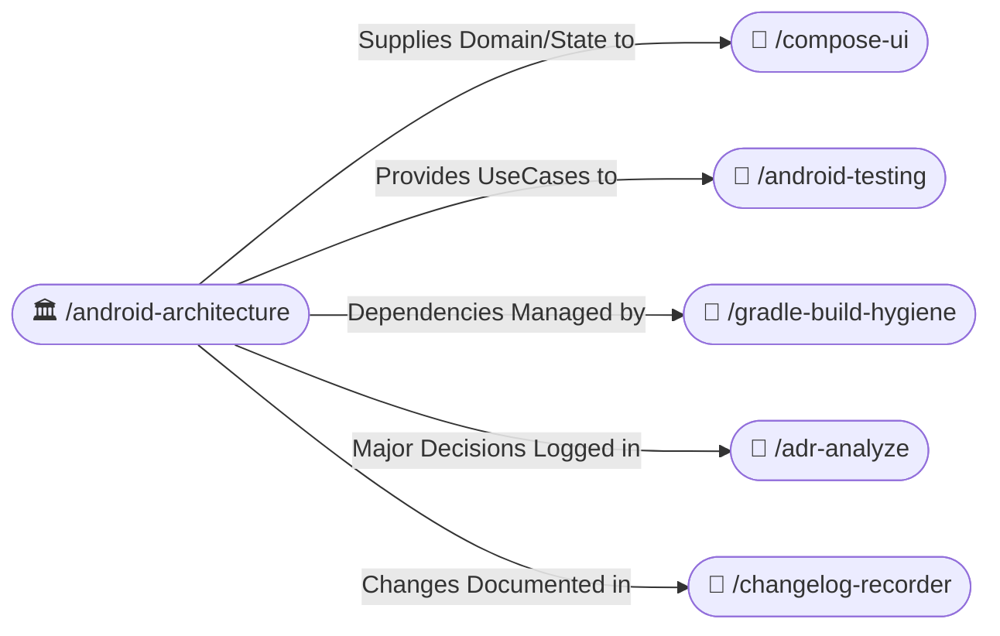
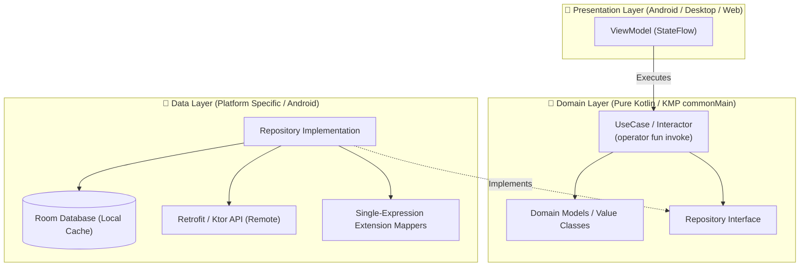

# 🏛️ Android & KMP Clean Architecture (/android-architecture)

The **Android Clean Architecture Skill** enforces strict separation of concerns across mobile and multiplatform codebases. It guarantees that business logic remains completely decoupled from platform frameworks, ensuring effortless testing, maintainability, and instant readiness for Kotlin Multiplatform (KMP).

---

## 🧭 Connected Skills & Routing



---

## 🏗️ 1. Layer Boundary Rules (KMP-Ready)



### A. Domain Layer (Pure Kotlin — Zero Framework Leakage)
- **Zero Android Imports**: The domain layer MUST NEVER import `android.*` packages (e.g. no `android.os.Bundle`, no `android.content.Context`, no `android.util.Log`).
- **KMP Ready (`commonMain`)**: All entities, UseCases, and repository interfaces must reside in pure Kotlin source sets capable of compilation to iOS, Desktop, and Web.
- **Single-Expression UseCases**: UseCases must have a single public responsibility exposed via `operator fun invoke`:
  ```kotlin
  /**
   * Retrieves active user subscriptions with offline fallback.
   *
   * @property repository Domain contract for user subscription persistence.
   */
  class GetUserSubscriptionsUseCase @Inject constructor(
      private val repository: SubscriptionRepository,
  ) {
      /**
       * Emits subscription updates reactively.
       *
       * @param userId The unique identifier of the target user.
       * @return A cold [Flow] emitting the current [UserSubscription].
       */
      operator fun invoke(userId: UserId): Flow<UserSubscription> = repository.observeSubscriptions(userId)
  }
  ```
- **Type-Safe Value Classes**: Wrap domain identifiers in `@JvmInline value class` for zero runtime memory overhead:
  ```kotlin
  /** Unique domain identifier for a user entity. */
  @JvmInline
  value class UserId(val value: String)
  ```

### B. Data Layer (Encapsulation & Extension Mappers)
- Implement repository interfaces defined in Domain.
- Keep Room entities, Retrofit DTOs, and serialization annotations (`@Serializable`, `@Entity`) strictly inside the Data layer.
- Transform data to domain using concise, single-expression extension mappers:
  ```kotlin
  /** Maps database entity to pure domain model. */
  fun UserEntity.toDomain(): User = User(id = UserId(id), name = name, email = email)

  /** Maps network DTO to database entity for local caching. */
  fun UserDto.toEntity(): UserEntity = UserEntity(id = id, name = name, email = email)
  ```

### C. Dependency Injection (Dagger Hilt & Compose ViewModel Import)
- Bind repository implementations to domain interfaces via `@Binds` in dedicated Hilt modules (`@InstallIn(SingletonComponent::class)`).
- Scope expensive resources (`@Singleton`) and ViewModel dependencies (`@ViewModelScoped`).
- **Mandatory Non-Deprecated `hiltViewModel` Import in Compose**:
  - When consuming a `@HiltViewModel` in Jetpack Compose, **ALWAYS** import from:
    ```kotlin
    import androidx.hilt.lifecycle.viewmodel.compose.hiltViewModel
    ```
  - **NEVER** use the deprecated import `import androidx.hilt.navigation.compose.hiltViewModel`!
  - Always place `modifier: Modifier = Modifier` at the **very first top parameter (`#1`)** of the Screen Composable declaration before `viewModel: MyViewModel = hiltViewModel()`.

---

## ✍️ 2. Clean Code, KTX Extensions, Lint Hygiene & Anti-Slop Discipline

1. **Android KTX Extensions Over Java/Static Calls (`androidx.core.net.*`, `androidx.core.content.*`, etc.)**:
   - **NEVER** use `Uri.parse(urlString)` — **ALWAYS** import `androidx.core.net.toUri` and call `urlString.toUri()`.
   - **NEVER** use `Color.parseColor(hex)` — **ALWAYS** import `androidx.core.graphics.toColorInt` and call `hex.toColorInt()`.
   - **NEVER** use manual `sharedPreferences.edit().putString(...).apply()` — **ALWAYS** use `sharedPreferences.edit { putString(...) }` (or migrate to DataStore).
   - **NEVER** use `View.VISIBLE` / `View.GONE` assignments in legacy views — **ALWAYS** use `view.isVisible = true` from `androidx.core.view.isVisible`.
2. **Clean Top-Level Imports (Zero Inline Fully-Qualified Package Calls)**:
   - **NEVER** write inline fully-qualified package calls inside functions or expressions (e.g., `kotlin.math.abs(x)`, `kotlin.math.max(a, b)`, `kotlin.math.roundToInt()`, `java.util.UUID.randomUUID()`).
   - **ALWAYS** add the explicit top-level `import` statement at the top of the file (`import kotlin.math.abs`, `import kotlin.math.max`, `import kotlin.math.roundToInt`, `import java.util.UUID`) and invoke the short function name (`abs(x)`, `max(a, b)`, `UUID.randomUUID()`).
3. **Functional Collection Operations Over Imperative Loops**:
   - Prefer idiomatic functional operators (`forEach`, `forEachIndexed`, `map`, `filter`, `firstOrNull`, `any`, `all`, `associateBy`, `sumOf`) over verbose imperative `for (item in list)` or index loops `for (i in 0 until list.size)`.
   - Only use a `for` loop when `suspend` calls inside a non-inline boundary or early non-local `break`/`continue` labels genuinely require it.
4. **Zero Unused Imports, Unused Parameters & Redundant `@OptIn`**:
   - **Unused Imports**: Audit every file's import block before finishing. Remove every single unused import and never use wildcard imports (`import foo.*`).
   - **Unused Parameters**: Never leave unused parameters in functions, constructors, or lambdas. If a lambda parameter is unused, replace it with `_` (e.g., `{ _, item -> ... }`). If a function parameter is unused, remove it from the signature.
   - **No Redundant `@OptIn(Experimental...)`**: Never slap `@OptIn(ExperimentalMaterial3Api::class)`, `@OptIn(ExperimentalCoroutinesApi::class)`, or `@OptIn(ExperimentalFoundationApi::class)` on a file, class, or function unless an experimental symbol is *actually* invoked inside that scope. If a previously experimental API has stabilized or was removed, immediately delete the redundant `@OptIn` annotation and its import.
5. **Mandatory Automated Lint & Compiler Verification**:
   - Whenever creating or modifying Android/Kotlin code, you **MUST** run the project's lint/compiler verification (`./gradlew lintDebug` or `./gradlew :module:lintDebug` and `./gradlew compileDebugKotlin`) and fix all reported warnings (`UseKtx`, `UnusedImport`, `UnusedParameter`, `RedundantOptIn`, `ObsoleteSdkInt`, etc.) before completing the task.
6. **Mandatory KDocs**: All public classes, interfaces, and functions must feature clear KDocs documenting their intention, parameters, and return types.
7. **No Robotic Comments & No Dead Code**: Remove filler comments (`// Assigning variable`, `// Return result`) and commented-out code blocks.
8. **Time Safety with `kotlin.time.Duration`**: Never pass raw Long milliseconds to delays or timeouts. Use `5.seconds`, `300.milliseconds`, `10.minutes`.
