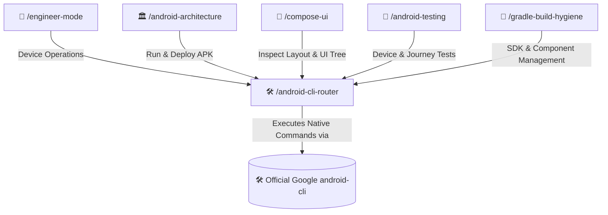

# 🛠️ Android CLI Router Skill

Routes developer requests, device automation, and documentation queries from the **AI-Engineer-Skills** mesh directly into the official **Google Android CLI** (`android`).

---

## 🧭 Connected Skills Architecture



---

## 📂 Subfolder Structure

| Path | Purpose | Description |
| :--- | :--- | :--- |
| [`SKILL.md`](./SKILL.md) | Agent Skill Definition | Core prompt instructions and routing rules to official Google CLI. |
| [`instructions/guidelines.md`](./instructions/guidelines.md) | Agent Execution Protocol | Dispatch rules, official CLI command mapping, and error recovery. |
| [`instructions/examples.md`](./instructions/examples.md) | Command Execution Examples | Real-world CLI invocation examples for running APKs, layouts, and screenshots. |

---

## 🚀 How to Use

### 1. Direct Skill Activation
Trigger this skill whenever you need to interact with connected devices, capture screens, inspect UI hierarchies, or manage Android SDK packages:
```text
/android-cli-router
```

### 2. Guided via Engineer Mode
Start through the adaptive interactive questionnaire:
```text
/engineer-mode
```
Select **Playbook 04 (Deep Android Engineering)**.

---

## 🔗 Related Skills

- [📱 Android Architecture](../android-architecture/README.md)
- [🎨 Jetpack Compose UI](../compose-ui/README.md)
- [🧪 Android Testing](../android-testing/README.md)
- [🐘 Gradle Build Hygiene](../gradle-build-hygiene/README.md)
- [🏠 Master Suite README](../../README.md)
