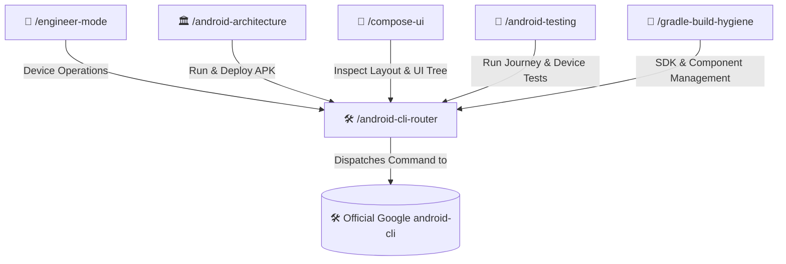

# 🛠️ Android CLI Router (/android-cli-router)

The **Android CLI Router Skill** acts as the dedicated bridge between the AI engineering mesh and the official **Google Android CLI** (`android`). Rather than reimplementing device automation or guessing ADB commands, this router inspects developer intent and dispatches tasks directly to the official Google `android` CLI tool.

---

## 🧭 Connected Skills Architecture



---

## 📋 1. Core Official CLI Commands

The router coordinates the following operations using the official Google `android` binary:

| Task | Official Command | Purpose |
|---|---|---|
| **Initialize Skills** | `android init` | Sets up directories, agent configuration, and default official skills. |
| **Run & Deploy APK** | `android run` | Builds, deploys, and launches an app on a connected device/emulator. |
| **Inspect UI Layout** | `android layout` | Returns the hierarchical UI layout tree of a running app in JSON. |
| **Screen Capture** | `android screen` | Captures device screenshots or annotates UI element bounding boxes. |
| **SDK Management** | `android sdk <install\|update\|list>` | Installs, updates, and manages Android SDK platforms and tools. |
| **Search Documentation**| `android docs search "<query>"` | Queries authoritative Google Android Developer documentation. |
| **Emulator Lifecycle** | `android emulator <start\|stop\|list>` | Manages Android Virtual Devices (AVDs). |
| **Update CLI** | `android update` | Updates the Google Android CLI to the latest version. |

---

## 🎯 2. Operational Dispatch Rules

1. **Always Verify Availability First**:
   - Check if `android` is executable in PATH or standard paths (`/usr/local/bin/android`, `/opt/homebrew/bin/android`, `~/.local/bin/android`).
   - If missing, prompt the developer or execute the official Google installation command:
     - macOS (Apple Silicon): `curl -fsSL https://dl.google.com/android/cli/latest/darwin_arm64/install.sh | bash`
     - macOS (Intel): `curl -fsSL https://dl.google.com/android/cli/latest/darwin_x86_64/install.sh | bash`
     - Linux (x86_64): `curl -fsSL https://dl.google.com/android/cli/latest/linux_x86_64/install.sh | bash`
     - Windows: `curl -fsSL https://dl.google.com/android/cli/latest/windows_x86_64/install.cmd -o "%TEMP%\i.cmd" && "%TEMP%\i.cmd"`
2. **Never Reinvent Official Capabilities**:
   - When asked to inspect a UI tree, never manually parse raw `adb shell uiautomator dump`; dispatch to `android layout`.
   - When asked to capture a screen, dispatch to `android screen`.
   - When asked to look up official Android API docs, dispatch to `android docs search "<topic>"`.
3. **Keep the Official `android-cli` Skill Intact**:
   - This router collaborates with the official `android-cli` skill installed by `android init` and does not overwrite or remove it.

---

## 📱 3. Active ADB Device & Live App Logcat Telemetry (Mandatory When Connected)

Whenever working on an Android project (debugging, testing, verifying a feature, or investigating runtime behavior), automatically check if an active ADB device or emulator is connected and capture the live app's logs for analysis:

1. **Detect Connected ADB Devices**:
   ```bash
   adb devices -l
   ```
   *(If at least one device/emulator is in `device` state, proceed immediately with live telemetry extraction).*
2. **Identify the Active / Foreground App & Process PID**:
   - Resolve `applicationId` from `app/build.gradle.kts` (or detect the current foreground activity via `adb shell dumpsys window | grep -E 'mCurrentFocus|mFocusedApp'`).
   - Get the running PID of the target package:
     ```bash
     adb shell pidof -s <applicationId>
     ```
3. **Capture & Analyze Scoped App Logcat**:
   - Dump the recent logs filtered strictly to the active app's PID (plus fatal crash buffers):
     ```bash
     # Scoped to the active app process PID
     adb logcat -d --pid=<PID> -v threadtime *:V

     # Always check the crash buffer for Fatal Exceptions / ANRs
     adb logcat -d -b crash -v threadtime
     ```
   - Analyze exceptions (`AndroidRuntime`, `Fatal Exception`), coroutine cancellations, network/HTTP status codes, Compose recomposition warnings, and lifecycle anomalies directly from the live device output before proposing or verifying a fix.
