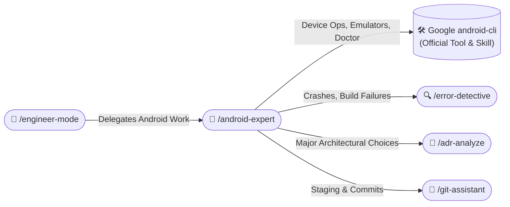
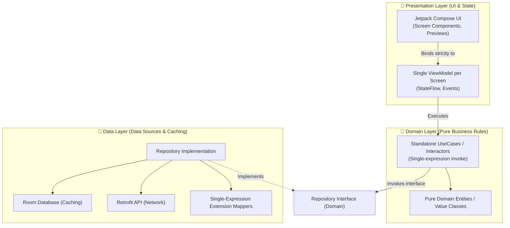

# 📱 Android In-Depth Expert Skill (/android-expert)

The **Android Expert Skill** is the comprehensive master standard for enterprise Android engineering. It consolidates Clean Architecture layer boundaries, reactive data streaming, modern declarative Jetpack Compose UI, strict Kotlin 2.x idioms, and platform compliance into a single, unified source of truth.

---

## 🧭 Connected Skills & Inter-Skill Routing



### Routing Rules:
1. **Google Android CLI Operations**: Whenever you or the user need to run device tasks (e.g., launching emulators, installing APKs, capturing screenshots, executing `android doctor`, `android init`, `android run`, `android device`, or viewing official SDK docs), **do NOT use custom reimplementations**. Seamlessly route to the official Google `android-cli` tool and skill.
2. **Error Triage**: If Gradle builds fail, tests break, or runtime exceptions occur during implementation, invoke `/error-detective`.
3. **Architecture Decisions**: When adding dependencies (e.g. Room vs DataStore) or altering layer contracts, document via `/adr-analyze`.
4. **Shipping**: When changes are verified green, commit and push via `/git-assistant`.

---

## 🏛️ 1. Architecture Blueprint: Clean Architecture (MVVM/MVI)



### Strict Layer Boundary Rules
- **Domain Layer Isolation**:
  - Pure Kotlin only. **Zero dependencies on `android.*` framework classes**.
  - No serialization annotations (`@Serializable`, `@Parcelize`), no database annotations (`@Entity`, `@Dao`), no network DTOs.
  - Expose business logic via single-expression `operator fun invoke(...)`.
- **Data Layer Encapsulation**:
  - Abstract network and database behind clean Repository interfaces defined in Domain.
  - Implement one-liner extension mappers for converting DTOs and Entities into Domain models:
    ```kotlin
    fun UserEntity.toDomain(): User = User(id = id, name = name, email = email)
    fun UserDto.toDomain(): User = User(id = id, name = name, email = email)
    ```
- **Presentation Layer Independence**:
  - Single `ViewModel` per screen. UI observes state via `.collectAsStateWithLifecycle()`.
  - ViewModels emit immutable `StateFlow<UiState>` and accept one-off user intents (`UiEvent`).

---

## 🎨 2. Modern Jetpack Compose UI Standards

### State Stability & Strong Skipping Mode
- Ensure state parameters are immutable. Annotate UI state models with `@Immutable` or `@Stable`.
- Use immutable collections (`kotlinx.collections.immutable.ImmutableList`) instead of standard `List` in state classes to guarantee compose stability and avoid recomposition loops.
- Leverage Kotlin 2.x Compose compiler default Strong Skipping mode.

### Edge-to-Edge & System Insets
- Enforce full edge-to-edge rendering by default.
- Apply window insets purposefully using `Modifier.windowInsetsPadding(WindowInsets.safeDrawing)` or Scaffold inner paddings.

### Tactile Haptic Feedback
- Obtain `val haptics = LocalHapticFeedback.current` in Composables.
- Fire purpose-specific feedback strictly per Android guidelines:
  - Toggle / Checkbox / Tab: `haptics.performHapticFeedback(HapticFeedbackType.SegmentTick)`
  - Confirmation / Success: `haptics.performHapticFeedback(HapticFeedbackType.Confirm)`
  - Error / Boundary rejection: `haptics.performHapticFeedback(HapticFeedbackType.Reject)`

---

## ✍️ 3. Idiomatic Kotlin & Code Hygiene (Mandatory)

### Clean Code Mindset & Single-Expression Preference
- **Single-Expression Functions (`fun ... = ...`)**:
  ```kotlin
  // ✅ Clean single-expression
  fun calculateSubtotal(items: List<CartItem>): Double = items.sumOf { it.price * it.quantity }
  ```
- **Expression Property Getters**:
  ```kotlin
  // ✅ Clean one-liner getter
  val isReady: Boolean get() = state is UiState.Success && items.isNotEmpty()
  ```
- **Temporal Values with `kotlin.time.Duration`**:
  - Never pass raw integer/long milliseconds to delays or timeouts.
  - Always import and use `kotlin.time.Duration.Companion.seconds`, `.milliseconds`:
    ```kotlin
    // ❌ WRONG
    delay(3000L)

    // ✅ CORRECT
    delay(3.seconds)
    ```
- **Zero Hardcoded Strings**:
  - Extract all user-facing strings into `res/values/strings.xml`.
  - Use semantic prefixes: `label_`, `msg_`, `title_`, `action_`, `error_`, `hint_`, `desc_`.

---

## 💾 4. Reactive Data Layer: Room, Retrofit & DataStore

- **Room Database**:
  - Always define explicit migration plans or use automated migrations with schemas exported to `schemas/`.
  - Store entity tables with type-safe primary keys (`@PrimaryKey`).
- **Retrofit & kotlinx.serialization**:
  - Prefer `kotlinx.serialization` with `Json { ignoreUnknownKeys = true; coerceInputValues = true }`.
  - Return clean `Response<T>` or direct DTO models in suspend functions.
- **Jetpack DataStore**:
  - Enforce `PreferencesDataStore` or `ProtoDataStore` for key-value preferences. SharedPreferences is prohibited.

---

## ⚡ 5. Gradle Build Hygiene & Version Catalogs

- Manage all dependencies strictly through `gradle/libs.versions.toml`.
- Group related plugins and libraries under type-safe accessors (`libs.plugins.*`, `libs.androidx.*`).
- Keep R8/ProGuard rules minimal and intentional (`proguard-rules.pro`).

---

## 🛡️ 6. Android 14+ (API 34/35) Platform Restrictions

- **Foreground Services**: Always declare explicit `foregroundServiceType` in `AndroidManifest.xml` (e.g., `dataSync`, `mediaPlayback`, `location`) and pair with immediate notification display.
- **Predictive Back Navigation**: Support `PredictiveBackHandler` in Compose for smooth back gestures.
- **Exact Alarms & Permissions**: Check `alarmManager.canScheduleExactAlarms()` before requesting exact triggers; prefer `WorkManager` for non-time-critical workloads.
- **Photo Picker**: Use `ActivityResultContracts.PickVisualMedia` instead of requesting broad `READ_EXTERNAL_STORAGE` permissions.
