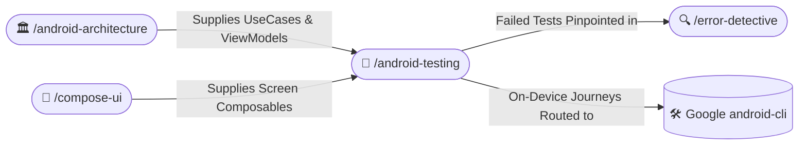

# 🧪 Android Testing Standards (/android-testing)

The **Android Testing Skill** establishes rigorous testing standards across unit, integration, and Compose UI levels. It enforces isolated, deterministic test suites utilizing Turbine for Coroutines Flow testing, clean offline fakes, Compose semantic testing, and strict Arrange-Act-Assert (AAA) hygiene.

---

## 🧭 Connected Skills & Routing



---

## 🧠 1. Domain UseCase & ViewModel Unit Testing

### A. UseCase Testing with In-Memory Fakes
Prefer lightweight in-memory fake repositories over excessive mock verification:

```kotlin
/**
 * Test suite verifying business rules of [CalculateCartSubtotalUseCase].
 */
class CalculateCartSubtotalUseCaseTest {

    private val fakeCartRepository = FakeCartRepository()
    private val useCase = CalculateCartSubtotalUseCase(fakeCartRepository)

    @Test
    fun `given empty cart, when calculated, then subtotal is zero`() = runTest {
        // Arrange
        fakeCartRepository.emitItems(emptyList())

        // Act
        val result = useCase()

        // Assert
        assertEquals(0.0, result, 0.001)
    }
}
```

### B. ViewModel StateFlow Testing with Turbine
Always test asynchronous `StateFlow` emissions using the **Turbine** library paired with `StandardTestDispatcher`:

```kotlin
@OptIn(ExperimentalCoroutinesApi::class)
class CartViewModelTest {

    private val testDispatcher = StandardTestDispatcher()
    private val fakeCartRepository = FakeCartRepository()
    private lateinit var viewModel: CartViewModel

    @Before
    fun setUp() {
        Dispatchers.setMain(testDispatcher)
        viewModel = CartViewModel(
            getCartItemsUseCase = GetCartItemsUseCase(fakeCartRepository),
        )
    }

    @After
    fun tearDown() {
        Dispatchers.resetMain()
    }

    @Test
    fun `given cart items available, when initialized, then emits success state`() = runTest {
        viewModel.uiState.test {
            // Initial emission
            assertEquals(CartUiState.Loading, awaitItem())

            // Seed fake data and advance
            fakeCartRepository.emitItems(listOf(CartItem(id = "1", title = "Book", price = 15.0)))
            advanceUntilIdle()

            val successState = awaitItem() as CartUiState.Success
            assertEquals(1, successState.items.size)
            assertEquals("Book", successState.items.first().title)
            cancelAndIgnoreRemainingEvents()
        }
    }
}
```

---

## 🎨 2. Compose UI Semantic Testing (`ComposeTestRule`)

Test Composable screens and atomic components using semantic matchers rather than brittle coordinate clicks:

```kotlin
class CartScreenTest {

    @get:Rule
    val composeTestRule = createComposeRule()

    @Test
    fun `given empty state, then displays empty cart message`() {
        // Arrange
        composeTestRule.setContent {
            CartContent(
                state = CartUiState(items = persistentListOf(), isLoading = false),
                onEvent = {},
            )
        }

        // Assert
        composeTestRule
            .onNodeWithText("Your cart is empty")
            .assertIsDisplayed()
    }

    @Test
    fun `given item in cart, when delete clicked, then fires callback`() {
        var clickedItemId: String? = null

        composeTestRule.setContent {
            CartItemCard(
                item = CartItemUiModel(id = "item_42", name = "Coffee Mug", price = "$12.00"),
                onQuantityChange = { _, _ -> },
                onDeleteClick = { id -> clickedItemId = id },
            )
        }

        // Act
        composeTestRule
            .onNodeWithContentDescription("Remove item")
            .performClick()

        // Assert
        assertEquals("item_42", clickedItemId)
    }
}
```

---

## 🛡️ 3. Clean Testing Discipline & Anti-Patterns

1. **No `Thread.sleep()`**: Never use sleeping threads to wait for asynchronous coroutines. Always use `runTest`, `advanceUntilIdle()`, or Turbine `awaitItem()`.
2. **Deterministic Assertions**: Tests must pass or fail reliably across local machines and CI runners without timing flakiness.
3. **KDocs on Complex Test Cases**: Document tricky edge cases or specific business constraints tested.
