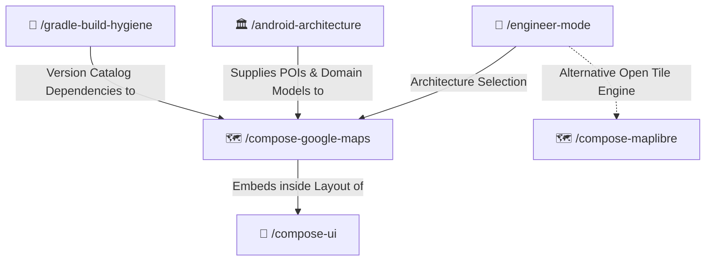

# 🗺️ Compose Google Maps Skill

Production-ready Google Maps integration for Jetpack Compose using the official `maps-compose` and `maps-compose-utils` libraries. Enforces declarative `rememberCameraPositionState` tracking, high-performance marker clustering, custom styling, location permissions, and lifecycle safety grounded in official Google Maps Platform documentation.

---

## 🧭 Connected Skills Architecture



---

## 📂 Subfolder Structure

| Path | Purpose | Description |
| :--- | :--- | :--- |
| [`SKILL.md`](./SKILL.md) | Agent Skill Definition | Core rules, CameraPositionState, clustering, and anti-patterns. |
| [`instructions/guidelines.md`](./instructions/guidelines.md) | Agent Execution Protocol | Version catalog setup, API key management, and location permission rules. |
| [`instructions/examples.md`](./instructions/examples.md) | Production Code Examples | Real-world map composable with clustering, camera animation, and FAB overlay controls. |

---

## 🚀 How to Use

### 1. Direct Skill Activation
Trigger this skill when building or optimizing Google Maps features in Jetpack Compose:
```text
/compose-google-maps
```

### 2. Guided via Engineer Mode
Start through the adaptive interactive questionnaire:
```text
/engineer-mode
```
Select **Playbook 04 (In-Depth Android Engineering)** and choose Google Maps as your mapping provider.

---

## 🔗 Related Skills

- [🗺️ Compose MapLibre](../compose-maplibre/README.md)
- [🎨 Compose UI](../compose-ui/README.md)
- [🏛️ Android Architecture](../android-architecture/README.md)
- [🐘 Gradle Build Hygiene](../gradle-build-hygiene/README.md)
- [🏠 Master Suite README](../../README.md)
