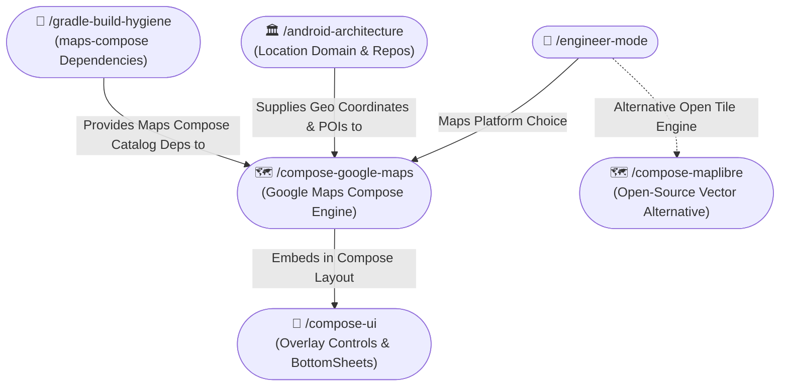

# 🗺️ Compose Google Maps Skill (/compose-google-maps)

The **Compose Google Maps Skill** architects and implements production-ready mapping features using the official Google Maps Compose SDK (`com.google.maps.android:maps-compose`). It enforces declarative camera positioning via `rememberCameraPositionState`, performant marker clustering with `maps-compose-utils`, cloud and JSON map styling, and lifecycle-safe location permissions.

---

## 🧭 Connected Skills & Inter-Skill Routing



---

## 📚 1. Grounding in Official Documentation

All implementations must align with official Google Maps Platform documentation:
- **Official Maps Compose Guide**: `https://developers.google.com/maps/documentation/android-sdk/maps-compose`
- **GitHub Repository & Releases**: `https://github.com/googlemaps/android-maps-compose`
- **Maps Android Utility Library**: `https://developers.google.com/maps/documentation/android-sdk/utility`
- **Cloud-based Map Styling**: `https://developers.google.com/maps/documentation/android-sdk/cloud-based-map-styling`

---

## 🏗️ 2. Core Architecture Rules

### 1. CameraPositionState Management
- Always use `rememberCameraPositionState` to retain camera state across recompositions:
  ```kotlin
  val cameraPositionState = rememberCameraPositionState {
      position = CameraPosition.fromLatLngZoom(initialLocation, 12f)
  }
  ```
- **Camera Animation**: Animate camera movements inside a coroutine scope using `CameraUpdateFactory`:
  ```kotlin
  coroutineScope.launch {
      cameraPositionState.animate(
          update = CameraUpdateFactory.newLatLngZoom(targetLocation, 15f),
          durationMs = 800
      )
  }
  ```

### 2. High-Performance Marker Clustering (`maps-compose-utils`)
- When displaying more than 20 markers, **always use `Clustering`** to prevent rendering lag:
  ```kotlin
  GoogleMap(
      modifier = modifier,
      cameraPositionState = cameraPositionState,
  ) {
      Clustering(
          items = poiItems,
          onClusterClick = { cluster ->
              coroutineScope.launch {
                  cameraPositionState.animate(
                      CameraUpdateFactory.newLatLngZoom(cluster.position, cameraPositionState.position.zoom + 2)
                  )
              }
              true
          },
          onClusterItemClick = { item ->
              onPoiSelected(item)
              true
          },
      )
  }
  ```

### 3. Layer Separation: Map vs Floating Overlays
- **Never nest non-map UI widgets inside the `GoogleMap { ... }` content block**.
- Use a root `Box` composable:
  - `GoogleMap` at the base (`Modifier.fillMaxSize()`).
  - Search bars, floating action buttons (FABs), and bottom sheets in alignment layers above the map.

### 4. Lifecycle & Location Permissions
- Synchronize `MapProperties(isMyLocationEnabled = hasLocationPermission)`.
- Request `ACCESS_FINE_LOCATION` and `ACCESS_COARSE_LOCATION` before enabling the location blue dot.
- Catch `SecurityException` when modifying location properties.

### 5. Custom Map Styling
- Support both **Cloud-based map styling** (`MapProperties(mapId = "...")`) and **JSON styling** (`MapStyleOptions.loadRawResourceStyle(context, R.raw.map_style)`).
- Dynamically toggle dark mode map styles based on `isSystemInDarkTheme()`.

---

## 🚫 3. Anti-Patterns to Prevent

| Anti-Pattern | Why It Breaks | Correct Pattern |
|:---|:---|:---|
| Reading `cameraPositionState.position` directly in parent UI | Causes continuous recompositions at 60fps during camera pans. | Use `derivedStateOf` or observe only `cameraPositionState.isMoving`. |
| Adding 100+ raw `Marker` composables without clustering | Drastic frame drops, memory spikes, and laggy gestures. | Use `Clustering(items = ...)` from `maps-compose-utils`. |
| Hardcoding Google Maps API Key in layout or source | Security leak; exposed in version control. | Store in `local.properties` or Secrets Gradle Plugin (`secrets-gradle-plugin`). |
| Missing `isMyLocationEnabled` permission check | Causes immediate `SecurityException` crash. | Verify runtime permission before enabling. |
