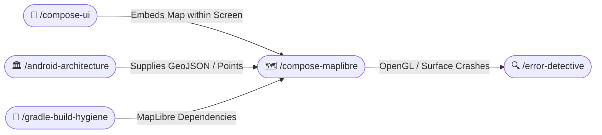

# 🗺️ MapLibre for Jetpack Compose (/compose-maplibre)

The **MapLibre Compose Skill** guides high-performance geospatial mapping in Android using MapLibre Native and modern Jetpack Compose. It ensures lifecycle safety, smooth vector tile rendering, declarative layer styling, and leak-free camera management.

---

## 🧭 Connected Skills & Routing



---

## 🏛️ 1. Clean Architectural Separation for Maps

Never mix map surface rendering, vector tile parsing, and coordinate math inside a single file:

```
feature/map/
├── MapScreen.kt               # Container observing coordinates from ViewModel
├── components/
│   ├── MapLibreContainer.kt   # Composable wrapping MapView with lifecycle handling
│   ├── MapControlsOverlay.kt  # Zoom, pitch, compass, and layer switch buttons
│   └── LocationMarkerCard.kt  # Floating bottom card displaying selected point
├── model/
│   ├── GeoPointUiModel.kt     # Immutable UI point representation
│   └── CameraPositionState.kt # Stable camera state holder
└── domain/
    └── ConvertGeoJsonUseCase.kt # Pure Kotlin GeoJSON parser (zero Android UI imports)
```

---

## 🛡️ 2. Lifecycle Safety & GL Surface Management

`MapView` manages OpenGL / Vulkan native rendering surfaces. Improper lifecycle attachment causes severe memory leaks or crashes during screen rotation:

```kotlin
/**
 * Lifecycle-safe Composable wrapper around MapLibre MapView.
 *
 * @param modifier Applied to the native AndroidView container (MUST be at the very top of parameters).
 * @param styleUrl Vector tile style JSON URL.
 * @param cameraPosition Target camera center and zoom level.
 * @param onMapClick Fired when user selects coordinates on the map.
 */
@Composable
fun MapLibreContainer(
    modifier: Modifier = Modifier, // ✅ Declaration: VERY TOP parameter
    styleUrl: String,
    cameraPosition: CameraPositionState,
    onMapClick: (latitude: Double, longitude: Double) -> Unit,
) {
    val context = LocalContext.current
    val lifecycleOwner = LocalLifecycleOwner.current

    val mapView = remember {
        MapView(context).apply {
            getMapAsync { maplibreMap ->
                maplibreMap.setStyle(styleUrl)
                maplibreMap.addOnMapClickListener { point ->
                    onMapClick(point.latitude, point.longitude)
                    true
                }
            }
        }
    }

    DisposableEffect(lifecycleOwner, mapView) {
        val observer = LifecycleEventObserver { _, event ->
            when (event) {
                Lifecycle.Event.ON_START -> mapView.onStart()
                Lifecycle.Event.ON_RESUME -> mapView.onResume()
                Lifecycle.Event.ON_PAUSE -> mapView.onPause()
                Lifecycle.Event.ON_STOP -> mapView.onStop()
                Lifecycle.Event.ON_DESTROY -> mapView.onDestroy()
                else -> Unit
            }
        }
        lifecycleOwner.lifecycle.addObserver(observer)
        onDispose {
            lifecycleOwner.lifecycle.removeObserver(observer)
            mapView.onDestroy()
        }
    }

    AndroidView(
        factory = { mapView },
        update = { view ->
            view.getMapAsync { _ ->
                // Synchronize cameraPosition state updates safely
            }
        },
        modifier = modifier, // ✅ Call site: VERY BOTTOM argument
    )
}
```

---

## 🎨 3. Material 3 Theming & Responsive Controls

- Position map overlays (compass, zoom buttons, location centering FAB) using Material 3 `FloatingActionButton` or `IconButton`.
- Respect edge-to-edge window insets by applying `WindowInsets.safeDrawing` to control overlays so navigation bars never obscure map interactions.
- Provide smooth camera animations via `animateCamera` rather than abrupt jumps.

---

## ✅ 4. Do's & ❌ Don'ts + Official References

| Topic | ❌ DON'T (Deprecated / Unsafe) | ✅ DO (Latest Stable) |
| :--- | :--- | :--- |
| **Lifecycle Owner** | `androidx.compose.ui.platform.LocalLifecycleOwner` | `androidx.lifecycle.compose.LocalLifecycleOwner` |
| **MapView Cleanup** | Leaving `MapView` unattached to `LifecycleEventObserver` | Attach `ON_START/RESUME/PAUSE/STOP/DESTROY` + `onDispose { mapView.onDestroy() }` |
| **Modifier Order** | `Modifier.padding(16.dp).clickable { ... }` on overlay cards | `Modifier.clip(shape).clickable { ... }.padding(16.dp)` |

- **Official MapLibre Native Docs**: `https://maplibre.org/maplibre-native/docs/`
- **Lifecycle in Compose**: `https://developer.android.com/develop/ui/compose/lifecycle`
