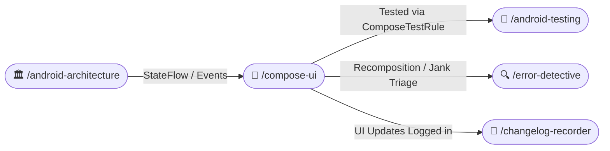

# 🎨 Jetpack Compose UI Engineering (/compose-ui)

The **Compose UI Skill** establishes production standards for declarative Android UI. It enforces modular component decomposition into dedicated files, strict modifier ordering (top in declarations, bottom at call sites), Compose compiler state stability, edge-to-edge window insets, purposeful tactile feedback, and zero hardcoded strings.

---

## 🧭 Connected Skills & Routing



---

## 📂 1. Modular File Separation (Never in a Single File)

Never bundle a complete screen, its multiple child subcomponents, its state models, and its previews into a single monolithic 800-line file. Always decompose each screen component into cohesive, single-responsibility files:

```
feature/cart/presentation/
├── CartScreen.kt             # Stateful screen container (ViewModel binding, lifecycle observation)
├── CartContent.kt            # Stateless top-level content layout
├── CartUiState.kt            # Immutable UI state and UI event definitions
├── CartPreview.kt            # MultiPreview annotations (Dark, Light, Font Scale)
└── components/
    ├── CartItemCard.kt       # Individual item card component
    ├── CartItemThumbnail.kt  # Cached image with fallback
    └── CartSummaryBar.kt     # Sticky bottom action bar with checkout CTA
```

---

## 📐 2. The Modifier Parameter & Consumption Rule (Mandatory)

To maintain strict API consistency across the Android Jetpack Compose ecosystem, you MUST distinguish between **declaring** a `@Composable` function and **consuming (calling)** a `@Composable` function:

| Context | Where `modifier` Goes | Rule Summary |
|:---|:---|:---|
| **1. Declaring `@Composable fun`** | **VERY TOP (`#1 First Parameter`)** | Always place `modifier: Modifier = Modifier` at the **very first top parameter** of the function signature—**NEVER** at the bottom of the parameter list! |
| **2. Consuming / Calling a Composable** | **VERY BOTTOM (`Last Argument`)** | Always pass `modifier = Modifier...` at the **very bottom** of the call-site arguments (just before any trailing `{ ... }` content lambda). |

### Rule A: In the Composable Function Declaration (`modifier` at the VERY TOP)
When **declaring** any `@Composable fun` (whether a Screen container, Content layout, or custom child component), `modifier: Modifier = Modifier` MUST be placed at the **very top of the parameter list**—**NEVER** at the bottom of the function parameters!

```kotlin
// ✅ CORRECT DECLARATION: modifier is placed at the VERY TOP (#1 parameter)
/**
 * Renders an individual cart item with quantity adjustment controls.
 *
 * @param modifier Applied to the outer card container. MUST be at the very top of parameters.
 * @param item The immutable cart item entity.
 * @param onQuantityChange Fired when the user increments or decrements quantity.
 * @param onDeleteClick Fired when the user removes the item.
 * @param isHighlighted Whether to render an accent border indicating pending checkout.
 * @param elevation Elevation level of the card container.
 */
@Composable
fun CartItemCard(
    modifier: Modifier = Modifier,                        // 1. VERY TOP PARAMETER (Mandatory!)
    item: CartItemUiModel,                                // 2. Required data parameters
    onQuantityChange: (itemId: String, qty: Int) -> Unit, // 3. Required callback parameters
    onDeleteClick: (itemId: String) -> Unit,
    isHighlighted: Boolean = false,                       // 4. Subsequent optional configs
    elevation: Dp = 2.dp,                                 // 5. Subsequent optional styling
) {
    Card(
        elevation = CardDefaults.cardElevation(defaultElevation = elevation),
        modifier = modifier, // Consuming Card -> modifier at the bottom of arguments
    ) {
        // Implementation
    }
}

// ❌ WRONG DECLARATION: NEVER place modifier at the bottom of a @Composable fun signature!
@Composable
fun CartItemCardWrong(
    item: CartItemUiModel,
    onQuantityChange: (itemId: String, qty: Int) -> Unit,
    onDeleteClick: (itemId: String) -> Unit,
    modifier: Modifier = Modifier, // ❌ VIOLATION! Never put modifier at the bottom of a declaration!
)
```

### Rule B: At the Call Site / Consumption (`modifier` at the VERY BOTTOM)
When **calling / consuming** any Composable (both built-in Material/Foundation composables like `Row`, `Column`, `Card`, `LazyColumn`, `GoogleMap` and your own custom Composables), pass the `modifier = Modifier...` argument at the **very bottom of the argument list**. This ensures business data and callbacks remain prominent at the top while long layout modifier chains sit cleanly at the bottom:

```kotlin
// ✅ CORRECT CALL SITE: Content & callbacks at the top, modifier chain at the VERY BOTTOM
CartItemCard(
    item = cartItem,
    onQuantityChange = { id, qty -> viewModel.onEvent(CartEvent.UpdateQuantity(id, qty)) },
    onDeleteClick = { id -> viewModel.onEvent(CartEvent.RemoveItem(id)) },
    isHighlighted = cartItem.isPending,
    modifier = Modifier                                   // ✅ VERY BOTTOM of call-site arguments!
        .fillMaxWidth()
        .padding(horizontal = 16.dp, vertical = 8.dp)
        .clickable { viewModel.onEvent(CartEvent.Select(cartItem.id)) },
)

// ❌ WRONG CALL SITE: Do not pass modifier at the top when consuming a Composable with other args
CartItemCard(
    modifier = Modifier.fillMaxWidth(),                   // ❌ VIOLATION! Move to the bottom of call site!
    item = cartItem,
    onQuantityChange = { _, _ -> },
    onDeleteClick = {},
)
```

### Rule C: Hilt ViewModel in Compose — Mandatory Non-Deprecated Import
When injecting a Dagger Hilt `@HiltViewModel` inside a `@Composable` screen, AI models frequently hallucinate or use the **deprecated** `androidx.hilt.navigation.compose.hiltViewModel` import. You MUST strictly import `hiltViewModel` from `androidx.hilt.lifecycle.viewmodel.compose.hiltViewModel` (introduced in `androidx.hilt:hilt-navigation-compose:1.3.0+` / `androidx.hilt:hilt-lifecycle-viewmodel-compose`):

```kotlin
// ✅ CORRECT IMPORT (Mandatory):
import androidx.hilt.lifecycle.viewmodel.compose.hiltViewModel

// ❌ DEPRECATED / FORBIDDEN IMPORT (NEVER USE THIS):
// import androidx.hilt.navigation.compose.hiltViewModel

@Composable
fun CartScreen(
    modifier: Modifier = Modifier,                  // 1. VERY TOP parameter in declaration!
    viewModel: CartViewModel = hiltViewModel(),     // 2. Uses androidx.hilt.lifecycle.viewmodel.compose.hiltViewModel
) {
    val uiState by viewModel.uiState.collectAsStateWithLifecycle()

    CartContent(
        state = uiState,
        onEvent = viewModel::onEvent,
        modifier = modifier,                        // ✅ VERY BOTTOM at call site!
    )
}
```

### Rule D: Modifier Chaining Order (`clip` ➔ `background` ➔ `clickable` ➔ `padding`)
Modifiers are applied **sequentially from outside to inside**. Putting `padding` before `clickable` or `background` shrinks the clickable touch target and clips the ripple inside the padding.

| Intent | ❌ DON'T (Broken Ripple / Target) | ✅ DO (Full Ripple & Correct Bounds) |
| :--- | :--- | :--- |
| **Clickable `Column`/`Row`/`Box` with full ripple** | `Modifier.padding(16.dp).clickable { onClick() }` *(ripple & tap area stop inside padding)* | `Modifier.clip(RoundedCornerShape(12.dp)).clickable(onClick = onClick).padding(16.dp)` |
| **Card-like container with background + border + ripple** | `Modifier.background(bg).padding(16.dp).clip(shape).clickable { }` | `Modifier.clip(shape).background(bg).border(1.dp, border, shape).clickable(onClick = onClick).padding(16.dp)` |
| **Outer margin + full inner ripple** | `Modifier.clickable(onClick = onClick).padding(16.dp)` *(when outer margin was meant)* | `Modifier.padding(horizontal = 16.dp).clip(shape).clickable(onClick = onClick).padding(16.dp)` |

```kotlin
// ✅ DO: clip -> background -> clickable -> inner padding (full-area bounded ripple)
Column(
    modifier = Modifier
        .fillMaxWidth()
        .clip(RoundedCornerShape(12.dp))
        .background(MaterialTheme.colorScheme.surfaceContainerLow)
        .clickable(onClick = onItemClick)
        .padding(16.dp),
) {
    Text(text = item.title, style = MaterialTheme.typography.titleMedium)
}
```

---

## ⚡ 3. Compose State Stability & Recomposition Discipline

1. **Annotate UI State Models**: Mark all UI state classes with `@Immutable` or `@Stable`.
2. **Immutable Collections**: Never use raw `List<T>` or `Map<K, V>` inside `@Immutable` state classes (standard lists are considered unstable by the Compose compiler). Always use `kotlinx.collections.immutable.ImmutableList` or wrap in a stable holder:
   ```kotlin
   @Immutable
   data class CartUiState(
       val items: ImmutableList<CartItemUiModel> = persistentListOf(),
       val subtotal: String = "",
       val isLoading: Boolean = false,
       val errorMessage: String? = null,
   )
   ```
3. **No Unstable Lambdas**: Pass method references or lambda instances that capture stable properties to prevent unnecessary recompositions.

---

## 📳 4. Tactile Haptic Feedback Standards

Fire tactile feedback strictly based on UI interaction physics:
- **Continuous Sliders & Fluid Dragging/Scrubbing (System Volume Slider Feel)**:
  - **NEVER** fire discrete sharp ticks on every value step change during smooth dragging — use a **whisper-light, ultra-weak continuous repeating waveform** via `VibratorManager` + `VibrationEffect.createWaveform(timings = longArrayOf(24L, 48L, 52L, 52L, 48L), amplitudes = intArrayOf(2, 4, 6, 5, 4), repeat = 1)` while `vibrator.hasAmplitudeControl()` is true (keep amplitudes ultra-low `~2..6/255` so modern LRA motors feel silky, never harsh or buzz-heavy).
  - Guard with an active flag (`isSlideWaveActive`) so movement frames sustain the wave without restarting/clicking, auto-stop (`vibrator.cancel()`) after `~85ms` of finger stillness or immediately on drag end / `DisposableEffect.onDispose`, and play a whisper-soft single low-frequency thud (`PRIMITIVE_LOW_TICK`, scale `0.18f`) once when hitting the exact min/max bound.
  - Fall back to `HapticFeedbackType.SegmentFrequentTick` **only** on hardware lacking amplitude control (`!vibrator.hasAmplitudeControl()`).
- **`HapticFeedbackType.SegmentTick`**: Discrete single-step changes — segmented button choice, tab switches, step `-`/`+` buttons, dropdown/expand toggles, discrete detent crossing.
- **`HapticFeedbackType.Confirm`**: Successful action completion (e.g. item added to cart, payment success, gesture dismiss commit).
- **`HapticFeedbackType.Reject`**: Validation errors, boundary bounces, blocked inputs.

---

## 🌐 5. Zero Hardcoded Strings & Multi-Language Localization

- Never embed literal text in `Text()` or content descriptions.
- Extract all user-visible strings to `res/values/strings.xml` with mandatory semantic prefixes:
  - `label_<name>` (e.g. `label_total_price`)
  - `action_<name>` (e.g. `action_checkout`)
  - `msg_<name>` (e.g. `msg_empty_cart`)
  - `title_<name>` (e.g. `title_cart`)
  - `desc_<name>` (e.g. `desc_remove_cart_item`)
- Resolve via `stringResource(R.string.key)`.

---

## 🧹 6. Strict Kotlin & Lint Hygiene in Compose (Zero Warnings)

Every Composable file generated or modified must pass Android Lint and Kotlin compiler checks with **zero warnings**:

| Anti-Pattern (Forbidden) | Clean Idiomatic Standard (Mandatory) |
| :--- | :--- |
| `Uri.parse(url)` | `import androidx.core.net.toUri` + `url.toUri()` |
| `kotlin.math.abs(offset)` (inline FQN) | `import kotlin.math.abs` at top of file + `abs(offset)` |
| `for (item in items) { ... }` | `items.forEach { item -> ... }` / `items.map { ... }` |
| Unused parameter in Composable or lambda | Remove unused Composable param; replace unused lambda param with `_` |
| Unused imports or wildcard `import foo.*` | Explicit imports only (`import androidx.compose.foundation.layout.Row`); prune all unused imports |
| Unnecessary `@OptIn(ExperimentalMaterial3Api::class)` | Only add `@OptIn` when an experimental API is genuinely used in that function; remove immediately if not needed |

---

## 🚀 7. Latest Stable Compose APIs (Zero Deprecations — Do's & Don'ts)

Always use current stable Jetpack Compose & Material 3 APIs; never emit deprecated packages or legacy Accompanist wrappers:

| Feature | ❌ DON'T (Deprecated / Legacy) | ✅ DO (Latest Stable) |
| :--- | :--- | :--- |
| **Lifecycle Owner** | `androidx.compose.ui.platform.LocalLifecycleOwner` | `androidx.lifecycle.compose.LocalLifecycleOwner` |
| **StateFlow Observation** | `flow.collectAsState()` | `flow.collectAsStateWithLifecycle()` |
| **Hilt ViewModel** | `androidx.hilt.navigation.compose.hiltViewModel` | `androidx.hilt.lifecycle.viewmodel.compose.hiltViewModel` |
| **Dividers (M3)** | `Divider()` | `HorizontalDivider()` / `VerticalDivider()` |
| **Pull to Refresh** | `com.google.accompanist.swiperefresh.SwipeRefresh` | `androidx.compose.material3.pulltorefresh.PullToRefreshBox` |
| **Directional Icons** | `Icons.Default.ArrowBack` / `Icons.Filled.Send` | `Icons.AutoMirrored.Filled.ArrowBack` / `Icons.AutoMirrored.Filled.Send` |
| **Edge-to-Edge System Bars** | `accompanist-systemuicontroller` | `enableEdgeToEdge()` in `ComponentActivity` + `WindowInsets.safeDrawing` |
| **Text Field Input State** | `BasicTextField(value: String, onValueChange: (String) -> Unit)` | `BasicTextField(state = remember { TextFieldState() }, lineLimits = TextFieldLineLimits.SingleLine)` + `snapshotFlow { state.text.toString() }` |

---

## 📦 8. Expandable Containers & Anti-Misclick Architecture

When implementing expandable cards or collapsible settings sub-sections, AI models frequently introduce one of two critical UX bugs:
1. **The Tiny Tap Target Bug**: Placing `.clickable` only on a small inner title or icon, forcing the user to precisely hunt for a tiny click target.
2. **The Accidental Collapse Bug**: Wrapping the entire outer container (both header and expanded content) in `.clickable`, causing any touch on child sliders, switches, text fields, or buttons to accidentally collapse the card.

### Mandatory Architecture Pattern:
- **When Collapsed**: The clickable area and Material 3 ripple MUST span the entire card edge-to-edge (`Modifier.clip(cardShape).clickable { onToggle() }`).
- **When Expanded**: The header remains cleanly clickable to collapse, but the expanded body content MUST reside **outside** the toggle clickable container:

```kotlin
/**
 * Expandable container ensuring full-card clickability when collapsed, while
 * strictly isolating expanded child controls from accidental toggle events.
 */
@Composable
fun ExpandableCard(
    modifier: Modifier = Modifier,
    title: String,
    expanded: Boolean,
    onToggleExpand: () -> Unit,
    cardShape: Shape = RoundedCornerShape(18.dp),
    content: @Composable ColumnScope.() -> Unit,
) {
    val haptics = LocalHapticFeedback.current
    val chevronRotation by animateFloatAsState(
        targetValue = if (expanded) 180f else 0f,
        animationSpec = spring(dampingRatio = 0.72f, stiffness = 380f),
        label = "expandableChevron",
    )

    Surface(
        shape = cardShape,
        color = MaterialTheme.colorScheme.surfaceContainerHigh,
        modifier = modifier.fillMaxWidth(),
    ) {
        Column(modifier = Modifier.fillMaxWidth()) {
            // Header box: spans full card width when collapsed
            Row(
                verticalAlignment = Alignment.CenterVertically,
                horizontalArrangement = Arrangement.SpaceBetween,
                modifier = Modifier
                    .fillMaxWidth()
                    .clip(cardShape)
                    .clickable {
                        haptics.performHapticFeedback(HapticFeedbackType.SegmentTick)
                        onToggleExpand()
                    }
                    .padding(horizontal = 16.dp, vertical = 14.dp),
            ) {
                Text(
                    text = title,
                    style = MaterialTheme.typography.titleMedium,
                    fontWeight = FontWeight.SemiBold,
                    modifier = Modifier.weight(1f),
                )
                Icon(
                    imageVector = Icons.Rounded.ExpandMore,
                    contentDescription = null,
                    modifier = Modifier
                        .size(22.dp)
                        .graphicsLayer { rotationZ = chevronRotation },
                )
            }

            // Expanded body: strictly OUTSIDE the toggle clickable container
            AnimatedVisibility(
                visible = expanded,
                enter = fadeIn(tween(180)) + expandVertically(spring(dampingRatio = 0.82f, stiffness = 380f)),
                exit = fadeOut(tween(140)) + shrinkVertically(spring(dampingRatio = 0.86f, stiffness = 400f)),
            ) {
                Column(
                    modifier = Modifier
                        .fillMaxWidth()
                        .padding(start = 16.dp, end = 16.dp, bottom = 14.dp),
                    content = content,
                )
            }
        }
    }
}
```

---

## 🔲 9. Responsive `FlowRow` & Multi-Column Layouts (Sub-Pixel Guard)

When arranging sub-items or chips in a multi-column responsive layout, naive column calculation (e.g., `maxWidth / 2`) causes Compose layout rounding errors where items prematurely wrap into an unsightly single column on wider viewports.

### Mandatory Sub-Pixel Rounding Guard Formula:
Always wrap multi-column sub-items in `BoxWithConstraints` and compute column counts with horizontal spacing compensation and a `1.dp` guard:

```kotlin
@Composable
fun ResponsiveSubItemGrid(
    modifier: Modifier = Modifier,
    minItemWidth: Dp = 200.dp,
    horizontalSpacing: Dp = 12.dp,
    verticalSpacing: Dp = 8.dp,
    maxColumns: Int = 2,
    content: @Composable (itemModifier: Modifier) -> Unit,
) {
    BoxWithConstraints(modifier = modifier.fillMaxWidth()) {
        val columns = ((maxWidth + horizontalSpacing) / (minItemWidth + horizontalSpacing))
            .toInt()
            .coerceIn(1, maxColumns.coerceAtLeast(1))

        val itemModifier = if (columns > 1) {
            val totalGap = horizontalSpacing * (columns - 1)
            // Subtract 1.dp sub-pixel guard so floating-point rounding never forces accidental wrapping
            val safeColumnWidth = ((maxWidth - totalGap - 1.dp) / columns.toFloat()).coerceAtLeast(1.dp)
            Modifier.width(safeColumnWidth)
        } else {
            Modifier.fillMaxWidth()
        }

        FlowRow(
            maxItemsInEachRow = columns,
            horizontalArrangement = Arrangement.spacedBy(horizontalSpacing),
            verticalArrangement = Arrangement.spacedBy(verticalSpacing),
            modifier = Modifier.fillMaxWidth(),
        ) {
            content(itemModifier)
        }
    }
}
```

---

## 🔄 10. Animated Icon Transformations in Menus & Dropdowns

Never display static icons for expandable menus, dialogs, or dropdown selectors.
- Animate chevron and dropdown arrow rotations using `animateFloatAsState` (`0° <-> 180°` spring rotation).
- Apply via `.graphicsLayer { rotationZ = rotation }` to avoid recomposing the entire Composable during angle updates:

```kotlin
val dropdownArrowRotation by animateFloatAsState(
    targetValue = if (menuExpanded) 180f else 0f,
    animationSpec = spring(dampingRatio = 0.72f, stiffness = 380f),
    label = "dropdownArrowRotation",
)

Icon(
    imageVector = Icons.Rounded.ArrowDropDown,
    contentDescription = null,
    modifier = Modifier
        .size(20.dp)
        .graphicsLayer { rotationZ = dropdownArrowRotation },
)
```

---

## 📜 11. Scrollable Viewports, Spacing & Adaptive Elevation Shadows

When displaying scrollable content below a sticky header, camera cutout, or simulation mockup:
1. **Dedicated Clearance**: Always place an explicit spacing buffer (e.g. `12.dp` to `16.dp`) between sticky controls/previews and the scrollable viewport.
2. **Rounded Viewport Clipping**: Clip the scrollable container to matching corner radii (`RoundedCornerShape(topStart = 22.dp, topEnd = 22.dp)`) so scrolled content never bleeds outside the card boundaries.
3. **Adaptive Scroll Shadow**: Never draw static shadow lines that look unpolished when content is at rest. Use `derivedStateOf { scrollState.value > 0 }` to dynamically fade in a top/bottom vertical gradient shadow **only when scrolled down**, keeping it 100% transparent at top rest:

```kotlin
val scrollState = rememberScrollState()
val isScrolled by remember { derivedStateOf { scrollState.value > 0 } }
val topShadowAlpha by animateFloatAsState(
    targetValue = if (isScrolled) 1f else 0f,
    animationSpec = tween(durationMillis = 180),
    label = "topScrollShadowAlpha",
)

Box(
    modifier = Modifier
        .weight(1f)
        .fillMaxWidth()
        .clip(RoundedCornerShape(topStart = 22.dp, topEnd = 22.dp)),
) {
    Column(
        modifier = Modifier
            .fillMaxSize()
            .verticalScroll(scrollState)
            .padding(bottom = 16.dp),
    ) {
        // Scroll content
    }

    if (topShadowAlpha > 0.01f) {
        Box(
            modifier = Modifier
                .align(Alignment.TopCenter)
                .fillMaxWidth()
                .height(20.dp)
                .background(
                    Brush.verticalGradient(
                        0.0f to MaterialTheme.colorScheme.scrim.copy(alpha = 0.12f * topShadowAlpha),
                        1.0f to Color.Transparent,
                    ),
                ),
        )
    }
}
```

---

## 📚 12. Official References

- **Compose Modifier Order**: `https://developer.android.com/develop/ui/compose/modifiers-order`
- **Compose API Guidelines**: `https://android.googlesource.com/platform/frameworks/support/+/androidx-main/compose/docs/compose-component-api-guidelines.md`
- **Lifecycle & State in Compose**: `https://developer.android.com/develop/ui/compose/lifecycle`
- **Material 3 Components**: `https://developer.android.com/develop/ui/compose/designsystems/material3`
