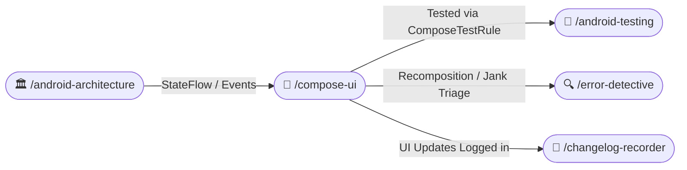

# 🎨 Jetpack Compose UI Engineering (/compose-ui)

The **Compose UI Skill** establishes production standards for declarative Android UI. It enforces modular component decomposition into dedicated files, strict modifier ordering, Compose compiler state stability, edge-to-edge window insets, purposeful tactile feedback, and zero hardcoded strings.

---

## 🧭 Connected Skills & Routing



---

## 📂 1. Modular File Separation (Never in a Single File)

Never bundle a complete screen, its multiple child subcomponents, its state models, and its previews into a single monolithic 800-line file. Always decompose each screen component into cohesive, single-responsibility files:

```
feature/cart/presentation/
├── CartScreen.kt             # Stateful screen container (ViewModel binding, lifecycle observation)
├── CartContent.kt            # Stateless top-level content layout
├── CartUiState.kt            # Immutable UI state and UI event definitions
├── CartPreview.kt            # MultiPreview annotations (Dark, Light, Font Scale)
└── components/
    ├── CartItemCard.kt       # Individual item card component
    ├── CartItemThumbnail.kt  # Cached image with fallback
    └── CartSummaryBar.kt     # Sticky bottom action bar with checkout CTA
```

---

## 📐 2. The Modifier Parameter & Consumption Rule (Mandatory)

To maintain standard API consistency across the Android ecosystem:

### Rule A: In the Composable Declaration (Modifier on Top of Optional Params)
The `modifier: Modifier = Modifier` parameter MUST be positioned as the **very first optional parameter** (immediately following required data and callback parameters):

```kotlin
/**
 * Renders an individual cart item with quantity adjustment controls.
 *
 * @param item The immutable cart item entity.
 * @param onQuantityChange Fired when the user increments or decrements quantity.
 * @param onDeleteClick Fired when the user removes the item.
 * @param modifier Applied to the outer card container. Must be first optional param.
 * @param isHighlighted Whether to render an accent border indicating pending checkout.
 * @param elevation Elevation level of the card container.
 */
@Composable
fun CartItemCard(
    item: CartItemUiModel,                              // 1. Mandatory data parameters
    onQuantityChange: (itemId: String, qty: Int) -> Unit, // 2. Mandatory callback parameters
    onDeleteClick: (itemId: String) -> Unit,
    modifier: Modifier = Modifier,                      // 3. TOP of optional parameters
    isHighlighted: Boolean = false,                     // 4. Subsequent optional configs
    elevation: Dp = 2.dp,                               // 5. Subsequent optional styling
) {
    Card(
        modifier = modifier,
        elevation = CardDefaults.cardElevation(defaultElevation = elevation),
    ) {
        // Implementation
    }
}
```

### Rule B: At the Call Site / Consumption (Modifier at the Bottom)
When calling and consuming the Composable, pass the `modifier` chain at the **very bottom of the argument list** (or chain it at the end). This ensures business data and callbacks remain prominent while long layout chains do not obscure component arguments:

```kotlin
// ✅ Call Site: Content arguments first, modifier chain at the VERY BOTTOM
CartItemCard(
    item = cartItem,
    onQuantityChange = { id, qty -> viewModel.onEvent(CartEvent.UpdateQuantity(id, qty)) },
    onDeleteClick = { id -> viewModel.onEvent(CartEvent.RemoveItem(id)) },
    isHighlighted = cartItem.isPending,
    modifier = Modifier
        .fillMaxWidth()
        .padding(horizontal = 16.dp, vertical = 8.dp)
        .clickable { viewModel.onEvent(CartEvent.Select(cartItem.id)) }
)
```

---

## ⚡ 3. Compose State Stability & Recomposition Discipline

1. **Annotate UI State Models**: Mark all UI state classes with `@Immutable` or `@Stable`.
2. **Immutable Collections**: Never use raw `List<T>` or `Map<K, V>` inside `@Immutable` state classes (standard lists are considered unstable by the Compose compiler). Always use `kotlinx.collections.immutable.ImmutableList` or wrap in a stable holder:
   ```kotlin
   @Immutable
   data class CartUiState(
       val items: ImmutableList<CartItemUiModel> = persistentListOf(),
       val subtotal: String = "",
       val isLoading: Boolean = false,
       val errorMessage: String? = null,
   )
   ```
3. **No Unstable Lambdas**: Pass method references or lambda instances that capture stable properties to prevent unnecessary recompositions.

---

## 📳 4. Tactile Haptic Feedback Standards

Obtain `val haptics = LocalHapticFeedback.current` in Composables. Fire tactile feedback strictly based on UI semantics:
- **`HapticFeedbackType.SegmentTick`**: Slider movements, segmented button toggles, tab switches.
- **`HapticFeedbackType.Confirm`**: Successful action completion (e.g. item added to cart, payment success).
- **`HapticFeedbackType.Reject`**: Validation errors, boundary bounces, blocked inputs.

---

## 🌐 5. Zero Hardcoded Strings & Multi-Language Localization

- Never embed literal text in `Text()` or content descriptions.
- Extract all user-visible strings to `res/values/strings.xml` with mandatory semantic prefixes:
  - `label_<name>` (e.g. `label_total_price`)
  - `action_<name>` (e.g. `action_checkout`)
  - `msg_<name>` (e.g. `msg_empty_cart`)
  - `title_<name>` (e.g. `title_cart`)
  - `desc_<name>` (e.g. `desc_remove_cart_item`)
- Resolve via `stringResource(R.string.key)`.
