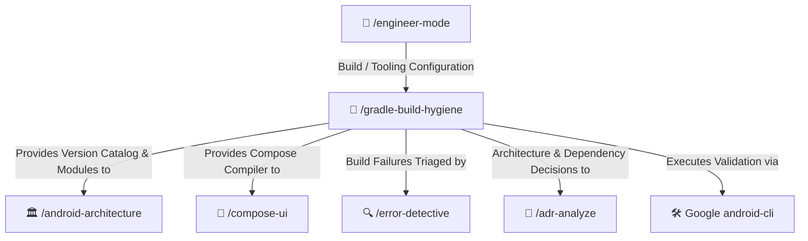

# 🐘 Gradle Build Hygiene Skill

Enforces Version Catalog (`libs.versions.toml`) governance, multi-module dependency rules, R8/ProGuard shrinking safety, and compile-time compatibility strictly grounded in official Google Android documentation without guesswork.

---

## 🧭 Connected Skills Architecture



---

## 📂 Subfolder Structure

| Path | Purpose | Description |
| :--- | :--- | :--- |
| [`SKILL.md`](./SKILL.md) | Agent Skill Definition | Core prompt instructions and entry points for AI agents. |
| [`instructions/guidelines.md`](./instructions/guidelines.md) | Agent Execution Protocol | Strict zero-guesswork rules, version catalog requirements, and multi-module dependency boundaries. |
| [`instructions/examples.md`](./instructions/examples.md) | Production Code Examples | Real-world `libs.versions.toml`, `build.gradle.kts` configuration, and ProGuard / R8 safety rules. |

---

## 🚀 How to Use

### 1. Direct Skill Activation
Trigger this skill whenever configuring project dependencies, creating new Gradle modules, upgrading Kotlin/AGP, or troubleshooting build script errors:
```text
/gradle-build-hygiene
```

### 2. Guided via Engineer Mode
Start through the adaptive interactive questionnaire:
```text
/engineer-mode
```
Select **Playbook 02 (Android Engineering)** or **Playbook 06 (Diagnostic & Build Remediation)**.

---

## 🔗 Related Skills

- [🏛️ Android Clean Architecture](../android-architecture/README.md)
- [🎨 Jetpack Compose UI](../compose-ui/README.md)
- [🔍 Error Detective](../../diagnostic-skills/error-detective/README.md)
- [📜 ADR Analyzer](../../diagnostic-skills/adr-analyze/README.md)
- [🏠 Master Suite README](../../README.md)
