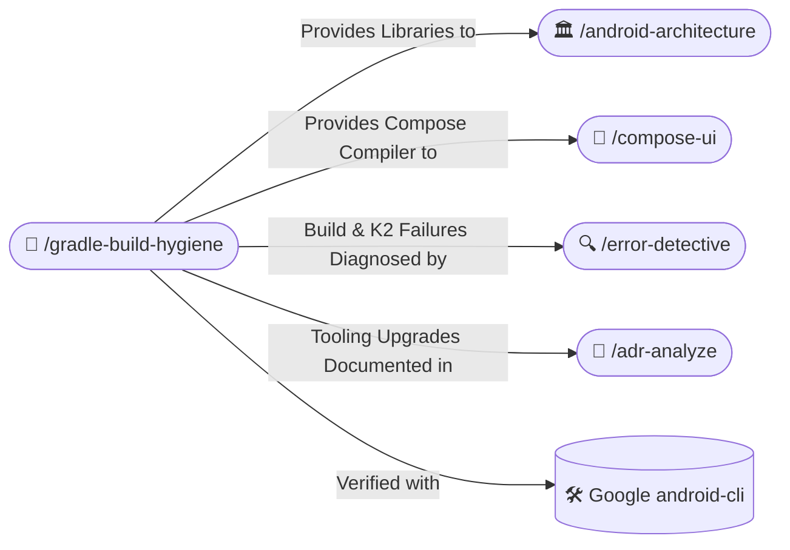

# 🐘 Gradle Build Hygiene & Configuration (/gradle-build-hygiene)

The **Gradle Build Hygiene Skill** governs build configurations, dependency versioning, and compilation optimizations across Android projects. It mandates that all Gradle and AGP configurations are strictly grounded in official Google documentation, eliminating guesswork, version mismatch regressions, and fragile build scripts.

---

## 🧭 Connected Skills & Routing



---

## 📚 1. Grounding in Official Google Documentation (No Guessing)

- **Official Sources Required**:
  - Android Gradle Plugin Release Notes: `https://developer.android.com/build/releases/gradle-plugin`
  - Compose to Kotlin Compiler Compatibility Map: `https://developer.android.com/jetpack/androidx/releases/compose-kotlin`
  - Google Maven Dependency Search: `https://maven.google.com`
- **Zero Hallucination Policy**:
  - Never invent unofficial plugin IDs, experimental DSL properties, or non-existent library versions.
  - Always verify that the Kotlin compiler version aligns with the Compose compiler plugin (especially Kotlin 2.0+ with the default Compose compiler Gradle plugin `org.jetbrains.kotlin.plugin.compose`).

---

## 📋 2. Centralized Version Catalog (`gradle/libs.versions.toml`)

Never declare hardcoded dependency strings (e.g. `"androidx.core:core-ktx:1.13.1"`) directly in `build.gradle.kts` files. All versions, libraries, bundles, and plugins must be registered inside `libs.versions.toml`:

```toml
[versions]
agp = "8.7.1"
kotlin = "2.0.21"
coreKtx = "1.13.1"
composeBom = "2024.10.00"
hilt = "2.52"
room = "2.6.1"
retrofit = "2.11.0"
turbine = "1.2.0"

[libraries]
androidx-core-ktx = { group = "androidx.core", name = "core-ktx", version.ref = "coreKtx" }
androidx-compose-bom = { group = "androidx.compose", name = "compose-bom", version.ref = "composeBom" }
androidx-compose-ui = { group = "androidx.compose.ui", name = "ui" }
androidx-compose-material3 = { group = "androidx.compose.material3", name = "material3" }
hilt-android = { group = "com.google.dagger", name = "hilt-android", version.ref = "hilt" }
hilt-compiler = { group = "com.google.dagger", name = "hilt-compiler", version.ref = "hilt" }
room-runtime = { group = "androidx.room", name = "room-runtime", version.ref = "room" }
room-compiler = { group = "androidx.room", name = "room-compiler", version.ref = "room" }
room-ktx = { group = "androidx.room", name = "room-ktx", version.ref = "room" }
turbine = { group = "app.cash.turbine", name = "turbine", version.ref = "turbine" }

[bundles]
compose = ["androidx-compose-ui", "androidx-compose-material3"]

[plugins]
android-application = { id = "com.android.application", version.ref = "agp" }
android-library = { id = "com.android.library", version.ref = "agp" }
kotlin-android = { id = "org.jetbrains.kotlin.android", version.ref = "kotlin" }
kotlin-compose = { id = "org.jetbrains.kotlin.plugin.compose", version.ref = "kotlin" }
hilt = { id = "com.google.dagger.hilt.android", version.ref = "hilt" }
```

### Consumption in `app/build.gradle.kts`:
```kotlin
plugins {
    alias(libs.plugins.android.application)
    alias(libs.plugins.kotlin.android)
    alias(libs.plugins.kotlin.compose)
    alias(libs.plugins.hilt)
}

dependencies {
    implementation(libs.androidx.core.ktx)
    implementation(platform(libs.androidx.compose.bom))
    implementation(libs.bundles.compose)
    implementation(libs.hilt.android)
    ksp(libs.hilt.compiler)
    testImplementation(libs.turbine)
}
```

---

## 🛡️ 3. R8 / ProGuard Keep Rules & Optimization

- Avoid broad wildcard rules that defeat code shrinking (e.g. NEVER use `-keep class com.example.** { *; }`).
- Keep rules must target only reflection boundaries, such as JNI native bindings or third-party serialization models that lack compile-time code generation.
- For Room: Configure explicit schema exports so migrations are verified during Gradle builds:
  ```kotlin
  ksp {
      arg("room.schemaLocation", "$projectDir/schemas")
  }
  ```
