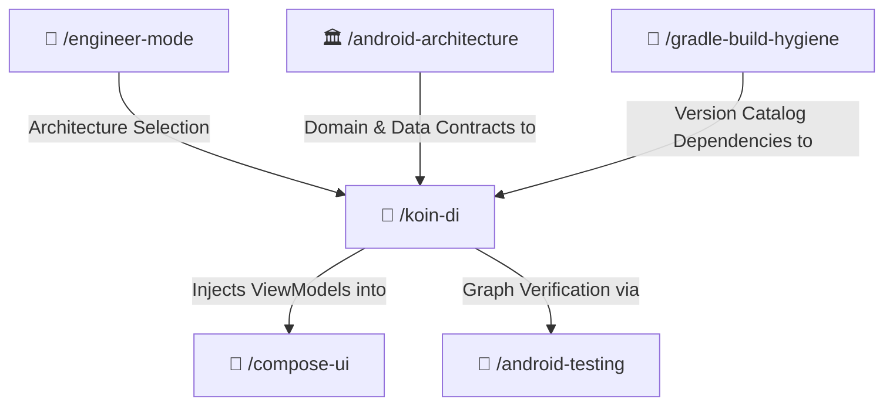

# 💉 Koin Dependency Injection Skill

Lightweight, modern Dependency Injection for Android, Jetpack Compose, and Kotlin Multiplatform using Koin. Enforces Constructor DSL (`singleOf`, `viewModelOf`, `factoryOf`), Compose consumption (`koinViewModel()`), layer module separation, Koin Annotations, and static graph verification grounded in official `insert-koin.io` documentation.

---

## 🧭 Connected Skills Architecture



---

## 📂 Subfolder Structure

| Path | Purpose | Description |
| :--- | :--- | :--- |
| [`SKILL.md`](./SKILL.md) | Agent Skill Definition | Core rules, Constructor DSL, Compose consumption, and anti-patterns. |
| [`instructions/guidelines.md`](./instructions/guidelines.md) | Agent Execution Protocol | Dependency setup, module decomposition, and graph verification rules. |
| [`instructions/examples.md`](./instructions/examples.md) | Production Code Examples | Real-world module definitions, Compose screen injection, Application initialization, and unit test verification. |

---

## 🚀 How to Use

### 1. Direct Skill Activation
Trigger this skill when setting up or refactoring dependency injection in Android or KMP:
```text
/koin-di
```

### 2. Guided via Engineer Mode
Start through the adaptive interactive questionnaire:
```text
/engineer-mode
```
Select **Playbook 04 (In-Depth Android Engineering)** and choose Koin as your DI engine.

---

## 🔗 Related Skills

- [🏛️ Android Architecture](../android-architecture/README.md)
- [🎨 Compose UI](../compose-ui/README.md)
- [🧪 Android Testing](../android-testing/README.md)
- [🐘 Gradle Build Hygiene](../gradle-build-hygiene/README.md)
- [🏠 Master Suite README](../../README.md)
