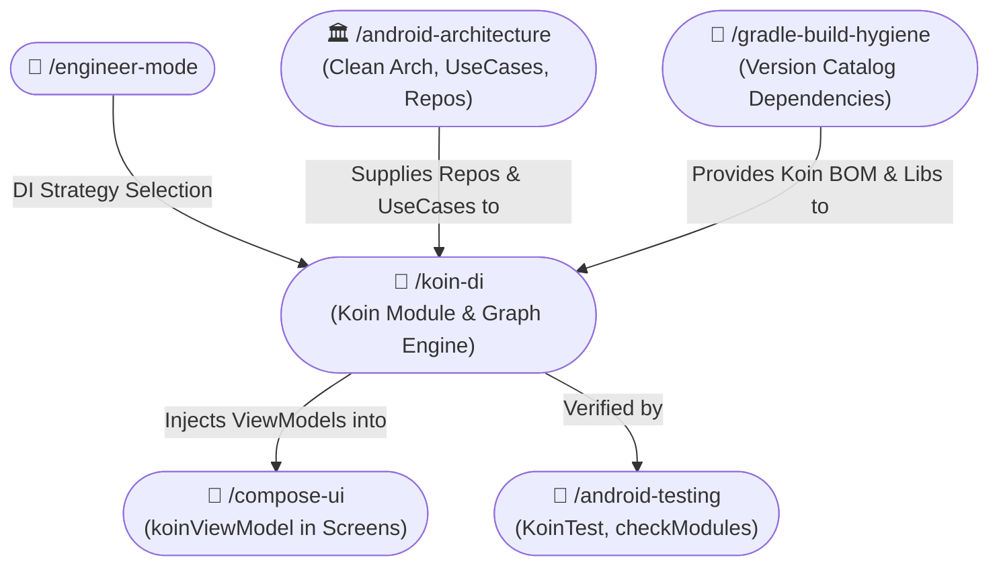

# 💉 Koin Dependency Injection Skill (/koin-di)

The **Koin DI Skill** delivers pragmatic, lightweight, and modern Dependency Injection for Android and Kotlin Multiplatform (KMP) applications. It enforces modern **Constructor DSL** (`singleOf`, `viewModelOf`, `factoryOf`), clean **module separation**, Jetpack Compose lifecycle-safe injection (`koinViewModel()`), and static architecture verification with `checkModules()` / `verify()`.

---

## 🧭 Connected Skills & Inter-Skill Routing



---

## 📚 1. Grounding in Official Documentation (insert-koin.io)

All Koin implementations must adhere to the latest official standards:
- **Koin Core & Constructor DSL**: `https://insert-koin.io/docs/reference/koin-core/dsl-constructor/`
- **Koin Compose & ViewModel**: `https://insert-koin.io/docs/reference/koin-android/compose/`
- **Koin Multiplatform Compose**: `https://insert-koin.io/docs/reference/koin-compose/viewmodel/`
- **Koin Annotations**: `https://insert-koin.io/docs/reference/koin-annotations/start/`
- **Testing & Graph Verification**: `https://insert-koin.io/docs/reference/koin-test/testing/`

---

## 🏗️ 2. Core Architecture Rules

### 1. Modern Constructor DSL (Zero `get()` Boilerplate)
- **Use `singleOf(::Impl)`** instead of manual `single { Impl(get(), get()) }`.
- **Use `bind<Interface>()`** when binding an implementation to its contract:
  ```kotlin
  singleOf(::UserRepositoryImpl) { bind<UserRepository>() }
  ```
- **Use `viewModelOf(::MyViewModel)`**:
  - Automatically handles constructor dependencies.
  - **NEVER** declare a ViewModel as `single` or `factory`! Always use `viewModel` or `viewModelOf`.
- **Use `factoryOf(::MyUseCase)`** for transient, stateless domain interactors.

### 2. Composable Consumption Rule
- In Compose UI container screens, place `modifier: Modifier = Modifier` as the **very first top parameter**, followed by `viewModel: ProfileViewModel = koinViewModel()`:
  ```kotlin
  @Composable
  fun ProfileScreen(
      modifier: Modifier = Modifier, // ✅ Declaration: VERY TOP parameter
      viewModel: ProfileViewModel = koinViewModel(),
  ) {
      val uiState by viewModel.uiState.collectAsStateWithLifecycle()
      ProfileContent(
          state = uiState,
          modifier = modifier, // ✅ Call site: VERY BOTTOM argument
      )
  }
  ```
- **Never call `koinViewModel()` inside event lambdas or click listeners** (e.g. `onClick = { koinViewModel() }`). Always invoke directly in the Composable function header or body.

### 3. Modular Module Partitioning
Split Koin modules by layer and domain:
- `networkModule`: Retrofit, OkHttpClient, Json parsers.
- `databaseModule`: Room database, DAOs.
- `repositoryModule`: Repository implementations bound to domain interfaces.
- `useCaseModule`: Factory UseCases / Interactors.
- `viewModelModule`: Presentation ViewModels.

Combine them in an `appModules` list:
```kotlin
val appModules = listOf(
    networkModule,
    databaseModule,
    repositoryModule,
    useCaseModule,
    viewModelModule,
)
```

### 4. Static Graph Verification (`checkModules` / `verify`)
Prevent runtime `NoBeanDefFoundException` crashes by including an automated test that checks the Koin graph before deployment:
```kotlin
class KoinGraphVerificationTest : KoinTest {
    @Test
    fun verifyKoinGraph() {
        appModules.verify(
            extraTypes = listOf(
                Context::class,
                SavedStateHandle::class,
            )
        )
    }
}
```

---

## 🚫 3. Anti-Patterns to Prevent

| Anti-Pattern | Why It Breaks | Correct Pattern |
|:---|:---|:---|
| `single { MyViewModel(get()) }` | Breaks ViewModel lifecycle, survives past screen destruction, leaks memory. | `viewModelOf(::MyViewModel)` |
| `val repo = get<UserRepository>()` in Composables | Bypasses Jetpack Compose state & ViewModel lifecycle. | Inject into ViewModel; expose `StateFlow` to UI. |
| Global mutable `val koin = ...` | Defeats test isolation and encapsulation. | Initialize via `startKoin` in `Application.onCreate()`. |
| Unverified module definitions | Runtime crashes when a dependency is missing. | Verify with `verify()` in unit tests. |
