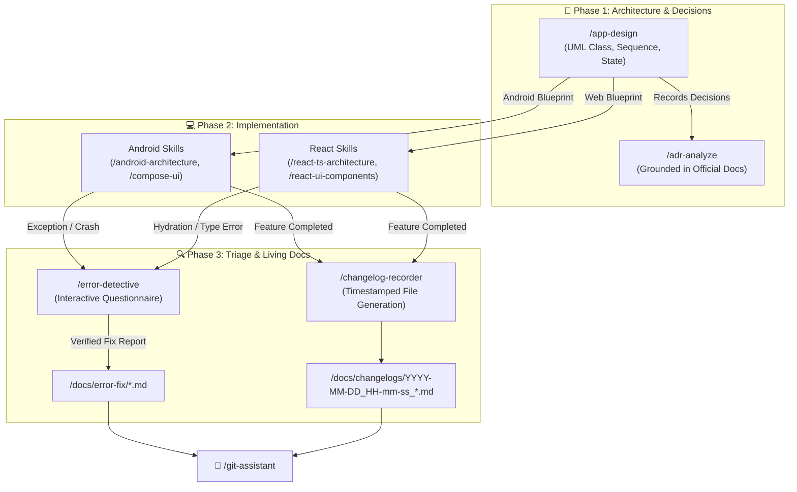

# 🔍 Diagnostic, ADR, App Design & Changelog Skills

Welcome to the **Diagnostic, ADR, App Design & Changelog Skills** documentation. This module contains the analytical, documentation, and architectural engine of the **AI-Engineer-Skills** suite.

---

## 🧭 Navigation & Connected Skills Hub

| Hub Directory | Domain | Direct Link |
|---|---|---|
| 🏠 **Root Hub** | Full Suite Overview & Universal Installer | [Root README](../README.md) |
| 🚀 **Engineer Mode** | Master Entry Point & Adaptive Playbook Router | [Engineer Mode README](../engineer-mode/README.md) |
| 📱 **Android Skills** | Clean Arch, Compose, MapLibre, Testing, Gradle | [Android README](../android-skills/README.md) |
| ⚛️ **React TS Skills** | Next.js, Vite, TypeScript, Tailwind, Web Vitals | [React TS README](../react-ts-skills/README.md) |
| 🌿 **Git Skills** | Branching, Safe Rebase, Conflict Resolution, PRs | [Git README](../git-skills/README.md) |

---

## 🗂️ Skills in this Directory

| Skill Directory | Slash Command | Primary Purpose | Deliverables |
|---|---|---|---|
| [**`error-detective/`**](./error-detective/README.md) | `/error-detective`, `/error-detection` | Interactive error triage (asks error type & module or auto-analyzes), root cause fix, post-mortem generation. | `/docs/error-fix/*.md` with Mermaid Pie Score |
| [**`adr-analyze/`**](./adr-analyze/README.md) | `/adr-analyze` | Architecture Decision Records grounded in official documentation (Google, React, W3C/MDN). | `/docs/adr/ADR-XXXX-*.md` and index |
| [**`app-design/`**](./app-design/README.md) | `/app-design` | Visual system modeling, UML class, sequence, and state diagrams, use case specifications in English. | `/docs/architecture/*.md` |
| [**`changelog-recorder/`**](./changelog-recorder/README.md) | `/changelog-recorder`, `/changelog` | Detailed, timestamped changelog generation with strict naming (`YYYY-MM-DD_HH-mm-ss_<title>.md`). | `/docs/changelogs/` and index |

---

## 🔄 Diagnostic & Architecture Lifecycle



---

## ⚡ How to Trigger

### 1. Error Detective (`/error-detective`)
```text
/error-detective
```
*Interactively asks error type (crash, build, ANR, hydration, network) and affected module.*

### 2. ADR Analyze (`/adr-analyze`)
```text
/adr-analyze evaluate Room vs DataStore for offline sync referencing Google docs
```

### 3. App Design (`/app-design`)
```text
/app-design generate UML class and sequence diagrams for our payment module in English
```

### 4. Changelog Recorder (`/changelog-recorder` or `/changelog`)
```text
/changelog record our Clean Architecture migration in docs/changelogs/ with full verification details
```
