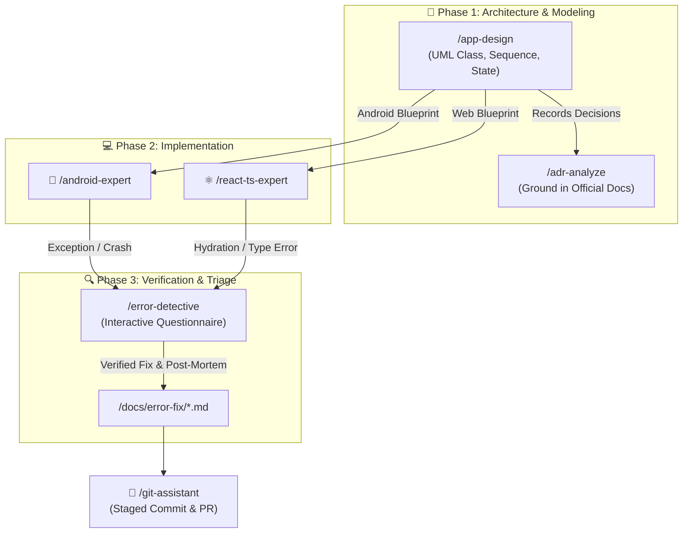

# 🔍 Diagnostic, ADR & App Design Skills

Welcome to the **Diagnostic, ADR & App Design Skills** documentation. This module contains the analytical and architectural foundation of the **AI-Engineer-Skills** suite, providing automated error triage, evidence-based ADR creation, and visual UML system modeling.

---

## 🧭 Navigation & Connected Skills Hub

| Hub Directory | Domain | Direct Link |
|---|---|---|
| 🏠 **Root Hub** | Full Suite Overview & Installer | [Root README](../README.md) |
| 🚀 **Engineer Mode** | Master Entry Point & Playbook Router | [Engineer Mode README](../engineer-mode/README.md) |
| 📱 **Android Skills** | Kotlin, Compose, Clean Architecture, Google android-cli | [Android README](../android-skills/README.md) |
| ⚛️ **React TS Skills** | Next.js, Vite, TypeScript, Tailwind, Web Vitals | [React TS README](../react-ts-skills/README.md) |
| 🌿 **Git Skills** | Branching, Safe Rebase, Conflict Resolution, PRs | [Git README](../git-skills/README.md) |

---

## 🗂️ Skills in this Directory

| Skill | Slash Commands | Primary Purpose | Deliverables |
|---|---|---|---|
| **Error Detective** | `/error-detective`, `/error-detection` | Interactive error triage, root cause analysis, fix generation | `/docs/error-fix/*.md` with Mermaid Pie Score |
| **ADR Analyze** | `/adr-analyze` | Captures decisions, references official vendor documentation | `/docs/adr/*.md` & index table |
| **App Design** | `/app-design` | UML class, sequence, and state diagrams, use case specs | `/docs/architecture/*.md` in English |

---

## 🔄 Diagnostic & Architecture Lifecycle



---

## ⚡ How to Trigger

### 1. Error Detective (`/error-detective` or `/error-detection`)
```text
/error-detective
```
*Triggers the interactive diagnostic questionnaire asking for error type and affected module.*

```text
/error-detective analyze the crash occurring in PaymentCheckoutActivity when card expires
```

### 2. ADR Analyze (`/adr-analyze`)
```text
/adr-analyze evaluate migrating local preferences from SharedPreferences to DataStore
```
```text
/adr-analyze document our state management strategy using TanStack Query in /docs/adr/
```

### 3. App Design (`/app-design`)
```text
/app-design generate a UML class diagram and sequence flow for our Android chat feature
```
```text
/app-design model the offline-first synchronization engine with use case specifications
```

---

## 📑 Artifact Locations

All diagnostic and design outputs are stored cleanly in your project repository:
- **Error Resolutions**: `<project-root>/docs/error-fix/YYYY-MM-DD-<slug>.md`
- **Architecture Decision Records**: `<project-root>/docs/adr/ADR-XXXX-<slug>.md`
- **System Models & UML**: `<project-root>/docs/architecture/<feature>-design.md`
