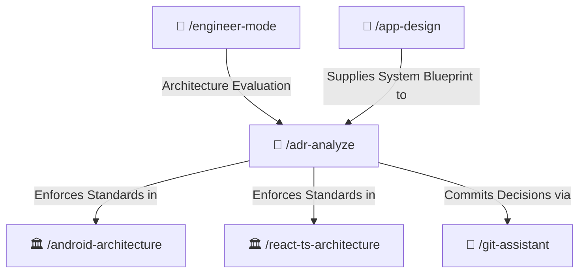

# 📜 Architecture Decision Record (ADR) Skill

Captures, evaluates, and documents significant architectural decisions across Android and Web projects. Ensures technical choices are systematically reasoned with trade-offs, grounded in official documentation (Google, React, W3C, MDN), and archived in standardized MADR format in `/docs/adr/`.

---

## 🧭 Connected Skills Architecture



---

## 📂 Subfolder Structure

| Path | Purpose | Description |
| :--- | :--- | :--- |
| [`SKILL.md`](./SKILL.md) | Agent Skill Definition | Core instructions and triggers for MADR evaluation. |
| [`instructions/guidelines.md`](./instructions/guidelines.md) | Agent Execution Protocol | Grounding in official documentation, MADR formatting, and index table maintenance. |
| [`instructions/examples.md`](./instructions/examples.md) | Production Documentation Example | Real-world MADR record in `/docs/adr/` with Mermaid diagram. |

---

## 🚀 How to Use

### 1. Direct Skill Activation
Trigger this skill whenever making technology choices, major refactors, or layer restructuring:
```text
/adr-analyze
```

### 2. Guided via Engineer Mode
Start through the adaptive interactive questionnaire:
```text
/engineer-mode
```
Select **Playbook 01 (Architecture Blueprint & System Design)**.

---

## 🔗 Related Skills

- [📐 App Design](../app-design/README.md)
- [🏛️ Android Architecture](../../android-skills/android-architecture/README.md)
- [🏛️ React Clean Architecture](../../react-ts-skills/react-ts-architecture/README.md)
- [🌿 Git Assistant](../../git-skills/git-assistant/README.md)
- [🏠 Master Suite README](../../README.md)
