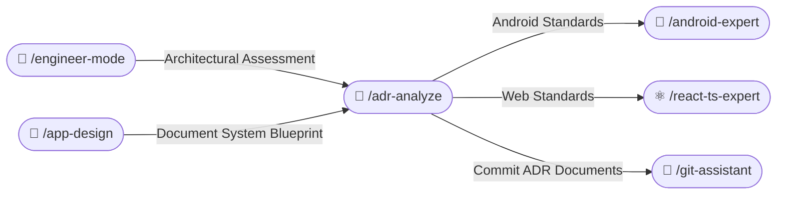
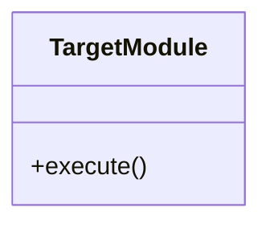

# 📜 Architecture Decision Record Skill (/adr-analyze)

The **ADR Analyze Skill** captures, evaluates, and documents significant architectural decisions across Android and Web projects. It ensures all technical decisions are systematically reasoned, weighed with pros and cons, and grounded directly in official documentation.

---

## 🧭 Connected Skills & Inter-Skill Routing



---

## 🎯 1. Detection of Architectural Shifts

Trigger ADR creation whenever:
1. **Introducing New Technologies**: Adding major libraries or frameworks (e.g. Room vs SQLDelight, Zustand vs TanStack Store).
2. **Structural / Layering Refactors**: Splitting multi-module architectures, modifying Clean Architecture rules, adopting new routing models.
3. **State & Concurrency Paradigms**: Migrating from LiveData to StateFlow, or Redux to Server Actions.
4. **Data Persistence Strategies**: Adopting DataStore over SharedPreferences, or IndexedDB over LocalStorage.

---

## 📚 2. Official Documentation Grounding (Mandatory)

Every ADR must reference authoritative vendor documentation:
- **Android**:
  - Official Architecture Guide: `https://developer.android.com/topic/architecture`
  - Jetpack Compose Guidelines: `https://developer.android.com/develop/ui/compose`
  - Kotlin Language Specs: `https://kotlinlang.org/docs/`
- **React & Web**:
  - Official React Documentation: `https://react.dev`
  - TypeScript Official Handbook: `https://www.typescriptlang.org/docs/`
  - W3C Web Standards & MDN: `https://developer.mozilla.org`

---

## 📝 3. MADR Record Generation (`/docs/adr/`)

Generate structured records following the Markdown Architectural Decision Record (MADR) format in:
`<project-root>/docs/adr/ADR-<NUMBER>-<title-in-kebab-case>.md`

### MADR Template:
```markdown
# ADR-<NUMBER>: [Title in Imperative Mood, e.g. Adopt Room for Offline Caching]

- **Status**: [Proposed | Accepted | Rejected | Superseded by ADR-XXXX]
- **Date**: YYYY-MM-DD
- **Author**: AI Engineering Agent / Developer
- **Technical Story**: [Link to issue / user story]

## Context and Problem Statement
[Describe the engineering challenge, technical constraints, and why a decision is necessary.]

## Decision Drivers
1. [Driver 1, e.g. Must support offline querying with type-safe migrations]
2. [Driver 2, e.g. Minimal memory footprint and strong compile-time verification]

## Considered Options
1. Option 1: [Name]
2. Option 2: [Name]

## Decision Outcome
Chosen Option: **[Option Name]**, because [justification grounded in official documentation].

### Official Documentation Citations
- [Official Source Title](https://developer.android.com/...) - "Quote or summary of official recommendation"

## Pros and Cons of the Options

### [Option 1]
- ✅ Good, because [argument]
- ❌ Bad, because [argument]

### [Option 2]
- ✅ Good, because [argument]
- ❌ Bad, because [argument]

## Architectural Blueprint (Mermaid Diagram)


## Consequences
- **Positive**: [Positive impact on velocity, testability, or maintainability]
- **Negative / Risks**: [Trade-offs accepted and how they are mitigated]
```

---

## 📑 4. ADR Registry Index Maintenance

Whenever a new ADR is generated, automatically update the master index table in:
`<project-root>/docs/adr/README.md`

| ADR ID | Title | Status | Date | Official Reference |
|---|---|---|---|---|
| [ADR-0001](ADR-0001-offline-caching.md) | Adopt Room for Offline Caching | `Accepted` | 2026-10-22 | Android Architecture Guide |
