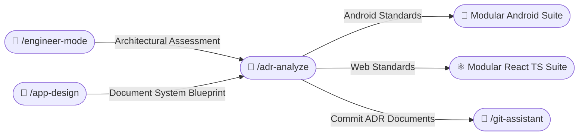
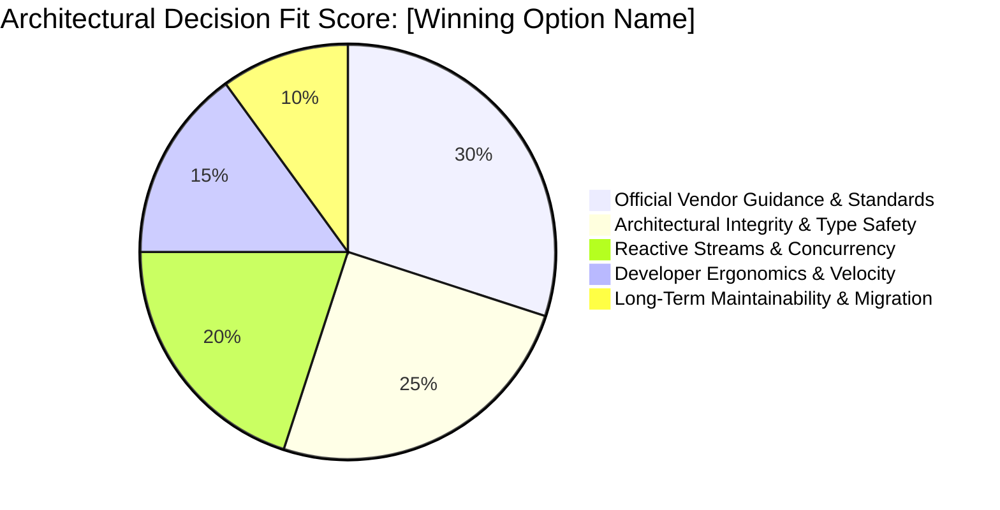
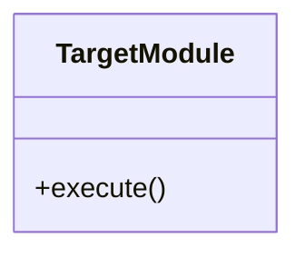

# 📜 Architecture Decision Record Skill (/adr-analyze)

The **ADR Analyze Skill** captures, evaluates, and documents significant architectural decisions across Android and Web projects. It ensures all technical decisions are systematically reasoned, weighed with pros and cons, grounded directly in official documentation, and presented with an immediate **executive summary** and **visual Mermaid pie chart scoring** before the in-depth technical analysis.

---

## 🧭 Connected Skills & Inter-Skill Routing



---

## 🎯 1. Detection of Architectural Shifts

Trigger ADR creation whenever:
1. **Introducing New Technologies**: Adding major libraries or frameworks (e.g. Room vs SQLDelight, Zustand vs TanStack Store).
2. **Structural / Layering Refactors**: Splitting multi-module architectures, modifying Clean Architecture rules, adopting new routing models.
3. **State & Concurrency Paradigms**: Migrating from LiveData to StateFlow, or Redux to Server Actions.
4. **Data Persistence Strategies**: Adopting DataStore over SharedPreferences, or IndexedDB over LocalStorage.

---

## 📚 2. Official Documentation Grounding (Mandatory)

Every ADR must reference authoritative vendor documentation:
- **Android**:
  - Official Architecture Guide: `https://developer.android.com/topic/architecture`
  - Jetpack Compose Guidelines: `https://developer.android.com/develop/ui/compose`
  - Kotlin Language Specs: `https://kotlinlang.org/docs/`
- **React & Web**:
  - Official React Documentation: `https://react.dev`
  - TypeScript Official Handbook: `https://www.typescriptlang.org/docs/`
  - W3C Web Standards & MDN: `https://developer.mozilla.org`

---

## 📝 3. MADR Record Generation (`/docs/adr/`)

Generate structured records following the Markdown Architectural Decision Record (MADR) format in:
`<project-root>/docs/adr/ADR-<NUMBER>-<title-in-kebab-case>.md`

### ⚡ Structure Rule: Executive Summary & Visual Scoring First
To ensure clarity for architects, developers, and stakeholders, every ADR **MUST** place:
1. **Executive Summary** (2-4 sentence overview of problem, chosen path, and core justification)
2. **Mermaid Pie Chart Score** (Visual breakdown of the selected option's architectural fit)
3. **Detailed Multi-Criteria Scoring Table** (Quantitative side-by-side comparison across options)

**Immediately below the header metadata, BEFORE the deep narrative and blueprint.**

### MADR Template:
```markdown
# ADR-<NUMBER>: [Title in Imperative Mood, e.g. Adopt Room for Offline Caching]

- **Status**: [Proposed | Accepted | Rejected | Superseded by ADR-XXXX]
- **Date**: YYYY-MM-DD
- **Author**: Lead AI Architect / Developer
- **Technical Story**: [Link to issue / user story / ticket]

---

## 📋 Executive Summary
[A concise 2-4 sentence executive overview explaining the architectural problem, the evaluated choices, the winning option, and the primary business/technical justification. Stakeholders can read this single section to understand what was decided and why.]

---

## 📊 Architectural Evaluation & Scoring

### 1. Decision Fit Score (Mermaid Pie Chart)
Visual distribution of the winning option's architectural fit across evaluation dimensions:



### 2. Multi-Criteria Scoring Matrix
Quantitative side-by-side comparison across all considered options:

| Evaluation Criteria | Weight | [Option A (Winner)] | [Option B] | [Option C] | Evaluation Rationale |
|:---|:---:|:---:|:---:|:---:|:---|
| **Architecture & Layering** | 25% | **9.5 / 10** | 6.0 / 10 | 4.0 / 10 | Clean separation of concerns, repository abstraction |
| **Official Guidance Conformance** | 25% | **10.0 / 10** | 4.0 / 10 | 2.0 / 10 | First-class endorsement in official vendor guidelines |
| **Type Safety & Reliability** | 20% | **9.5 / 10** | 5.0 / 10 | 7.0 / 10 | Compile-time verification prevents runtime crashes |
| **Developer Velocity & Ergonomics** | 15% | **8.5 / 10** | 6.0 / 10 | 8.5 / 10 | Boilerplate vs query writing speed |
| **Maintainability & Testing** | 15% | **9.0 / 10** | 4.5 / 10 | 5.0 / 10 | Automated schema migrations & test harnesses |
| **Overall Weighted Score** | **100%** | **🏆 9.35 / 10** | **5.15 / 10** | **4.90 / 10** | **Selected Winner: [Option A]** |

---

## 🔍 In-Depth Technical Analysis

### Context and Problem Statement
[Describe the engineering challenge, technical constraints, and why a decision is necessary.]

### Decision Drivers
1. [Driver 1, e.g. Must support offline querying with type-safe migrations]
2. [Driver 2, e.g. Minimal memory footprint and strong compile-time verification]

### Considered Options
1. **[Option 1 Name]**: [Brief summary]
2. **[Option 2 Name]**: [Brief summary]
3. **[Option 3 Name]**: [Brief summary]

### Decision Outcome
Chosen Option: **[Option Name]**, because [justification grounded in official documentation].

#### Official Documentation Citations
- [Official Source Title](https://developer.android.com/...) - "Quote or summary of official recommendation"

### Pros and Cons of the Options

#### [Option 1]
- ✅ Good, because [argument]
- ❌ Bad, because [argument]

#### [Option 2]
- ✅ Good, because [argument]
- ❌ Bad, because [argument]

### Architectural Blueprint (Mermaid Diagram)


### Consequences
- **Positive**: [Positive impact on velocity, testability, or maintainability]
- **Negative / Risks**: [Trade-offs accepted and how they are mitigated]
```

---

## 📑 4. ADR Registry Index Maintenance

Whenever a new ADR is generated, automatically update the master index table in:
`<project-root>/docs/adr/README.md`

| ADR ID | Title | Status | Date | Official Reference |
|---|---|---|---|---|
| [ADR-0001](ADR-0001-offline-caching.md) | Adopt Room for Offline Caching | `Accepted` | 2026-10-22 | Android Architecture Guide |
