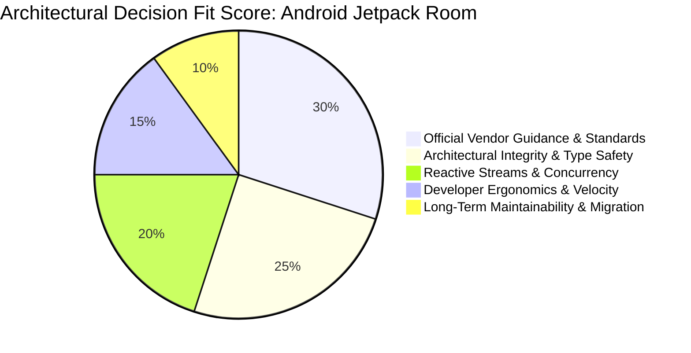
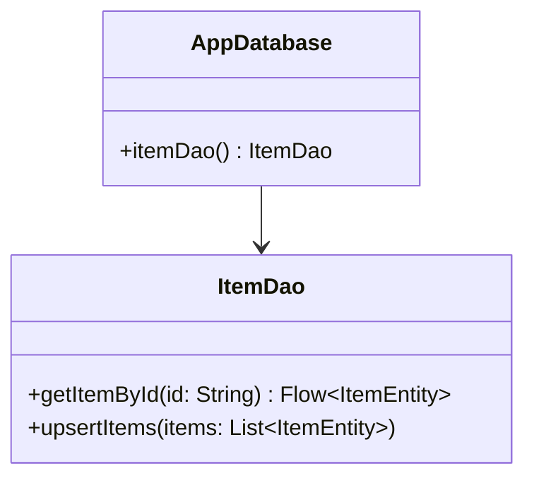

# 📜 ADR Record Examples

Reference example of a generated Architectural Decision Record.

---

## Sample Record: `docs/adr/ADR-0001-adopt-room-for-offline-caching.md`

```markdown
# ADR-0001: Adopt Room Persistence Library for Offline Caching

- **Status**: Accepted
- **Date**: 2026-10-22
- **Author**: Lead AI Architect
- **Technical Story**: Offline data persistence requirement for user catalog

---

## 📋 Executive Summary
The application requires persistent, local relational data storage with reactive synchronization to support offline-first catalog browsing. We evaluated **Android Jetpack Room**, **Raw SQLiteOpenHelper**, and **Preferences DataStore**. We have chosen **Room** because it provides compile-time verification of SQL queries, native Kotlin Coroutines `Flow` reactive streams, and official Google AGP lifecycle support, achieving a **9.35 / 10** overall weighted architectural fit score.

---

## 📊 Architectural Evaluation & Scoring

### 1. Decision Fit Score (Mermaid Pie Chart)
Visual distribution of Room's architectural fit across core evaluation criteria:



### 2. Multi-Criteria Scoring Matrix
Quantitative side-by-side evaluation across candidate persistence strategies:

| Evaluation Criteria | Weight | Jetpack Room (Chosen) | Raw SQLite | Preferences DataStore | Evaluation Rationale |
|:---|:---:|:---:|:---:|:---:|:---|
| **Architecture & Layering** | 25% | **9.5 / 10** | 6.0 / 10 | 4.0 / 10 | Clean DAO repository abstraction; DataStore lacks relational query support |
| **Official Guidance Conformance** | 25% | **10.0 / 10** | 4.0 / 10 | 3.0 / 10 | Explicitly recommended by Google Android Guide to App Architecture |
| **Type Safety & Reliability** | 20% | **9.5 / 10** | 4.0 / 10 | 7.0 / 10 | Compile-time SQL syntax verification prevents runtime query crashes |
| **Developer Velocity & Ergonomics** | 15% | **8.5 / 10** | 5.0 / 10 | 8.5 / 10 | Eliminates boilerplate Cursor parsing and manual transaction boilerplate |
| **Maintainability & Testing** | 15% | **9.0 / 10** | 4.5 / 10 | 6.0 / 10 | Automated migration tests and KSP-generated schema exports |
| **Overall Weighted Score** | **100%** | **🏆 9.35 / 10** | **4.75 / 10** | **5.25 / 10** | **Selected Winner: Android Jetpack Room** |

---

## 🔍 In-Depth Technical Analysis

### Context and Problem Statement
The application requires reliable offline data storage with background synchronization. We must evaluate whether to use raw SQLite, Room, or DataStore.

### Decision Drivers
1. Compile-time SQL verification to prevent runtime SQL syntax errors.
2. Full reactive stream support via Kotlin Coroutines `Flow`.
3. Seamless integration with Android Jetpack Architecture.

### Considered Options
1. **Android Jetpack Room**: Official abstraction layer over SQLite with compile-time checks.
2. **Raw SQLiteOpenHelper**: Manual SQL execution using raw database cursors.
3. **Preferences DataStore**: Key-value data store (insufficient for complex relational queries).

### Decision Outcome
Chosen Option: **Android Jetpack Room**, because it provides compile-time verification of SQL queries, first-class Kotlin Coroutines Flow emissions, and automated schema migration verification via KSP.

#### Official Documentation Citations
- [Android Developers: Save data in a local database using Room](https://developer.android.com/training/data-storage/room) - "The Room persistence library provides an abstraction layer over SQLite to allow fluent database access while harnessing the full power of SQLite."

### Pros and Cons of the Options

#### Android Jetpack Room
- ✅ Good, compile-time query syntax checking.
- ✅ Good, built-in migration test helpers and schema exports.
- ✅ Good, native Kotlin Coroutines `Flow` observable queries.
- ❌ Bad, requires KSP annotation processor configuration.

#### Raw SQLite
- ✅ Good, zero external dependencies.
- ❌ Bad, no compile-time query checking; high risk of runtime schema mismatches.
- ❌ Bad, manual cursor-to-model mapping introduces boilerplate and leak risks.

### Architectural Blueprint (Mermaid Diagram)


### Consequences
- **Positive**: Eliminates runtime SQL syntax bugs and provides robust offline reactive data streams.
- **Negative / Risks**: Incremental build times slightly increased by KSP annotation processing.
```
