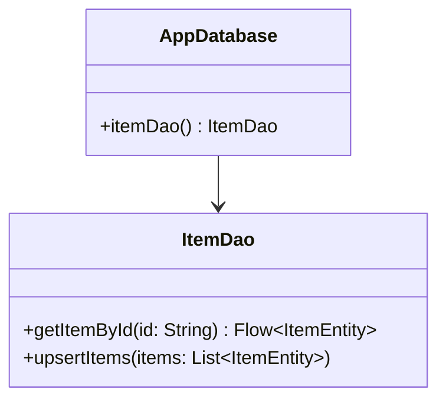

# 📜 ADR Record Examples

Reference example of a generated Architectural Decision Record.

---

## Sample Record: `docs/adr/ADR-0001-adopt-room-for-offline-caching.md`

```markdown
# ADR-0001: Adopt Room Persistence Library for Offline Caching

- **Status**: Accepted
- **Date**: 2026-10-22
- **Author**: Lead AI Architect
- **Technical Story**: Offline data persistence requirement for user catalog

## Context and Problem Statement
The application requires reliable offline data storage with background synchronization. We must evaluate whether to use raw SQLite, Room, or DataStore.

## Decision Drivers
1. Compile-time SQL verification to prevent runtime SQL syntax errors.
2. Full reactive stream support via Kotlin Coroutines `Flow`.
3. Seamless integration with Android Jetpack Architecture.

## Considered Options
1. **Android Jetpack Room**
2. **Raw SQLiteOpenHelper**
3. **Preferences DataStore** (insufficient for relational queries)

## Decision Outcome
Chosen Option: **Android Jetpack Room**, because it provides compile-time verification of SQL queries, first-class Kotlin Coroutines Flow emissions, and automated schema migration verification via KSP.

### Official Documentation Citations
- [Android Developers: Save data in a local database using Room](https://developer.android.com/training/data-storage/room) - "The Room persistence library provides an abstraction layer over SQLite to allow fluent database access while harnessing the full power of SQLite."

## Pros and Cons of the Options

### Android Jetpack Room
- ✅ Good, compile-time query syntax checking.
- ✅ Good, built-in migration test helpers.
- ❌ Bad, requires KSP annotation processor configuration.

### Raw SQLite
- ✅ Good, zero dependencies.
- ❌ Bad, no compile-time query checking; high risk of runtime schema mismatches.

## Architectural Blueprint (Mermaid Diagram)


## Consequences
- **Positive**: Eliminates runtime SQL syntax bugs and provides robust offline reactive data streams.
- **Negative / Risks**: Incremental build times slightly increased by KSP annotation processing.
```
