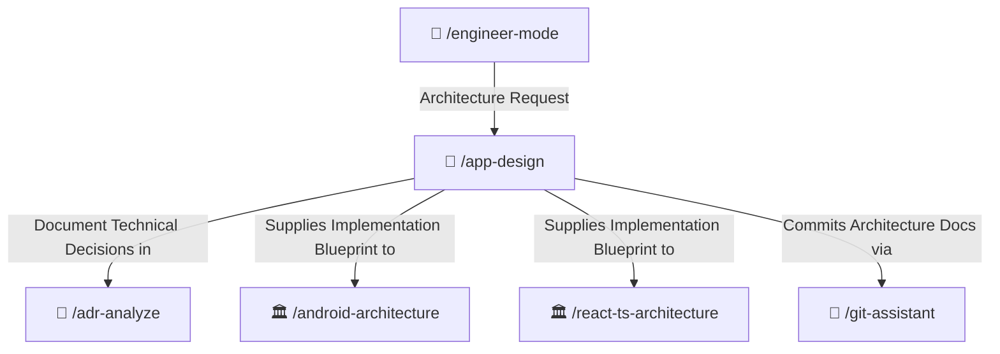

# 📐 App Design Skill

Enterprise software design and visual modeling specialist. Translates functional requirements into UML class diagrams, sequence flows, use case specifications, state machines, and C4 architecture blueprints in `/docs/architecture/` in clear, professional English.

---

## 🧭 Connected Skills Architecture



---

## 📂 Subfolder Structure

| Path | Purpose | Description |
| :--- | :--- | :--- |
| [`SKILL.md`](./SKILL.md) | Agent Skill Definition | Core instructions and system modeling prompt questionnaire. |
| [`instructions/guidelines.md`](./instructions/guidelines.md) | Agent Execution Protocol | Modeling protocols, UML rules, and file naming standards. |
| [`instructions/examples.md`](./instructions/examples.md) | Production Documentation Example | Real-world architecture document in `/docs/architecture/` with UML diagrams. |

---

## 🚀 How to Use

### 1. Direct Skill Activation
Trigger this skill whenever designing new subsystems, planning database schemas, or modeling interaction flows:
```text
/app-design
```

### 2. Guided via Engineer Mode
Start through the adaptive interactive questionnaire:
```text
/engineer-mode
```
Select **Playbook 01 (Architecture Blueprint & System Design)**.

---

## 🔗 Related Skills

- [📜 ADR Analyzer](../adr-analyze/README.md)
- [📱 Android Architecture](../../android-skills/android-architecture/README.md)
- [🏛️ React Clean Architecture](../../react-ts-skills/react-ts-architecture/README.md)
- [🌿 Git Assistant](../../git-skills/git-assistant/README.md)
- [🏠 Master Suite README](../../README.md)
