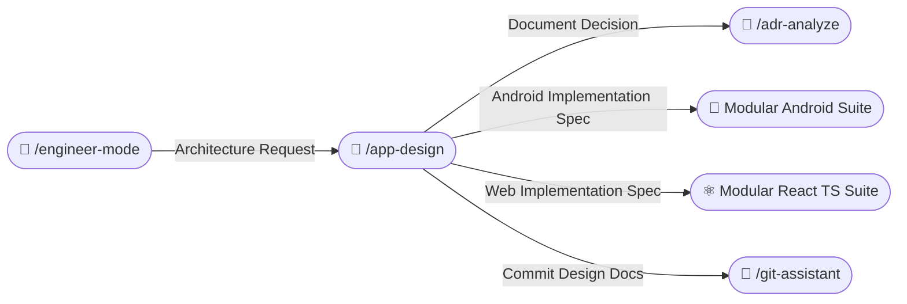
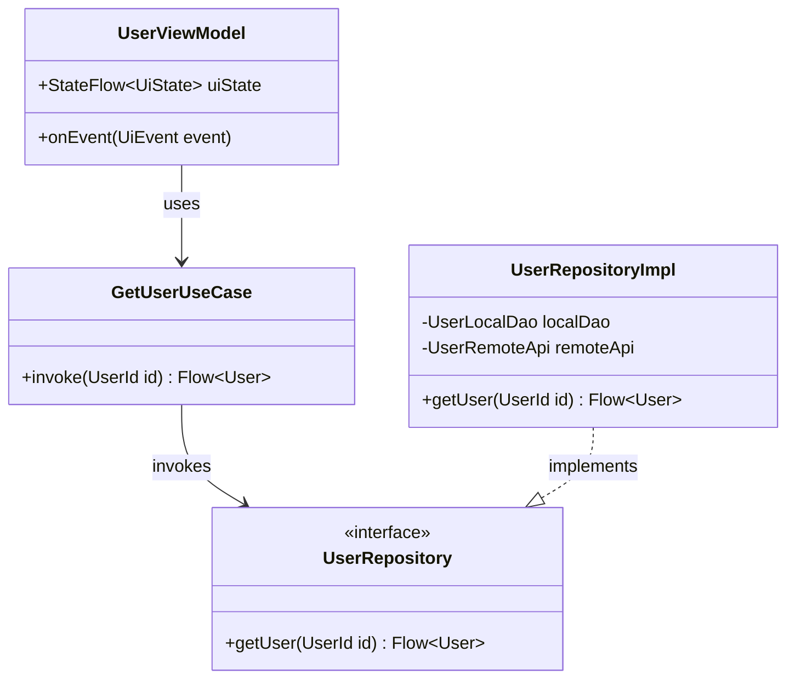
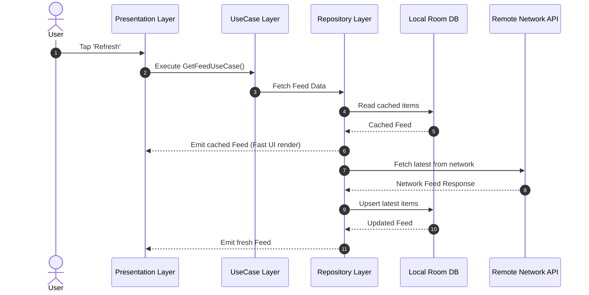
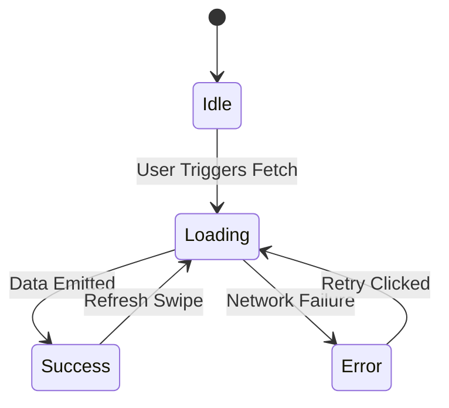

# 📐 App Design Skill (/app-design)

The **App Design Skill** translates user requirements into enterprise-grade software architecture blueprints, UML diagrams, use case specifications, and component relationship models. It ensures systems are modeled cleanly before implementation begins.

---

## 🧭 Connected Skills & Inter-Skill Routing



---

## 🎯 1. Interactive Modeling Questionnaire

When `/app-design` is invoked, query the user to understand system boundaries:

```markdown
### 📐 App Design: System Modeling Questionnaire

1. **What is the primary scope of the design?**
   - [A] New Feature / Subsystem (e.g. Chat, Checkout, In-app Purchase)
   - [B] Full Application Architecture (Monolith to Clean Architecture)
   - [C] Data Layer & Offline Sync Engine (Room / SQL / IndexedDB)
   - [D] UI State Machine & Interaction Flows

2. **Which target platform?**
   - [A] Android (Kotlin, Jetpack Compose, Clean Architecture)
   - [B] Web (React 19, TypeScript, Next.js / Vite)
   - [C] Cross-Platform / Fullstack
```

---

## 📊 2. UML Diagrams & Visual Modeling Standards

All diagrams must use valid GitHub Flavored Markdown **Mermaid** blocks:

### A. UML Class Diagram (`classDiagram`)
Models layer boundaries, dependency inversion, and entity fields:


### B. UML Sequence Diagram (`sequenceDiagram`)
Models dynamic interactions and async execution flows:


### C. UI State Machine Diagram (`stateDiagram-v2`)
Models valid screen states and lifecycle transitions:


---

## 📋 3. Use Case Specifications

Every design document must include structured use case tables:

| Field | Specification |
|---|---|
| **Use Case ID** | `UC-001: Offline Feed Retrieval` |
| **Primary Actor** | End User / Mobile App Client |
| **Pre-Conditions** | App launched; local database initialized. |
| **Trigger** | User navigates to Home Feed screen. |
| **Main Scenario (Happy Path)** | 1. UI requests feed from `GetFeedUseCase`.<br/>2. Repository emits cached data immediately.<br/>3. Repository launches background network sync.<br/>4. Database updates; UI observes fresh data. |
| **Alternative Scenario** | Network unavailable ➔ UI renders cached data with an offline snackbar notification. |
| **Post-Conditions** | Feed displayed; last-sync timestamp updated. |

---

## 📁 4. Architecture Documentation Output

Persist design documents in:
`<project-root>/docs/architecture/<feature-slug>-design.md`

All documentation, UML models, and use case specifications must be written in **clear, professional English**.
