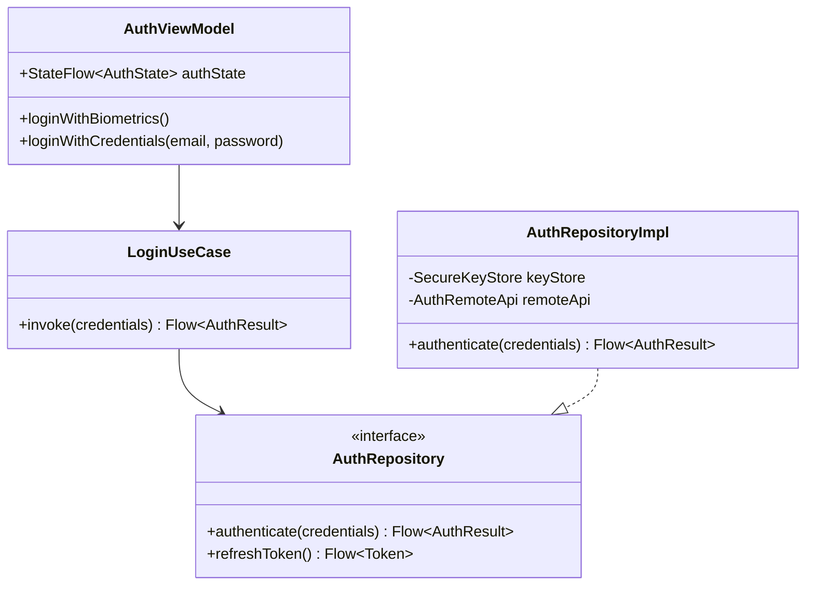
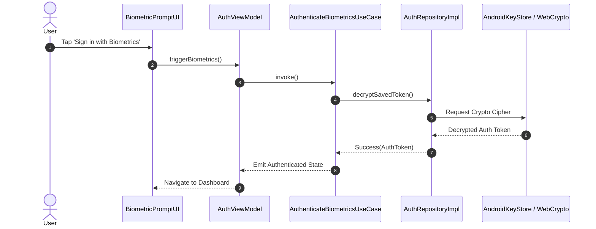

# 📐 App Design Specification Examples

Reference template for an architecture specification in `/docs/architecture/`.

---

## Sample Architecture Document: `docs/architecture/user-authentication-design.md`

```markdown
# 📐 System Architecture: User Authentication Subsystem

## 📋 System Overview
Provides secure biometric and token-based user authentication with offline credential caching and token refresh handling.

---

## 🏛️ Layered Component Architecture


---

## 🔄 Sequence Diagram: Biometric Authentication Flow


---

## 📝 Use Case Specification: UC-010 Biometric Login

| Field | Detail |
| :--- | :--- |
| **Identifier** | `UC-010: Biometric Login` |
| **Actor** | Mobile User |
| **Pre-Condition** | Biometrics registered on device; user logged in previously. |
| **Trigger** | User launches app when session is expired. |
| **Happy Path** | 1. Prompt displays system biometric dialog.<br/>2. User scans fingerprint/face.<br/>3. KeyStore decrypts session token.<br/>4. User is directed to home screen. |
| **Exception Flow** | Biometric scan fails 3 times ➔ Fallback to master password prompt. |
```
