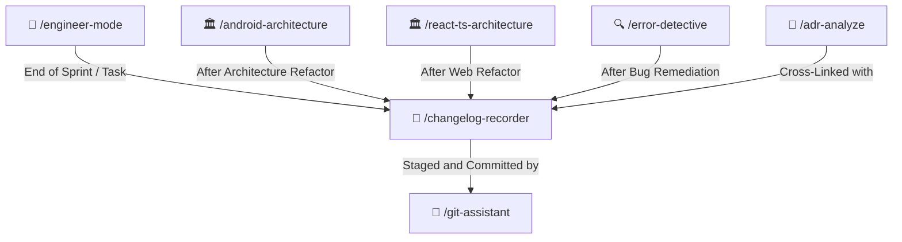

# 📝 Changelog Recorder Skill

Generates detailed, chronological changelog records in `/docs/changelogs/` with strict timestamp naming conventions (`YYYY-MM-DD_HH-mm-ss_<title>.md`), architectural impact summaries, and verification evidence in clear, professional English.

---

## 🧭 Connected Skills Architecture



---

## 📂 Subfolder Structure

| Path | Purpose | Description |
| :--- | :--- | :--- |
| [`SKILL.md`](./SKILL.md) | Agent Skill Definition | Core instructions and timestamp naming rules. |
| [`instructions/guidelines.md`](./instructions/guidelines.md) | Agent Execution Protocol | Naming conventions, section standards, and index table maintenance. |
| [`instructions/examples.md`](./instructions/examples.md) | Production Documentation Example | Real-world changelog record in `/docs/changelogs/`. |

---

## 🚀 How to Use

### 1. Direct Skill Activation
Trigger this skill whenever finalizing a feature, completing a refactor, or recording project milestones:
```text
/changelog-recorder
```
*(Alias: `/changelog`)*

### 2. Guided via Engineer Mode
Start through the adaptive interactive questionnaire:
```text
/engineer-mode
```
Select **Playbook 08 (Living Documentation & Changelogs)**.

---

## 🔗 Related Skills

- [📜 ADR Analyzer](../adr-analyze/README.md)
- [🔍 Error Detective](../error-detective/README.md)
- [🌿 Git Assistant](../../git-skills/git-assistant/README.md)
- [🏠 Master Suite README](../../README.md)
