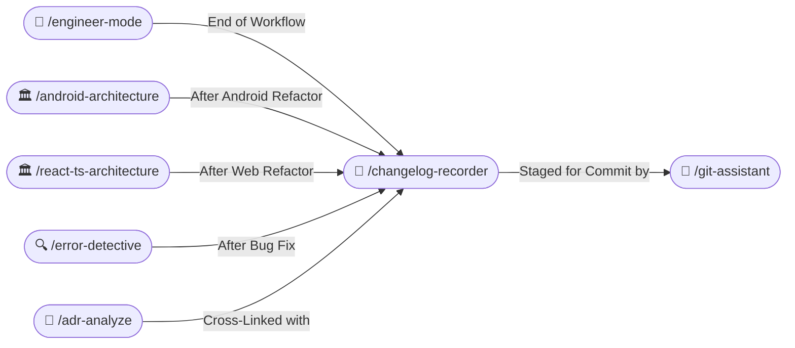

# 📝 Changelog Recorder Skill (/changelog-recorder /changelog)

The **Changelog Recorder Skill** creates permanent, auditable, and structured records of technical modifications within the project repository. It ensures that every significant change, migration, or refactoring is thoroughly documented for future developers and AI agents.

---

## 🧭 Connected Skills & Routing



---

## 📅 1. Strict File Naming Convention

All changelogs must be saved inside the project repository's `docs/changelogs/` folder:
`<project-root>/docs/changelogs/YYYY-MM-DD_HH-mm-ss_<main-change-title-in-kebab-case>.md`

### Naming Example:
```text
/docs/changelogs/2026-10-22_20-15-30_migrate-cart-to-clean-architecture.md
/docs/changelogs/2026-10-22_21-05-12_optimize-lazy-column-recomposition.md
/docs/changelogs/2026-10-23_09-30-00_upgrade-tanstack-query-v5.md
```

---

## 📑 2. Detailed Changelog Document Standard

Every changelog must follow this detailed structure written in **clear, professional English**:

```markdown
# Changelog: [Title of the Main Change]

- **Timestamp**: YYYY-MM-DD HH:mm:ss
- **Author**: [AI Engineering Agent / Developer]
- **Category**: [Feature | Bug Fix | Refactoring | Architecture | Performance | Dependency Update]
- **Target Platform**: [Android | Web | KMP | Fullstack]
- **Related ADR**: [docs/adr/ADR-XXXX.md](ADR-XXXX.md) (if applicable)
- **Related Incident**: [docs/error-fix/YYYY-MM-DD-error.md](error.md) (if applicable)

---

## 1. Executive Summary
[Concise 2-3 sentence overview of what was modified and the business/technical reason.]

---

## 2. Motivation & Problem Statement
[Detailed explanation of the technical debt, bug, or new capability that prompted this change.]

---

## 3. Detailed File Modifications

### Added Files
- `app/src/main/java/com/example/domain/usecase/GetCartUseCase.kt`: Pure Kotlin UseCase with single-expression `invoke`.
- `app/src/main/java/com/example/presentation/cart/components/CartItemCard.kt`: Isolated Composable card component.

### Modified Files
- `app/src/main/java/com/example/presentation/cart/CartViewModel.kt`: Refactored to observe domain UseCase via StateFlow.
- `gradle/libs.versions.toml`: Bumped library versions based on official Google documentation.

### Deleted / Deprecated Files
- `app/src/main/java/com/example/legacy/GodCartActivity.kt`: Removed monolithic legacy activity.

---

## 4. Architectural & KMP Impact
- **Clean Architecture Boundary**: Domain layer strictly isolated with zero `android.*` imports, ready for KMP `commonMain`.
- **Compose Stability**: All state parameters marked with `@Immutable`; lists upgraded to `ImmutableList`.
- **Zero Hardcoded Strings**: All new UI strings extracted to `res/values/strings.xml` with semantic prefixes.

---

## 5. Verification & Testing Evidence
- **Unit Tests Executed**:
  - `GetCartUseCaseTest`: PASSED (3/3 tests)
  - `CartViewModelTest`: PASSED (Turbine StateFlow test verified)
- **Build Verification Command**:
  - `./gradlew testDebugUnitTest` ➔ SUCCESS in 4.2s
  - `./gradlew assembleDebug` ➔ SUCCESS

---

## 6. Next Steps & Follow-Ups
- [ ] Monitor crash metrics on staging build.
- [ ] Update documentation for client onboarding.
```

---

## 📑 3. Master Changelog Index Maintenance

Automatically update `<project-root>/docs/changelogs/README.md` with every new record:

| Timestamp | Changelog Document | Category | Summary |
|---|---|---|---|
| `2026-10-22 20:15:30` | [Migrate Cart to Clean Architecture](2026-10-22_20-15-30_migrate-cart-to-clean-architecture.md) | `Architecture` | Decomposed monolithic activity into pure domain UseCases and Compose UI. |
