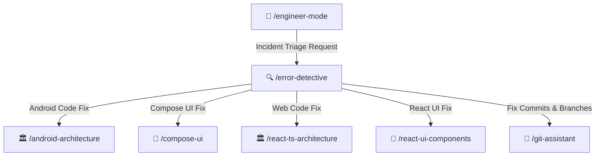

# 🔍 Error Detective Skill

Interactive diagnostic and root-cause resolution specialist for Android and Web. Interactively questions error category and affected module (or autonomously inspects logs/diffs if unsure), generates clean non-invasive fixes, and writes comprehensive incident post-mortems in `/docs/error-fix/` with Mermaid sequence diagrams and pie chart scoring.

---

## 🧭 Connected Skills Architecture



---

## 📂 Subfolder Structure

| Path | Purpose | Description |
| :--- | :--- | :--- |
| [`SKILL.md`](./SKILL.md) | Agent Skill Definition | Core instructions and triage prompt questionnaire. |
| [`instructions/guidelines.md`](./instructions/guidelines.md) | Agent Execution Protocol | Step-by-step triage, root-cause investigation, and documentation rules. |
| [`instructions/examples.md`](./instructions/examples.md) | Production Documentation Example | Real-world incident report in `/docs/error-fix/` with Mermaid diagrams. |

---

## 🚀 How to Use

### 1. Direct Skill Activation
Trigger this skill whenever you encounter crashes, build errors, memory leaks, or runtime exceptions:
```text
/error-detective
```
*(Alias: `/error-detection`)*

### 2. Guided via Engineer Mode
Start through the adaptive interactive questionnaire:
```text
/engineer-mode
```
Select **Playbook 06 (Diagnostic & Build Remediation)**.

---

## 🔗 Related Skills

- [📱 Android Architecture](../../android-skills/android-architecture/README.md)
- [🎨 Jetpack Compose UI](../../android-skills/compose-ui/README.md)
- [🏛️ React Clean Architecture](../../react-ts-skills/react-ts-architecture/README.md)
- [🌿 Git Assistant](../../git-skills/git-assistant/README.md)
- [🏠 Master Suite README](../../README.md)
