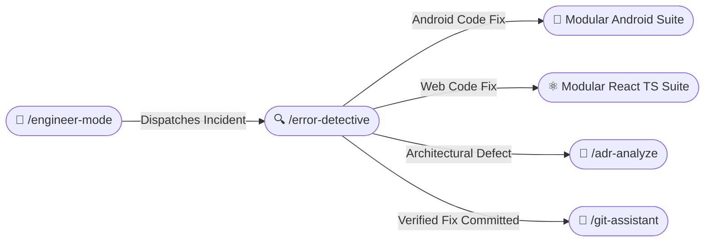

# 🔍 Error Detective Skill (/error-detective /error-detection)

The **Error Detective Skill** is an interactive, evidence-driven diagnostic engine for Android and Web applications. It eliminates guesswork by systematically questioning the symptom, localizing the failure point, implementing verified fixes, and generating documented incident post-mortems in `/docs/error-fix/`.

---

## 🧭 Connected Skills & Inter-Skill Routing



---

## 🎯 1. Interactive Diagnostic Questionnaire

Whenever invoked (via `/error-detective`, `/error-detection`, or routed from `/engineer-mode`), the agent **MUST** present these two triage questions unless already explicitly answered in the prompt:

```markdown
### 🔍 Error Detective: Interactive Triage

To help me pinpoint and resolve the issue quickly, please provide a few details:

1. **What kind of error are you encountering?**
   - [A] **Android Crash / Exception** (`NullPointerException`, `IllegalStateException`, `Fatal Exception`)
   - [B] **Android Build / Gradle Failure** (Dependency collision, Kotlin K2 error, R8/ProGuard)
   - [C] **Android ANR / UI Freeze / Memory Leak** (Main thread lock, coroutine deadlock)
   - [D] **Web/React Runtime Error** (`TypeError`, hydration mismatch, unhandled promise rejection)
   - [E] **Web/React Build Failure** (`tsc` type check error, Vite/Next.js bundling error)
   - [F] **Network / API / Serialization** (HTTP 4xx/5xx, malformed JSON, Retrofit/Fetch failure)
   - [G] **Unsure / Intermittent** ➔ *I will autonomously analyze project logs and recent diffs.*

2. **In which feature, screen, or file did you observe this?**
   *(Provide a file path, feature name, or reply "Not sure" for automatic codebase scanning)*
```

---

## 🔬 2. Autonomous Diagnostic Protocol (If Unsure)

If the user selects "Unsure" or provides incomplete information:
1. **Log & Trace Inspection**:
   - For Android: Inspect `adb logcat`, Gradle build output (`./gradlew test --stacktrace`), or crash reports.
   - For Web: Inspect browser console logs, test output (`vitest` / `jest`), or build errors (`npm run build`).
2. **Recent Delta Analysis**:
   - Inspect `git diff HEAD~1` or uncommitted changes to identify newly introduced regressions.
3. **Symbol & Invariant Tracing**:
   - Trace variables from entry point to the null/undefined dereference or broken invariant.

---

## 🛠️ 3. Fix Synthesis & Regression Testing

- **Minimal & Non-Invasive**: Fix the root cause directly; do NOT wrap broken code in blind empty try-catch blocks or add `@ts-ignore` / `@Suppress`.
- **Architectural Preservation**: Ensure the fix respects Clean Architecture (no business logic in UI, no UI in domain).
- **Automated Verification**:
  - Run the targeted unit test or write a reproducing test case before finalizing the fix.
  - Verify build passes cleanly.

---

## 📊 4. Post-Mortem Report Generation (`/docs/error-fix/`)

After every resolved incident, automatically generate a permanent markdown report in:
`<project-root>/docs/error-fix/YYYY-MM-DD-<slug>.md`

### Mandatory Report Structure:
1. **Metadata Table**: Date, Platform, Severity, Affected Component, Status.
2. **Executive Summary**: What broke and what was fixed.
3. **Incident Impact & Confidence Score (Mermaid Pie Chart)**:
   ```mermaid
   pie title Incident Severity & Resolution Score
       "Resolution Confidence" : 85
       "Root Cause Severity" : 10
       "Regression Risk" : 5
   ```
4. **Root Cause Analysis (RCA)**:
   - Defect classification.
   - Fault sequence diagram:
     ```mermaid
     sequenceDiagram
         participant UI as Presentation
         participant UC as UseCase
         participant Repo as Repository
         UI->>UC: Request data
         UC->>Repo: Fetch from remote
         Repo-->>UC: Null DTO field (Unexpected)
         UC-->>UI: Crash: NullPointerException
     ```
5. **Applied Fix & Code Diff**:
   - File links and line numbers.
   - Before and after code snippets.
6. **Regression Prevention Plan**:
   - Newly added unit test name and verification commands.
