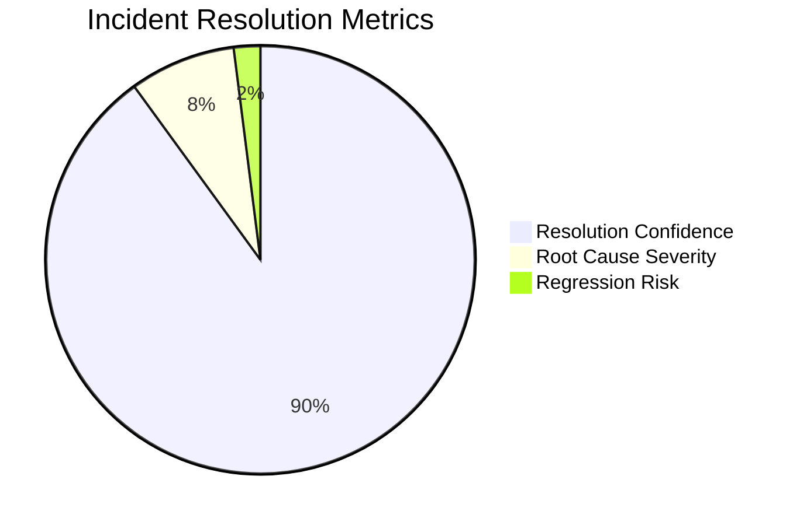
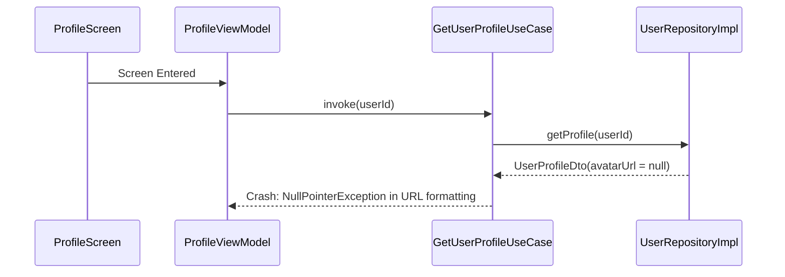

# 🔍 Error Detective Report Examples

Reference template for documented incident resolution generated in `/docs/error-fix/`.

---

## Sample Incident Report: `docs/error-fix/2026-10-22-null-user-profile-crash.md`

```markdown
# 🔍 Incident Post-Mortem: NullPointerException on Profile Navigation

## 📋 Metadata
| Field | Value |
| :--- | :--- |
| **Date** | 2026-10-22 |
| **Platform** | Android |
| **Severity** | High (Crash on launch) |
| **Component** | `feature:profile:ProfileViewModel` |
| **Resolution Status** | Verified & Fixed |

---

## 🎯 Executive Summary
Navigating to the user profile screen caused an immediate `NullPointerException` due to an unhandled optional DTO field in `UserProfileDto` when an account had not configured an avatar URL.

---

## 📊 Incident Severity & Resolution Score


---

## 🔬 Root Cause Analysis (RCA)

### Failure Sequence


### Explanation
The DTO mapping layer assumed `avatarUrl` was always non-null. When the backend returned `null`, string concatenation threw `NullPointerException` during domain mapping.

---

## 🛠️ Applied Fix & Code Diff

### In `UserRepositoryImpl.kt`:
```diff
- fun toDomain(dto: UserProfileDto): UserProfile = UserProfile(avatar = dto.avatarUrl.trim())
+ fun toDomain(dto: UserProfileDto): UserProfile = UserProfile(avatar = dto.avatarUrl?.trim().orEmpty())
```

---

## ✅ Regression Prevention & Verification
1. Added unit test `UserProfileMapperTest.givenNullAvatar_mapsToEmptyString()`.
2. Verified with `./gradlew testDebugUnitTest`.
```
