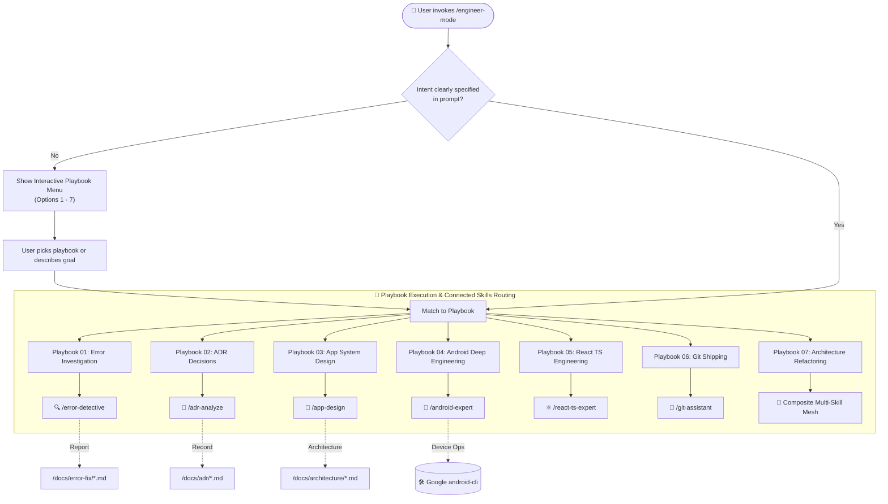

# 🚀 Engineer Mode (/engineer-mode)

Welcome to **Engineer Mode**, the central command post and intelligent orchestrator of the **AI-Engineer-Skills** suite. Inspired by the rigor and multi-model parallelism of *pstack (potato-mode)*, Engineer Mode transforms an AI coding assistant into a structured, proactive senior software engineer.

---

## 🧭 Navigation & Connected Skills Hub

| Hub Directory | Domain | Direct Link |
|---|---|---|
| 🏠 **Root Hub** | Full Suite Overview & Installer | [Root README](../README.md) |
| 📱 **Android Skills** | Kotlin, Compose, Clean Architecture, Google android-cli | [Android README](../android-skills/README.md) |
| ⚛️ **React TS Skills** | Next.js, Vite, TypeScript, Tailwind, Web Vitals | [React TS README](../react-ts-skills/README.md) |
| 🔍 **Diagnostic Skills** | Error Detective, ADR Detection, App Design | [Diagnostic README](../diagnostic-skills/README.md) |
| 🌿 **Git Skills** | Branching, Safe Rebase, Conflict Resolution, PRs | [Git README](../git-skills/README.md) |

---

## 💡 How It Works

Instead of blindly guessing what to do or generating verbose boilerplate code, `/engineer-mode` performs an **adaptive assessment**. It matches your goal against curated engineering playbooks, interviews you on critical constraints, and routes work dynamically across specialized skills:



---

## ⚡ How to Use

### 1. Interactive Entry (Default)
Simply type:
```text
/engineer-mode
```
The agent will immediately present the interactive menu, asking you to choose from the playbook catalog or describe your project goal.

### 2. Direct Task Trigger
You can attach your task directly to the command:
```text
/engineer-mode diagnose and fix the NullPointerException in OrderRepository
```
```text
/engineer-mode design a modular offline-first sync engine for Android
```
```text
/engineer-mode build a type-safe dashboard with React 19 and TanStack Query
```

---

## 📋 Playbook Catalog

| # | Playbook | Key Responsibilities | Output Location |
|---|---|---|---|
| **01** | [Error Investigation](playbooks/01-error-investigation.md) | Asks error type & location, root-causes bug, generates fix, and logs scoring | `/docs/error-fix/` |
| **02** | [ADR Decision Making](playbooks/02-adr-decision-making.md) | Formalizes architectural decisions grounded in official documentation | `/docs/adr/` |
| **03** | [App System Design](playbooks/03-app-system-design.md) | Generates UML class, sequence, and state diagrams with use case specs | `/docs/architecture/` |
| **04** | [Android Deep Engineering](playbooks/04-android-deep-engineering.md) | End-to-end Kotlin, Jetpack Compose, Room, Hilt, and routes to Google `android-cli` | `app/src/` |
| **05** | [React TS Web Engineering](playbooks/05-react-ts-web-engineering.md) | Next.js / Vite, strict TypeScript, Tailwind, Zustand, and WCAG accessibility | `src/` |
| **06** | [Git Shipping Workflow](playbooks/06-git-shipping-workflow.md) | Atomic staging, conventional commits, rebase/merge safety, PR briefs | Git / PR |
| **07** | [Architecture Refactoring](playbooks/07-architecture-refactoring.md) | Eliminates code debt, cleans domain boundaries, verifies zero regressions | Codebase |

---

## 🔗 Connected Cross-Skill Shortcuts

While `/engineer-mode` orchestrates everything, you can also trigger any connected skill directly whenever you prefer a focused interaction:

- **`/error-detective`** — Jump straight to error diagnostics and bug reporting.
- **`/app-design`** — Jump straight to UML modeling and system architecture.
- **`/adr-analyze`** — Jump straight to writing or auditing Architecture Decision Records.
- **`/android-expert`** — Jump straight to expert Android engineering.
- **`/react-ts-expert`** — Jump straight to expert React & TypeScript development.
- **`/git-assistant`** — Jump straight to Git operations and PR generation.
