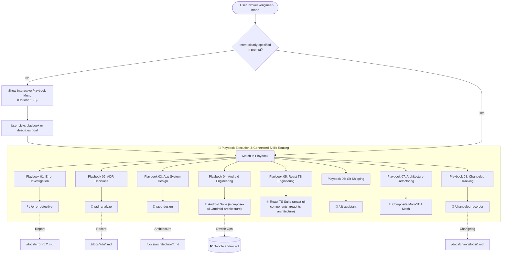

# 🚀 Engineer Mode (/engineer-mode)

Welcome to **Engineer Mode**, the central command post and intelligent orchestrator of the **AI-Engineer-Skills** suite. Inspired by the rigor and multi-agent parallelism of *pstack (potato-mode)*, Engineer Mode transforms an AI coding assistant into a structured, proactive senior software engineering team.

---

## 🧭 Navigation & Connected Skills Hub

| Hub Directory | Domain | Direct Link |
|---|---|---|
| 🏠 **Root Hub** | Full Suite Overview & Universal Installer | [Root README](../README.md) |
| 📱 **Android Skills** | Clean Arch, Compose, MapLibre, Testing, Gradle | [Android README](../android-skills/README.md) |
| ⚛️ **React TS Skills** | Next.js, Vite, TypeScript, Tailwind, Web Vitals | [React TS README](../react-ts-skills/README.md) |
| 🔍 **Diagnostic Skills** | Error Detective, ADR Detection, App Design, Changelogs | [Diagnostic README](../diagnostic-skills/README.md) |
| 🌿 **Git Skills** | Branching, Safe Rebase, Conflict Resolution, PRs | [Git README](../git-skills/README.md) |

---

## 📂 Subfolder Structure

| Path | Purpose | Description |
| :--- | :--- | :--- |
| [`SKILL.md`](./SKILL.md) | Agent Skill Definition | Master prompt instructions, questionnaire, and routing table. |
| [`playbooks/README.md`](./playbooks/README.md) | Playbook Catalog Registry | Complete index and overview of the 8 execution playbooks. |
| [`instructions/guidelines.md`](./instructions/guidelines.md) | Agent Execution Protocol | Master orchestration protocols and gating rules. |
| [`instructions/examples.md`](./instructions/examples.md) | Production Workflow Examples | Interactive triage dialogue and multi-skill routing chains. |

---

## 💡 How It Works

Instead of guessing or generating boilerplate code, `/engineer-mode` performs an **adaptive assessment**. It matches your goal against curated engineering playbooks, interviews you on critical constraints, and routes work dynamically across specialized modular skills:



---

## ⚡ How to Use

### 1. Interactive Entry (Default)
Simply type:
```text
/engineer-mode
```
The agent will immediately present the interactive menu, asking you to choose from the playbook catalog or describe your project goal.

### 2. Direct Task Trigger
```text
/engineer-mode diagnose and fix the NullPointerException in OrderRepository
```
```text
/engineer-mode design a modular offline-first sync engine for Android with KMP domain
```
```text
/engineer-mode build an accessible checkout screen in React 19 with TanStack Query
```

---

## 📋 Playbook Catalog

| # | Playbook | Key Responsibilities | Output Location |
|---|---|---|---|
| **01** | [Error Investigation](playbooks/01-error-investigation.md) | Asks error type & location, root-causes bug, generates fix, and logs scoring | `/docs/error-fix/` |
| **02** | [ADR Decision Making](playbooks/02-adr-decision-making.md) | Formalizes architectural decisions grounded in official documentation | `/docs/adr/` |
| **03** | [App System Design](playbooks/03-app-system-design.md) | Generates UML class, sequence, and state diagrams with use case specs in English | `/docs/architecture/` |
| **04** | [Android Engineering](playbooks/04-android-deep-engineering.md) | Modular Clean Architecture, Compose UI decomposition, testing, Gradle | `app/src/` |
| **05** | [React TS Web Engineering](playbooks/05-react-ts-web-engineering.md) | Frontend Clean Architecture, accessible modular UI, TanStack Query, Vitest | `src/` |
| **06** | [Git Shipping Workflow](playbooks/06-git-shipping-workflow.md) | Atomic staging, conventional commits, rebase/merge safety, PR briefs | Git / PR |
| **07** | [Architecture Refactoring](playbooks/07-architecture-refactoring.md) | Eliminates code debt, cleans domain boundaries, verifies zero regressions | Codebase |
| **08** | [Changelog Documentation](playbooks/08-changelog-documentation.md) | Records chronological changes with strict timestamp naming conventions | `/docs/changelogs/` |
