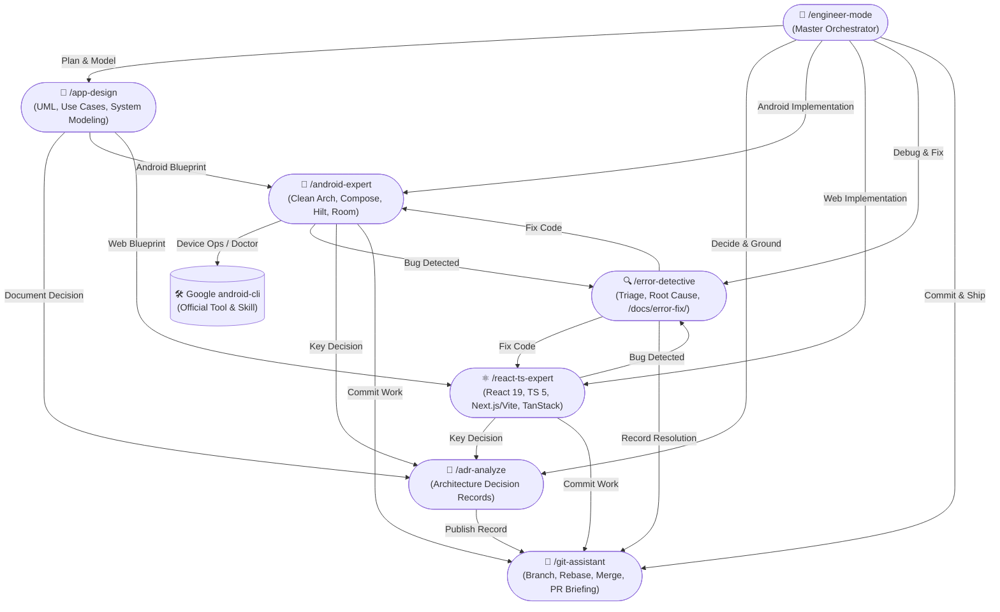

# 🚀 Engineer Mode (/engineer-mode)

**Engineer Mode** is the unified starting point and chief orchestrator for end-to-end software engineering. Built on the principle that AI coding should be rigorous, verifiable, and free of slop, `engineer-mode` adapts to any user goal, determines the optimal path through curated playbooks, and coordinates specialized skills into an interconnected execution mesh.

---

## 🧭 The Connected Skills Mesh

No skill operates in a silo. Every skill in the suite knows about and connects with its peers:



---

## ⚡ Adaptive Entry Point Protocol

When `/engineer-mode` is triggered:

### 1. Assess User Input
- **Scenario A: Explicit Directive Provided**
  *(e.g., `/engineer-mode fix the crash in CartViewModel when payment token expires`)*
  - Extract target platform (Android / Web), scope, and intent.
  - Match immediately to the corresponding playbook (e.g., `01-error-investigation`).
  - Summarize the execution plan and confirm before proceeding.

- **Scenario B: Broad, Ambiguous, or Empty Prompt**
  *(e.g., `/engineer-mode` or `/engineer-mode I want to build a new feature`)*
  - Initiate the **Interactive Adaptive Questionnaire** below. Do not guess or make unverified assumptions.

---

## 📋 Interactive Playbook Questionnaire

Present the user with clear, structured options to select their desired path:

```markdown
### 🛠️ Engineer Mode: Select an Engineering Playbook

What would you like to accomplish today?

1. 🔍 **[1] Error Detection & Root Cause Analysis** (`/error-detective`)
   - Triage runtime crashes, compilation failures, ANRs, hydration bugs, or memory leaks.
   - Generates automated root-cause diagnosis, code fix, and scoring report in `/docs/error-fix/`.

2. 📐 **[2] Architecture & App System Design** (`/app-design`)
   - Model new modules, domain workflows, UML class diagrams, sequence flows, and use cases.
   - Generates structured documentation in `/docs/architecture/`.

3. 📜 **[3] Architectural Decision Record (ADR)** (`/adr-analyze`)
   - Evaluate architecture choices, ground against official Google/W3C docs, and generate MADR entries in `/docs/adr/`.

4. 📱 **[4] In-Depth Android Engineering** (`/android-expert`)
   - Enterprise Android: Clean Architecture, Jetpack Compose, Flow/Coroutines, Room, Retrofit, Hilt DI, and official Google `android-cli` routing.

5. ⚛️ **[5] React + TypeScript Modern Web** (`/react-ts-expert`)
   - Modern Web: Next.js / Vite, strict TypeScript, Tailwind CSS, TanStack Query, Zustand, Web Vitals, and WCAG a11y.

6. 🌿 **[6] Git Assistant & Safe Shipping** (`/git-assistant`)
   - Branching strategies, rebase/merge safety, 3-way conflict resolution, conventional commits, and PR briefings.

7. 🔄 **[7] End-to-End Autonomous Feature Delivery**
   - Full lifecycle: System Design (`/app-design`) ➔ ADR Logging (`/adr-analyze`) ➔ Implementation (`/android-expert` or `/react-ts-expert`) ➔ Test & Error Verification (`/error-detective`) ➔ Safe Commit (`/git-assistant`).

*Reply with a number (1-7) or describe your goal in detail.*
```

---

## 🗂️ Playbook Execution Matrix

| # | Playbook | Entry Trigger | Primary Skills Involved | Deliverables / Artifacts |
|---|---|---|---|---|
| **1** | [Error Investigation](playbooks/01-error-investigation.md) | `/error-detective`, crash, bug, ANR, 500 | `error-detective`, `android-expert`, `react-ts-expert` | `/docs/error-fix/YYYY-MM-DD-<slug>.md` with Mermaid Pie Score |
| **2** | [ADR Decision Making](playbooks/02-adr-decision-making.md) | `/adr-analyze`, ADR, decision, trade-off | `adr-analyze`, official documentation | `/docs/adr/ADR-XXXX-<title>.md` & `README.md` index |
| **3** | [App System Design](playbooks/03-app-system-design.md) | `/app-design`, UML, sequence, architecture | `app-design`, `android-expert`, `react-ts-expert` | `/docs/architecture/` with Mermaid UML class & sequence diagrams |
| **4** | [Android Deep Engineering](playbooks/04-android-deep-engineering.md) | `/android-expert`, Compose, Kotlin, Room | `android-expert`, Google `android-cli`, `adr-analyze` | Production Kotlin code, unit tests, Gradle catalog sync |
| **5** | [React TS Web Engineering](playbooks/05-react-ts-web-engineering.md) | `/react-ts-expert`, Next.js, Vite, React | `react-ts-expert`, `app-design`, `git-assistant` | Strict TS components, hooks, tests, responsive UI |
| **6** | [Git Shipping Workflow](playbooks/06-git-shipping-workflow.md) | `/git-assistant`, commit, push, PR, merge | `git-assistant` | Clean commits, conflict resolution, PR brief |
| **7** | [Architecture Refactoring](playbooks/07-architecture-refactoring.md) | `/engineer-mode refactor`, technical debt | `engineer-mode`, `app-design`, `adr-analyze` | Refactored modules, ADR documentation, regression tests |

---

## 🔄 Dynamic Inter-Skill Routing Rules

When running within `engineer-mode`, enforce the following seamless transitions:

1. **Routing to Android CLI**:
   - If an Android device command, emulator build, screenshot capture, or `doctor` check is needed:
   - **Do NOT** duplicate custom CLI scripts.
   - Route directly to Google's official `android-cli` tool and skill (`android doctor`, `android init`, `android run`, `android doc`).

2. **Routing to Error Detective**:
   - If a test fails, a build breaks, or an unhandled exception occurs during feature implementation:
   - Transition context to `error-detective`.
   - Ask triage questions (error type, feature/part) or auto-inspect logs.
   - Generate diagnosis and record in `/docs/error-fix/`.

3. **Routing to ADR Analyze**:
   - Whenever a non-trivial architectural choice is made (introducing a new database library, changing state management, altering Clean Architecture layers):
   - Transition context to `adr-analyze`.
   - Ground the rationale against official Google or W3C documentation.
   - Save the decision in `/docs/adr/`.

4. **Routing to Git Assistant**:
   - Once implementation and verification are complete:
   - Transition to `git-assistant`.
   - Stage changes incrementally, write conventional commit messages, and generate the PR briefing.

---

## 🛡️ Rigorous Engineering Principles

1. **Evidence Over Speculation**: Every claim or diagnosis must be backed by file line numbers, compile output, or stack traces.
2. **Zero Code Slop**: Do not generate placeholder methods, empty catch blocks, or unnecessary conversational fluff. Keep responses concise, actionable, and maintainable.
3. **Living Documentation**: Technical changes MUST be permanently documented in `/docs/` (ADRs in `/docs/adr/`, bug resolutions in `/docs/error-fix/`, system models in `/docs/architecture/`).
4. **All Outputs in English**: All commit messages, documentation, ADRs, code comments, and error reports must be written strictly in clear, professional English.
