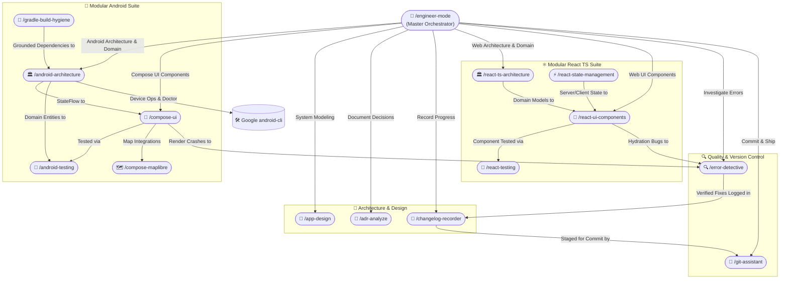

# 🚀 Engineer Mode (/engineer-mode)

**Engineer Mode** is the unified starting point and chief orchestrator for end-to-end software engineering. Built on the principle that AI coding should be rigorous, verifiable, and free of slop, `engineer-mode` adapts to any user goal, determines the optimal path through curated playbooks, and coordinates specialized skills into an interconnected execution mesh.

---

## 🧭 The Connected Skills Mesh

No skill operates in a silo. Every skill in the suite connects with its peers:



---

## ⚡ Adaptive Entry Point Protocol

When `/engineer-mode` is triggered:

### 1. Assess User Input
- **Scenario A: Explicit Directive Provided**
  *(e.g., `/engineer-mode fix the crash in CartViewModel when payment token expires`)*
  - Extract target platform, scope, and intent.
  - Match immediately to the corresponding playbook (e.g. `01-error-investigation`).
  - Summarize the execution plan and confirm before proceeding.

- **Scenario B: Broad, Ambiguous, or Empty Prompt**
  *(e.g., `/engineer-mode` or `/engineer-mode I want to build a new feature`)*
  - Initiate the **Interactive Adaptive Questionnaire** below. Do not guess or make unverified assumptions.

---

## 📋 Interactive Playbook Questionnaire

Present the user with clear, structured options to select their desired path:

```markdown
### 🛠️ Engineer Mode: Select an Engineering Playbook

What would you like to accomplish today?

1. 🔍 **[1] Error Detection & Root Cause Analysis** (`/error-detective`)
   - Triage runtime crashes, compilation failures, ANRs, hydration bugs, or memory leaks.
   - Generates automated root-cause diagnosis, code fix, and scoring report in `/docs/error-fix/`.

2. 📐 **[2] Architecture & App System Design** (`/app-design`)
   - Model new modules, domain workflows, UML class diagrams, sequence flows, and use cases.
   - Generates structured documentation in `/docs/architecture/` in English.

3. 📜 **[3] Architectural Decision Record (ADR)** (`/adr-analyze`)
   - Evaluate architecture choices, ground against official Google/W3C docs, and generate MADR entries in `/docs/adr/`.

4. 📱 **[4] Android Engineering Suite**
   - Clean Architecture (`/android-architecture`), Modular Compose UI (`/compose-ui`), MapLibre (`/compose-maplibre`), Testing (`/android-testing`), Gradle hygiene (`/gradle-build-hygiene`), and Android CLI routing (`/android-cli-router`).

5. ⚛️ **[5] React + TypeScript Modern Web Suite**
   - Frontend Clean Architecture (`/react-ts-architecture`), Accessible Modular UI (`/react-ui-components`), State Sync (`/react-state-management`), and Vitest Testing (`/react-testing`).

6. 📝 **[6] Changelog Documentation** (`/changelog-recorder`)
   - Document technical changes into permanent timestamped records in `/docs/changelogs/YYYY-MM-DD_HH-mm-ss_<title>.md`.

7. 🌿 **[7] Git Assistant & Safe Shipping** (`/git-assistant`)
   - Branching strategies, rebase/merge safety, 3-way conflict resolution, conventional commits, and PR briefings.

8. 🔄 **[8] End-to-End Autonomous Feature Delivery**
   - Full lifecycle: Design (`/app-design`) ➔ ADR (`/adr-analyze`) ➔ Modular Code ➔ Testing ➔ Changelog (`/changelog-recorder`) ➔ Safe Commit (`/git-assistant`).

*Reply with a number (1-8) or describe your goal in detail.*
```

---

## 🗂️ Playbook Execution Matrix

| # | Playbook | Entry Trigger | Primary Skills Involved | Deliverables / Artifacts |
|---|---|---|---|---|
| **1** | [Error Investigation](playbooks/01-error-investigation.md) | `/error-detective`, crash, bug, ANR, 500 | `error-detective`, domain skills | `/docs/error-fix/YYYY-MM-DD-<slug>.md` with Mermaid Pie Score |
| **2** | [ADR Decision Making](playbooks/02-adr-decision-making.md) | `/adr-analyze`, ADR, decision, trade-off | `adr-analyze`, official documentation | `/docs/adr/ADR-XXXX-<title>.md` & index |
| **3** | [App System Design](playbooks/03-app-system-design.md) | `/app-design`, UML, sequence, architecture | `app-design`, domain skills | `/docs/architecture/` with Mermaid UML class & sequence |
| **4** | [Android Engineering](playbooks/04-android-deep-engineering.md) | Android, Compose, Kotlin, Room, Gradle | `android-architecture`, `compose-ui`, `android-testing`, `gradle-build-hygiene` | Modular source files, KDocs, unit tests |
| **5** | [React TS Engineering](playbooks/05-react-ts-web-engineering.md) | React, Next.js, Vite, TypeScript | `react-ts-architecture`, `react-ui-components`, `react-state-management`, `react-testing` | Strict TS components, hooks, tests |
| **6** | [Git Shipping Workflow](playbooks/06-git-shipping-workflow.md) | `/git-assistant`, commit, push, PR, merge | `git-assistant` | Conventional commits, PR brief (Mandatory user confirmation before push/merge) |
| **7** | [Architecture Refactoring](playbooks/07-architecture-refactoring.md) | `/engineer-mode refactor`, technical debt | `engineer-mode`, `app-design`, `adr-analyze` | Refactored modules, ADR records, tests |
| **8** | [Changelog Documentation](playbooks/08-changelog-documentation.md) | `/changelog-recorder`, `/changelog` | `changelog-recorder`, `git-assistant` | `/docs/changelogs/YYYY-MM-DD_HH-mm-ss_*.md` |
