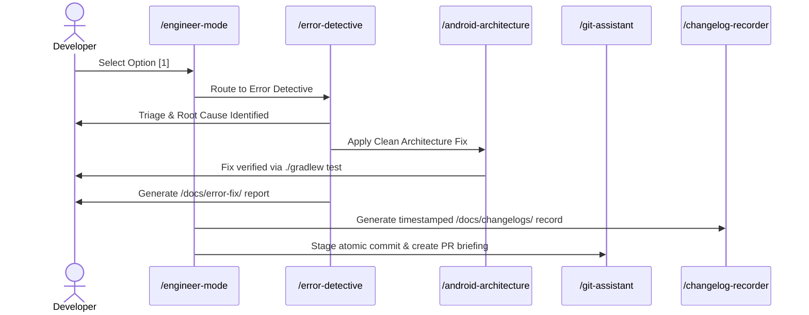

# 🚀 Engineer Mode Workflow Examples

Example interaction traces demonstrating the adaptive question-and-route protocol.

---

## 1. Interactive Session Example: Diagnostic Routing

```text
User: /engineer-mode

Agent:
🛠️ AI Engineering Mode Active
What would you like to achieve today?

[1] 🔍 Investigate & Fix an Error (Crash, ANR, build failure, hydration bug)
[2] 📜 Make / Document an Architecture Decision (ADR)
[3] 📐 System Design & Visual Modeling (UML, Sequence, Use Cases)
[4] 📱 Deep Android Engineering (Clean Arch, Compose, MapLibre, Gradle)
[5] ⚛️ Deep React + TypeScript Engineering (Clean Arch, Components, State)
[6] 🌿 Git & Shipping Assistant (Commits, Rebase, PR Briefing)
[7] 🏗️ Refactor Legacy Codebase
[8] 📝 Record Timestamped Changelog

User: 1

Agent:
Loading Playbook 01: Error Investigation & Triage.
Routing to 🔍 /error-detective...

To help me pinpoint and resolve the issue quickly:
1. What kind of error are you encountering? (Crash / Build / ANR / Runtime / Unsure)
2. In which feature, screen, or file did you observe this?
```

---

## 2. Multi-Skill Routing Chain


