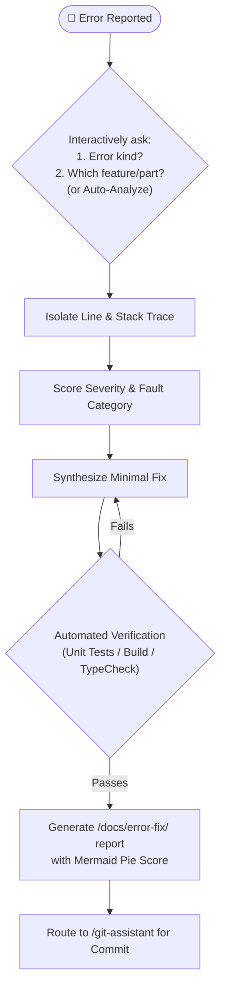

# Playbook 01: Error Investigation & Root-Cause Resolution

## Purpose
Systematically isolate, reproduce, root-cause, fix, and document software errors across Android and Web ecosystems without guessing or introducing regressions.

## Interconnected Skills
- **Primary Driver**: [`error-detective`](../../diagnostic-skills/error-detective/SKILL.md)
- **Domain Hand-offs**:
  - Android fixes ➔ Modular Android Suite ([`android-architecture`](../../android-skills/android-architecture/SKILL.md), [`compose-ui`](../../android-skills/compose-ui/SKILL.md), [`android-testing`](../../android-skills/android-testing/SKILL.md))
  - Web/React fixes ➔ Modular React TS Suite ([`react-ts-architecture`](../../react-ts-skills/react-ts-architecture/SKILL.md), [`react-ui-components`](../../react-ts-skills/react-ui-components/SKILL.md), [`react-testing`](../../react-ts-skills/react-testing/SKILL.md))
  - Documentation & Commits ➔ [`git-assistant`](../../git-skills/git-assistant/SKILL.md)

---

## Step-by-Step Workflow

### Step 1: Interactive Triage
Prompt user with the two essential diagnostic questions:
1. **What kind of error?** (Crash/Exception, Compilation/Build, ANR/Freeze, Hydration/DOM mismatch, Network/API error, Memory leak).
2. **In which feature or module?** (If the user is unsure, initiate automated scanning across `adb logcat`, browser logs, test outputs, or recent diffs).

### Step 2: Fault Localization
- Map stack traces to exact source lines.
- Identify the invariant violation (null pointer, lifecycle race condition, unhandled state, network timeout).
- Verify whether the issue violates Clean Architecture layer boundaries.

### Step 3: Minimal, Robust Fix
- Implement the fix following platform idioms (e.g. type-safe `Duration`, sealed interface states, or strict TypeScript discriminated unions).
- Prohibit quick-and-dirty band-aids like empty try/catch blocks or silencing linter warnings with `@ts-ignore` or `@Suppress`.

### Step 4: Verification
- Execute relevant test suites: `./gradlew test` (Android) or `npm run test` / `vitest` (Web).
- Verify build sanity: `./gradlew assembleDebug` or `npm run build`.

### Step 5: Incident Report Generation
- Auto-generate an incident record in `/docs/error-fix/YYYY-MM-DD-<slug>.md`.
- Include:
  - Incident details and reproduction steps.
  - Root cause breakdown.
  - Fix diff and affected files.
  - Mermaid pie chart showing error classification score.
  - Long-term prevention checklist.
