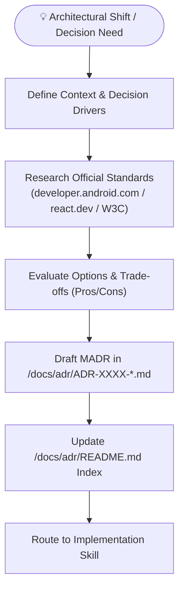

# Playbook 02: Architecture Decision Record (ADR) Decision Making

## Purpose
Capture, evaluate, and formalize crucial technical decisions. Ground architectural choices in official vendor documentation (Google Android Docs, W3C, React Docs, TypeScript Handbook) to establish a lasting, auditable decision history.

## Interconnected Skills
- **Primary Driver**: [`adr-analyze`](../../diagnostic-skills/adr-analyze/SKILL.md)
- **Domain Hand-offs**:
  - Android Architecture ➔ Modular Android Suite ([`android-architecture`](../../android-skills/android-architecture/SKILL.md), [`gradle-build-hygiene`](../../android-skills/gradle-build-hygiene/SKILL.md))
  - Web Architecture ➔ Modular React TS Suite ([`react-ts-architecture`](../../react-ts-skills/react-ts-architecture/SKILL.md), [`react-state-management`](../../react-ts-skills/react-state-management/SKILL.md))
  - Modeling & UML ➔ [`app-design`](../../diagnostic-skills/app-design/SKILL.md)
  - Publishing & Versioning ➔ [`git-assistant`](../../git-skills/git-assistant/SKILL.md)

---

## Step-by-Step Workflow

### Step 1: Detect & Define the Problem
- Identify when a decision requires an ADR:
  - Introducing a new library or dependency (e.g. Room vs SQLDelight, Zustand vs Redux).
  - Changing communication patterns (e.g. SharedFlow vs Channel, Server Actions vs API routes).
  - Modifying module structures or layering rules.

### Step 2: Ground in Official Documentation
- Every proposed ADR must quote and link to authoritative sources:
  - Android: `developer.android.com/topic/architecture`
  - React/Web: `react.dev`, `typescriptlang.org`, `w3.org`
  - No unsupported hearsay or deprecated paradigms.

### Step 3: Format in MADR
- Create `/docs/adr/ADR-XXXX-<title-in-kebab-case>.md`.
- Fill required sections: Status, Context, Decision Drivers, Considered Options, Pros & Cons, Decision Outcome, Official Citations, Consequences.

### Step 4: Index & Cross-Link
- Append new entry into `/docs/adr/README.md` with status badge and decision summary.
