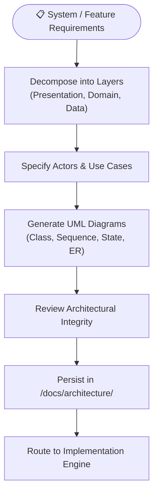

# Playbook 03: App System Design & Enterprise Modeling

## Purpose
Produce formal software architecture blueprints, UML diagrams, use case specifications, and C4 component diagrams before writing code. Enforces structural clarity and domain boundaries.

## Interconnected Skills
- **Primary Driver**: [`app-design`](../../diagnostic-skills/app-design/SKILL.md)
- **Domain Hand-offs**:
  - Decision Recording ➔ [`adr-analyze`](../../diagnostic-skills/adr-analyze/SKILL.md)
  - Android Construction ➔ Modular Android Suite ([`android-architecture`](../../android-skills/android-architecture/SKILL.md), [`compose-ui`](../../android-skills/compose-ui/SKILL.md))
  - Web Construction ➔ Modular React TS Suite ([`react-ts-architecture`](../../react-ts-skills/react-ts-architecture/SKILL.md), [`react-ui-components`](../../react-ts-skills/react-ui-components/SKILL.md))

---

## Step-by-Step Workflow

### Step 1: Layered Decomposition
- Define strict responsibilities:
  - **Presentation**: UI components, state holders (ViewModels / React hooks), user intent handling.
  - **Domain**: Pure business rules, UseCases / Interactors, domain entities. Zero UI or DB framework dependencies.
  - **Data**: Repositories, data sources (Room/SQL, Retrofit/Fetch), DTO mappers.

### Step 2: UML Modeling (Mermaid)
- **Class Diagram (`classDiagram`)**: Model interfaces, models, and dependency injection scopes.
- **Sequence Diagram (`sequenceDiagram`)**: Model asynchronous execution flows, caching layers, and network calls.
- **State Diagram (`stateDiagram-v2`)**: Model UI states (`Loading`, `Content`, `Error`, `Empty`) and valid transitions.
- **Entity Relationship (`erDiagram`)**: Model database schemas and relational entities.

### Step 3: Use Case Specifications
- For each primary use case, detail:
  - Actor
  - Pre-conditions
  - Main Flow (Happy Path)
  - Alternative & Error Flows
  - Post-conditions

### Step 4: Storage & English Language Standard
- Save all generated technical specifications in `/docs/architecture/<feature-slug>.md`.
- Ensure 100% of documentation, diagrams, and comments are written in clear, professional English.
