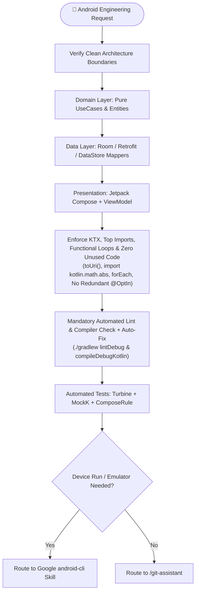

# Playbook 04: In-Depth Android Engineering

## Purpose
Execute mission-critical Android development enforcing modern Clean Architecture, idiomatic Kotlin 2.x, Jetpack Compose UI state stability, reactive data flows, Dagger Hilt DI, Gradle version catalog hygiene, and strict Android 14+ platform restrictions.

## Interconnected Skills
- **Primary Driver**: Modular Android Suite ([`android-architecture`](../../android-skills/android-architecture/SKILL.md), [`compose-ui`](../../android-skills/compose-ui/SKILL.md), [`compose-google-maps`](../../android-skills/compose-google-maps/SKILL.md), [`compose-maplibre`](../../android-skills/compose-maplibre/SKILL.md), [`koin-di`](../../android-skills/koin-di/SKILL.md), [`android-testing`](../../android-skills/android-testing/SKILL.md), [`gradle-build-hygiene`](../../android-skills/gradle-build-hygiene/SKILL.md), [`android-cli-router`](../../android-skills/android-cli-router/SKILL.md))
- **Connected Skills**:
  - Official Android CLI ➔ Hand-off to [`android-cli-router`](../../android-skills/android-cli-router/SKILL.md) (dispatches to official Google `android-cli`)
  - Error Debugging ➔ [`error-detective`](../../diagnostic-skills/error-detective/SKILL.md)
  - Architecture Recording ➔ [`adr-analyze`](../../diagnostic-skills/adr-analyze/SKILL.md)
  - Source Control ➔ [`git-assistant`](../../git-skills/git-assistant/SKILL.md)

---

## Step-by-Step Workflow



### Step 1: Clean Layer Boundaries
- **Domain**: Pure Kotlin. Zero `android.*` imports, zero serialization, zero database annotations.
- **Data**: Hide networking and database behind Repository interfaces. Use single-expression extension mappers (`fun UserDto.toDomain(): User = ...`).
- **Presentation**: Single `ViewModel` per screen emitting immutable state via `collectAsStateWithLifecycle()`.

### Step 2: Modern Compose, Strict Modifier Order & Tactile Feedback
- **Modifier Ordering Rule**:
  - **In `@Composable fun` Declarations**: Always place `modifier: Modifier = Modifier` at the **very first top parameter (`#1`)** of the function signature — **never** at the bottom!
  - **At Call Sites (Consuming a Composable)**: Always pass `modifier = Modifier...` at the **very bottom** of the call-site arguments.
- **Hilt ViewModel Compose Import**:
  - Always use `import androidx.hilt.lifecycle.viewmodel.compose.hiltViewModel` (never use the deprecated `import androidx.hilt.navigation.compose.hiltViewModel`).
- Use Material 3 with edge-to-edge window insets (`Modifier.windowInsetsPadding(...)`).
- Stable state parameters (`@Immutable`, `@Stable`, immutable collections).
- Tactile feedback: `LocalHapticFeedback.current` with purposeful `HapticFeedbackType`.

### Step 3: Zero Hardcoded Strings
- Extract all text into `res/values/strings.xml` with semantic prefixes (`label_`, `msg_`, `title_`, `action_`, `error_`, `hint_`, `desc_`).

### Step 4: KTX Extensions, Clean Imports, Functional Loops & Zero Unused Code
- **Use KTX Extensions (`UseKtx`)**: Always use `uriString.toUri()` (`import androidx.core.net.toUri`) instead of `Uri.parse(uriString)`, and `hex.toColorInt()` (`import androidx.core.graphics.toColorInt`) instead of `Color.parseColor(hex)`.
- **Top-Level Imports (No Inline FQNs)**: Never write `kotlin.math.abs(...)` or `kotlin.math.max(...)` inline; always add `import kotlin.math.abs` at the top of the file and call `abs(...)`.
- **Functional Iteration**: Prefer `.forEach { ... }`, `.forEachIndexed { ... }`, `.map { ... }`, `.filter { ... }` over imperative `for` loops.
- **Zero Unused Code & Redundant Annotations**:
  - Remove all unused imports (no wildcard `import foo.*`) and unused parameters (use `_` for unused lambda args).
  - Never add unnecessary `@OptIn(Experimental...)` annotations unless an experimental API is genuinely called in that scope.
- **Time Safety & One-Liners**:
  - Mandatory `kotlin.time.Duration` (e.g. `5.seconds`, `300.milliseconds`) over raw numbers.
  - Strongly prefer concise single-expression one-liners (`fun ... = ...`, `val isReady get() = ...`).

### Step 5: Mandatory Automated Lint Check & Auto-Fix Gate (Before Finishing!)
- Whenever `/engineer-mode` executes an Android task, you **MUST** run the project's lint and compiler tasks before reporting completion:
  ```bash
  ./gradlew lintDebug
  ```
  *(or `./gradlew :<module>:lintDebug` / `./gradlew compileDebugKotlin` for multi-module projects)*
- **Inspect & Fix Every Warning/Error**: Automatically fix any `UseKtx`, `UnusedImport`, `UnusedParameter`, `RedundantOptIn`, deprecated API usage, or modifier ordering violations reported by Lint or the Kotlin compiler, and re-run until clean.

### Step 6: Active ADB Device Logcat Analysis & Device Execution Routing
- **Automatic Live App Logcat Capture (When ADB Device is Active)**:
  - Check `adb devices -l`. Whenever an Android device or emulator is connected, automatically resolve the active app's package/PID (`adb shell pidof -s <applicationId>` or foreground activity via `adb shell dumpsys window | grep -E 'mCurrentFocus|mFocusedApp'`) and capture its live logs (`adb logcat -d --pid=<PID> -v threadtime` and `adb logcat -d -b crash`) to analyze runtime behavior, crashes, network payloads, and state transitions.
- **Official Google `android-cli` Routing**:
  - For deploying/running APKs (`android run`), inspecting UI hierarchies (`android layout`), or capturing screenshots (`android screen`), route to `/android-cli-router` and the official Google `android-cli` tool.
