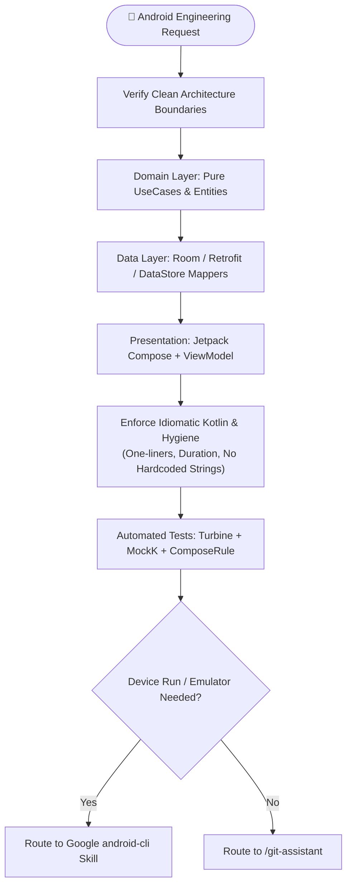

# Playbook 04: In-Depth Android Engineering

## Purpose
Execute mission-critical Android development enforcing modern Clean Architecture, idiomatic Kotlin 2.x, Jetpack Compose UI state stability, reactive data flows, Dagger Hilt DI, Gradle version catalog hygiene, and strict Android 14+ platform restrictions.

## Interconnected Skills
- **Primary Driver**: Modular Android Suite ([`android-architecture`](../../android-skills/android-architecture/SKILL.md), [`compose-ui`](../../android-skills/compose-ui/SKILL.md), [`compose-google-maps`](../../android-skills/compose-google-maps/SKILL.md), [`compose-maplibre`](../../android-skills/compose-maplibre/SKILL.md), [`koin-di`](../../android-skills/koin-di/SKILL.md), [`android-testing`](../../android-skills/android-testing/SKILL.md), [`gradle-build-hygiene`](../../android-skills/gradle-build-hygiene/SKILL.md), [`android-cli-router`](../../android-skills/android-cli-router/SKILL.md))
- **Connected Skills**:
  - Official Android CLI ➔ Hand-off to [`android-cli-router`](../../android-skills/android-cli-router/SKILL.md) (dispatches to official Google `android-cli`)
  - Error Debugging ➔ [`error-detective`](../../diagnostic-skills/error-detective/SKILL.md)
  - Architecture Recording ➔ [`adr-analyze`](../../diagnostic-skills/adr-analyze/SKILL.md)
  - Source Control ➔ [`git-assistant`](../../git-skills/git-assistant/SKILL.md)

---

## Step-by-Step Workflow

### Step 1: Clean Layer Boundaries
- **Domain**: Pure Kotlin. Zero `android.*` imports, zero serialization, zero database annotations.
- **Data**: Hide networking and database behind Repository interfaces. Use single-expression extension mappers (`fun UserDto.toDomain(): User = ...`).
- **Presentation**: Single `ViewModel` per screen emitting immutable state via `collectAsStateWithLifecycle()`.

### Step 2: Modern Compose, Strict Modifier Order & Tactile Feedback
- **Modifier Ordering Rule**:
  - **In `@Composable fun` Declarations**: Always place `modifier: Modifier = Modifier` at the **very first top parameter (`#1`)** of the function signature — **never** at the bottom!
  - **At Call Sites (Consuming a Composable)**: Always pass `modifier = Modifier...` at the **very bottom** of the call-site arguments.
- **Hilt ViewModel Compose Import**:
  - Always use `import androidx.hilt.lifecycle.viewmodel.compose.hiltViewModel` (never use the deprecated `import androidx.hilt.navigation.compose.hiltViewModel`).
- Use Material 3 with edge-to-edge window insets (`Modifier.windowInsetsPadding(...)`).
- Stable state parameters (`@Immutable`, `@Stable`, immutable collections).
- Tactile feedback: `LocalHapticFeedback.current` with purposeful `HapticFeedbackType`.

### Step 3: Zero Hardcoded Strings
- Extract all text into `res/values/strings.xml` with semantic prefixes (`label_`, `msg_`, `title_`, `action_`, `error_`, `hint_`, `desc_`).

### Step 4: Time Safety & One-Liner Preference
- Mandatory `kotlin.time.Duration` (e.g. `5.seconds`, `300.milliseconds`) over raw numbers.
- Strongly prefer concise single-expression one-liners (`fun ... = ...`, `val isReady get() = ...`).

### Step 5: Device Execution Routing
- For executing on devices, running emulators, or capturing screenshots, seamlessly route to the official Google `android-cli` tool.
