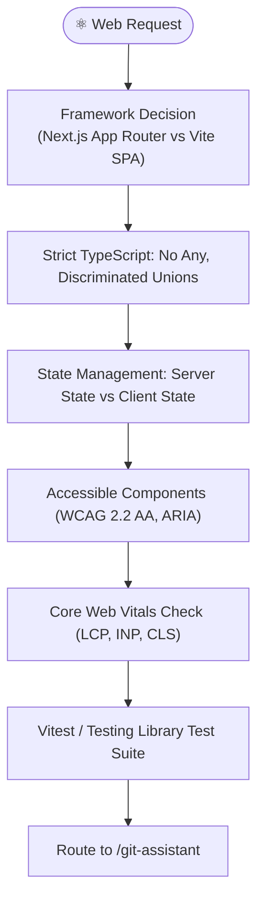

# Playbook 05: React + TypeScript Modern Web Engineering

## Purpose
Deliver enterprise-grade web applications using React 19, strict TypeScript 5+, modern frameworks (Next.js App Router / Vite), modern styling (Tailwind CSS / CSS modules), state management (TanStack Query / Zustand), WCAG 2.2 AA accessibility, and Core Web Vitals optimization.

## Interconnected Skills
- **Primary Driver**: Modular React TS Suite ([`react-ts-architecture`](../../react-ts-skills/react-ts-architecture/SKILL.md), [`react-ui-components`](../../react-ts-skills/react-ui-components/SKILL.md), [`react-state-management`](../../react-ts-skills/react-state-management/SKILL.md), [`react-testing`](../../react-ts-skills/react-testing/SKILL.md))
- **Connected Skills**:
  - System Modeling ➔ [`app-design`](../../diagnostic-skills/app-design/SKILL.md)
  - Error Debugging ➔ [`error-detective`](../../diagnostic-skills/error-detective/SKILL.md)
  - Architecture Recording ➔ [`adr-analyze`](../../diagnostic-skills/adr-analyze/SKILL.md)
  - Source Control ➔ [`git-assistant`](../../git-skills/git-assistant/SKILL.md)

---

## Step-by-Step Workflow



### Step 1: Type Safety First
- Zero `any` policy. Use `unknown` with type narrowing, branded types, and `satisfies`.
- Model state with Discriminated Unions:
  ```typescript
  type AsyncState<T> =
    | { status: 'idle' }
    | { status: 'loading' }
    | { status: 'success'; data: T }
    | { status: 'error'; error: Error };
  ```

### Step 2: Architecture & State Boundaries
- **Server State**: TanStack Query (`useQuery`, `useMutation`) with caching, retries, and invalidation.
- **Client State**: Lightweight Zustand stores or React Context for isolated UI state.
- **Data Layer Isolation**: Keep API calls in dedicated `/services/` or `/api/` modules with typed DTO-to-Domain mappers.

### Step 3: Accessibility & Responsive Design
- Semantic HTML (`<main>`, `<article>`, `<nav>`, `<button>`).
- Keyboard navigation and focus trap for modals/drawers.
- WCAG 2.2 AA contrast compliance.

### Step 4: Verification & Testing
- Unit and component tests with Vitest + React Testing Library.
- Type checking: `tsc --noEmit`.
- Linting and build verification: `npm run build`.
