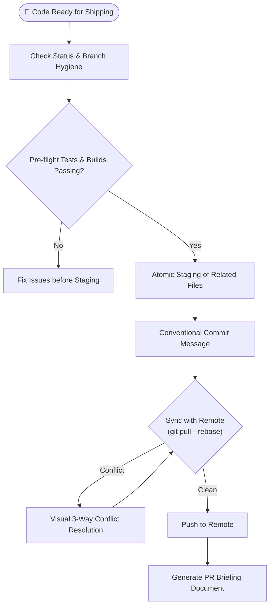

# Playbook 06: Git Shipping Workflow

## Purpose
Execute safe, deterministic version control workflows. Enforce conventional commits, clean atomic staging, branch safety, conflict resolution without data loss, and briefing-style Pull Request summaries.

## Interconnected Skills
- **Primary Driver**: [`git-assistant`](../../git-skills/git-assistant/SKILL.md)
- **Connected Skills**:
  - Verification Hand-off ➔ [`error-detective`](../../diagnostic-skills/error-detective/SKILL.md)
  - Architectural Changes ➔ [`adr-analyze`](../../diagnostic-skills/adr-analyze/SKILL.md)

---

## Step-by-Step Workflow



### Step 1: Pre-Flight Verification
- Verify uncommitted changes with `git status` and `git diff`.
- Ensure all test suites pass before staging.

### Step 2: Atomic Staging & Conventional Commits
- Stage files intentionally: `git add <specific files>` (avoid blind `git add .` containing debug logs or secrets).
- Format commit message:
  ```text
  <type>(<scope>): <concise description in imperative mood>

  [optional body explaining motivation and architectural impact]

  [optional footer: Closes #123]
  ```
- Types: `feat`, `fix`, `refactor`, `perf`, `test`, `docs`, `chore`.

### Step 3: Safe Rebasing & Conflict Resolution
- Always update local branches with `git pull --rebase origin <base-branch>`.
- If conflicts arise, inspect both sides, explain the divergence, and preserve valid changes with safety backup tags.

### Step 4: PR Briefing
- Produce an executive summary for PR reviewers:
  - **Summary**: Concise overview of changes.
  - **Motivation**: Why this was necessary.
  - **Impact**: Affected modules and performance implications.
  - **Test Evidence**: Commands executed and verification output.
