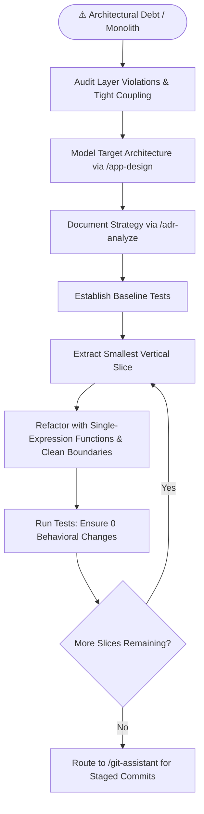

# Playbook 07: Architecture Refactoring & Debt Remediation

## Purpose
Safely refactor legacy, monolithic, or architectural-debt-laden codebases into decoupled, modular, testable systems without behavioral regressions.

## Interconnected Skills
- **Primary Driver**: [`engineer-mode`](../SKILL.md)
- **Connected Skills**:
  - Target Blueprint ➔ [`app-design`](../../diagnostic-skills/app-design/SKILL.md)
  - Decision Logging ➔ [`adr-analyze`](../../diagnostic-skills/adr-analyze/SKILL.md)
  - Android Refactor ➔ [`android-expert`](../../android-skills/android-expert/SKILL.md)
  - Web Refactor ➔ [`react-ts-expert`](../../react-ts-skills/react-ts-expert/SKILL.md)
  - Regression Testing ➔ [`error-detective`](../../diagnostic-skills/error-detective/SKILL.md)
  - Safe Commits ➔ [`git-assistant`](../../git-skills/git-assistant/SKILL.md)

---

## Step-by-Step Workflow

### Step 1: Detect Leaks and Coupling
- Identify domain layer contamination (e.g. Android framework `android.*` or Web DOM dependencies in pure business logic).
- Identify God-classes, duplicated business logic, and mixed concerns.

### Step 2: Formalize Target Blueprint & ADR
- Draft target UML models via `/app-design`.
- Create a formal Architecture Decision Record via `/adr-analyze` documenting the refactoring rationale and trade-offs.

### Step 3: Vertical Slice Refactoring
- Refactor one component at a time (e.g., Extract Domain Entity ➔ Create UseCase ➔ Rewire ViewModel/Hook).
- Never rewrite an entire application in one giant unverified change.

### Step 4: Verification & Regression Protection
- Run baseline unit tests before and after each slice.
- Commit each slice atomically via `/git-assistant`.
