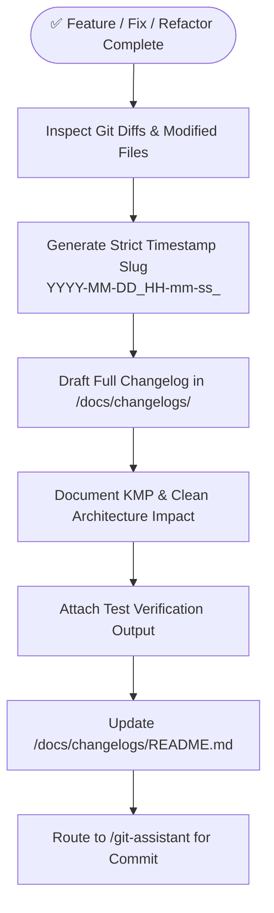

# Playbook 08: Changelog Documentation & Release Tracking

## Purpose
Systematically capture, structure, and record every non-trivial codebase alteration into a chronological, timestamped record under `/docs/changelogs/` with verification proof and architectural impact summaries.

## Interconnected Skills
- **Primary Driver**: [`changelog-recorder`](../../diagnostic-skills/changelog-recorder/SKILL.md)
- **Domain Hand-offs**:
  - Decision References ➔ [`adr-analyze`](../../diagnostic-skills/adr-analyze/SKILL.md)
  - Bug Fix Context ➔ [`error-detective`](../../diagnostic-skills/error-detective/SKILL.md)
  - Staging & Commits ➔ [`git-assistant`](../../git-skills/git-assistant/SKILL.md)

---

## Step-by-Step Workflow

### Step 1: Timestamp & File Path Formatting
- Compute the current ISO date and local time:
  - Format: `<project-root>/docs/changelogs/YYYY-MM-DD_HH-mm-ss_<main-change-title>.md`
  - Example: `/docs/changelogs/2026-10-22_20-15-30_migrate-cart-to-clean-architecture.md`

### Step 2: Content Breakdown
- Executive summary of the change.
- Categorized file modifications (Added, Modified, Removed).
- Architecture & KMP impact (Pure domain compliance, Compose stability, zero hardcoded strings).
- Testing verification evidence (Terminal test pass counts and compilation output).

### Step 3: Indexing & Safe Committing
- Append the entry into `/docs/changelogs/README.md`.
- Route to `/git-assistant` to stage both the code changes and the new changelog together in a single atomic conventional commit.
