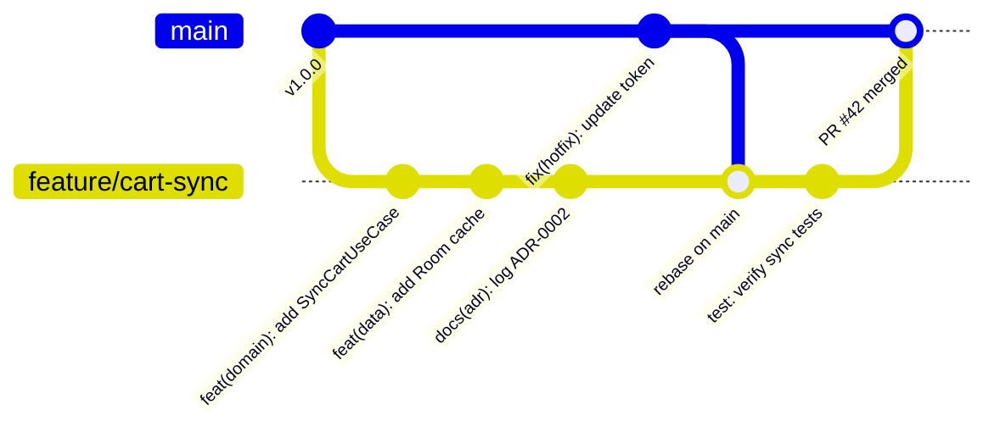

# 🌿 Git Assistant & Safe Shipping Skills

Welcome to the **Git Assistant Skills** documentation. This module contains the **Git Assistant** (`/git-assistant`) skill, providing safe version control operations, atomic staging, conventional commit formatting, conflict resolution without data loss, and briefing-style PR summaries.

---

## 🧭 Navigation & Connected Skills Hub

| Hub Directory | Domain | Direct Link |
|---|---|---|
| 🏠 **Root Hub** | Full Suite Overview & Installer | [Root README](../README.md) |
| 🚀 **Engineer Mode** | Master Entry Point & Playbook Router | [Engineer Mode README](../engineer-mode/README.md) |
| 📱 **Android Skills** | Kotlin, Compose, Clean Architecture, Google android-cli | [Android README](../android-skills/README.md) |
| ⚛️ **React TS Skills** | Next.js, Vite, TypeScript, Tailwind, Web Vitals | [React TS README](../react-ts-skills/README.md) |
| 🔍 **Diagnostic Skills** | Error Detective, ADR Detection, App Design | [Diagnostic README](../diagnostic-skills/README.md) |

---

## 🗂️ Skills in this Directory

| Skill Directory | Slash Command | Primary Purpose | Deliverables |
|---|---|---|---|
| [**`git-assistant/`**](./git-assistant/README.md) | `/git-assistant` | Safety-first version control: atomic commits, safe rebase, 3-way conflict resolution, PR briefings. | Git commits, PR briefings, conflict resolution |

---

## 🌳 Branching & Shipping Workflow



---

## 📋 Conventional Commit Types

| Type | Purpose | Example |
|---|---|---|
| **`feat`** | Introducing a new feature | `feat(auth): add biometric authentication support` |
| **`fix`** | Resolving a defect or bug | `fix(checkout): prevent duplicate payment submission` |
| **`refactor`** | Code restructuring without behavior changes | `refactor(domain): decompose GodViewModel into interactors` |
| **`perf`** | Performance improvements | `perf(compose): optimize lazy list recompositions` |
| **`docs`** | Documentation or ADR changes | `docs(adr): add ADR-0003 for state management` |
| **`test`** | Adding or fixing test suites | `test(cart): add edge cases for expired coupons` |
| **`chore`** | Tooling or build configuration | `chore(gradle): bump Kotlin to 2.0.21` |

---

## ⚡ How to Trigger

You can trigger Git Assistant directly or through `/engineer-mode`:

```text
/git-assistant stage our recent changes and draft a conventional commit
```
```text
/git-assistant safely pull and rebase from origin main, resolving any conflicts
```
```text
/git-assistant generate a briefing-style PR description for our branch
```

### Connected Skill Hand-offs:
- Encountering git merge or build errors? ➔ Routes to [Error Detective](../diagnostic-skills/README.md)
- Committing a major architecture change? ➔ Verify documented in [ADR Analyze](../diagnostic-skills/README.md)
- Finished shipping? ➔ Return to [Engineer Mode](../engineer-mode/README.md)
