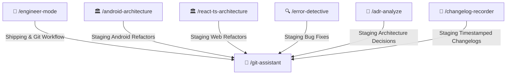

# 🌿 Git Assistant Skill

Safety-first version control and shipping specialist. Coordinates atomic commit staging, conventional commit formatting, branch management, safe rebasing, 3-way conflict resolution without data loss, and briefing-style PR descriptions in clear, professional English.

> [!IMPORTANT]
> **Zero Auto-Push Policy**: The agent must **NEVER** automatically push or merge code to remote repositories. Before executing `git push` or `git merge`, the agent must always pause, display the commit/branch details, and ask the user for explicit confirmation.

---

## 🧭 Connected Skills Architecture



---

## 📂 Subfolder Structure

| Path | Purpose | Description |
| :--- | :--- | :--- |
| [`SKILL.md`](./SKILL.md) | Agent Skill Definition | Core instructions and triggers for version control workflows. |
| [`instructions/guidelines.md`](./instructions/guidelines.md) | Agent Execution Protocol | Safety rules, conventional commit formatting, and conflict resolution protocols. |
| [`instructions/examples.md`](./instructions/examples.md) | Production Documentation Example | Conventional commit messages, safety tags, and PR briefing templates. |

---

## 🚀 How to Use

### 1. Direct Skill Activation
Trigger this skill whenever staging commits, resolving merge conflicts, rebasing, or opening PRs:
```text
/git-assistant
```

### 2. Guided via Engineer Mode
Start through the adaptive interactive questionnaire:
```text
/engineer-mode
```
Select **Playbook 05 (Git & Release Operations)**.

---

## 🔗 Related Skills

- [📝 Changelog Recorder](../../diagnostic-skills/changelog-recorder/README.md)
- [📜 ADR Analyzer](../../diagnostic-skills/adr-analyze/README.md)
- [🔍 Error Detective](../../diagnostic-skills/error-detective/README.md)
- [📱 Android Architecture](../../android-skills/android-architecture/README.md)
- [🏠 Master Suite README](../../README.md)
